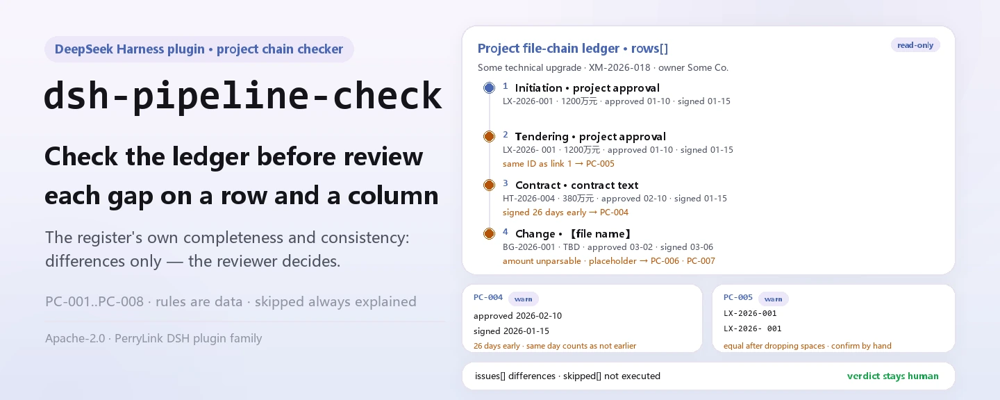
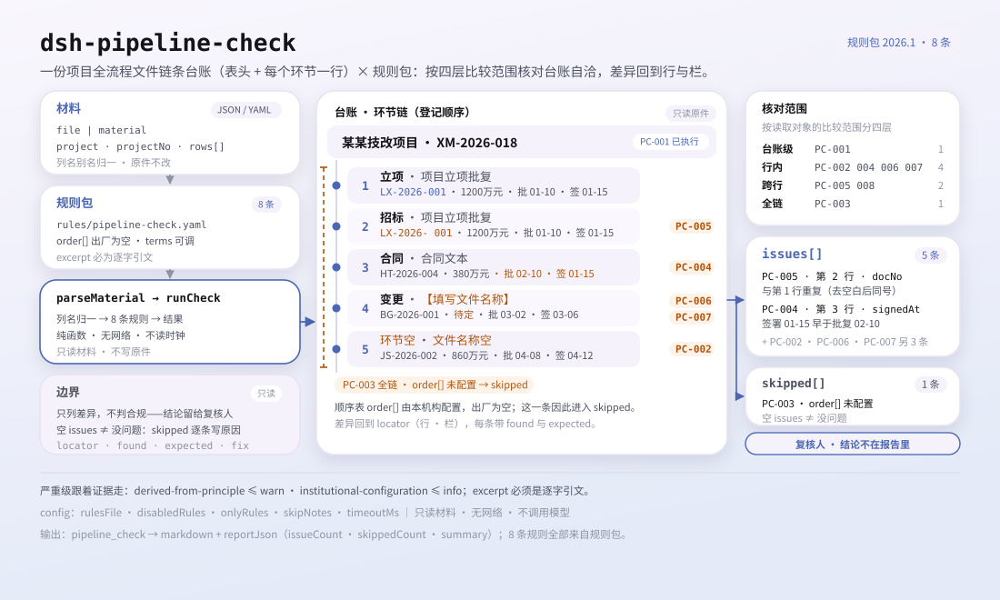

<div align="center">

<picture>
  <source media="(prefers-color-scheme: dark)" srcset="docs/assets/dsh-pipeline-check-hero-en-dark.webp">
  
</picture>

# dsh-pipeline-check

**Know exactly what the register is missing — before the review starts, row by row and column by column.**

A project whole-process document chain register checker for DeepSeek Harness: it reads the project header plus one row per stage document, applies eight register-level rules, and returns differences only — never a compliance verdict.

[Install](#three-step-setup) · [Configuration](#configuration) · [FAQ](#faq) · [简体中文](README.md) · [English](README.en.md)

[](LICENSE)
[](#compatibility)
[](https://www.npmjs.com/package/dsh-pipeline-check)
[](https://github.com/PerryLink/dsh-pipeline-check/actions/workflows/ci.yml)
[](#compatibility)

[](https://github.com/PerryLink/dsh-pipeline-check/stargazers)
[](https://www.npmjs.com/package/dsh-pipeline-check)
[](https://dshfind.com/plugins/PerryLink/dsh-pipeline-check?ref=badge)
[](https://securityscorecards.dev/viewer/?uri=github.com/PerryLink/dsh-pipeline-check)
[](https://dsh.market/)
[](https://gitee.com/perrylink/dsh-pipeline-check)

```sh
dsh plugin --profile <name> add dsh-pipeline-check
```

</div>

<sub>Community plugin, not affiliated with DeepSeek. Canonical repository: <https://github.com/PerryLink/dsh-pipeline-check> (Gitee is a mirror).</sub>

## What it is

`dsh-pipeline-check` reads one project whole-process document chain register — the project header plus one row per stage document — and checks that register's own completeness and internal consistency: that the project is identified, that each row names its stage or document, that the stages follow the sequence you declare, that approval and signing dates parse and follow each other, that document numbers are unique, that amounts parse as numbers, and that no template placeholder survives in a document name.

Material is JSON or YAML. The tool reads the `file` or `material` you pass and never modifies the original; Excel should be converted to JSON/YAML first, which can happen in chat too.

<picture>
  <source media="(prefers-color-scheme: dark)" srcset="docs/assets/dsh-pipeline-check-flow-v5-dark.svg">
  
</picture>

## Three-step setup

1. **Install** (pick one channel):

   ```sh
   # git channel (latest main)
   dsh plugin --profile <name> add github:PerryLink/dsh-pipeline-check
   # npm channel (published releases)
   dsh plugin --profile <name> add dsh-pipeline-check
   # tarball channel: pnpm pack in this repo, then
   dsh plugin --profile <name> add ./dsh-pipeline-check-<version>.tgz
   ```

   From a source checkout run `pnpm install` first (`prepare` runs the `tsdown` build that produces `lib/`).

2. **Minimal config** (the defaults work; this example runs three rules and adds a note to every `skipped` reason):

   ```yaml
   - insert:
       - id: dsh-pipeline-check
         name: dsh-pipeline-check
         config:
           onlyRules: [PC-001, PC-002, PC-004]
           skipNotes: institutional ruleset 2026
   ```

3. **Verify it is live**:

   ```sh
   dsh --profile <name> --dump-config | grep 'dsh-pipeline-check'
   ```

   Then have the model call the `pipeline_check` tool once with a minimal input:

   ```json
   {"project":"Example upgrading project","projectNo":"XM-2026-018","rows":[{"stageNo":"1","stage":"initiation","document":"project initiation approval","docNo":"LX-2026-001"}]}
   ```

   The report carries `issueCount`, `summary` and `skippedCount`; individual findings are rendered in `markdown` and `reportJson`. A source checkout can run the bundled sample directly (build first): `node samples/quickstart/run.mjs --check`; the input and expected output live in `samples/quickstart/`.

**Uninstall**: `dsh plugin --profile <name> remove dsh-pipeline-check`.

<details>
<summary>Material format (JSON / YAML)</summary>

The tool accepts JSON or YAML:

```yaml
project: 某某技改项目
projectNo: XM-2026-018
rows:
  - { 序号: '1', 环节: 立项, 文件名称: 项目立项批复, 文件编号: LX-2026-001,
      金额: 1200万元, 批复日期: 2026-01-10, 签署日期: 2026-01-15, 生效日期: 2026-01-16 }
```

Column names are matched case-insensitively and ignoring spaces, underscores and hyphens; the register's own column names are kept, so a finding names the column it read. Amounts may carry thousands separators or a unit — both forms in the sample above are accepted. Header and row fields accept English and Chinese aliases (for example `project`, `stage` and `docNo`); fields are optional at the reader layer, so a partial export produces missing-field findings instead of a crash.

</details>

## Core capabilities

`dsh-pipeline-check` turns one register into a list of differences a human can check line by line:

- **Register-level checking** — it reads only the register you pass; every finding carries a `locator` (row/field), `found`, `expected` and `fix`, pointing at one row and one column.
- **Eight rules, and the rule pack is data** — every check is declared in `rules/pipeline-check.yaml`; replacing that YAML swaps the ruleset version without touching TypeScript.
- **No silent pass** — an unconfigured, disabled or unrunnable check goes into `skipped` with its reason; an empty issue list must never be read as "nothing is wrong".
- **Differences only** — no compliance verdict, no liability finding, no replacement for the reviewer; the conclusion stays with the people who own it.
- **Local, side-effect free** — no network, no model call, no writes to the material file; parsing and checking are local pure functions.

| Rule | What it checks | Severity | Basis |
|---|---|---|---|
| `PC-001` | the register names its project and project number | warn | traceability |
| `PC-002` | each row names its stage or document | warn | completeness |
| `PC-003` | stages follow your configured sequence (off by default) | info | local order table |
| `PC-004` | signing is not earlier than approval | warn | date consistency |
| `PC-005` | document numbers are unique within a stage | warn | register uniqueness |
| `PC-006` | amounts parse as numbers | warn | comparability |
| `PC-007` | document names hold no unreplaced placeholder | warn | register integrity |
| `PC-008` | stage numbers are unique | warn | register uniqueness |

### A real run

**Tool** `pipeline_check`

**Input**

~~~json
{"project":"某某技改项目","projectNo":"XM-2026-018","rows":[{"序号":"1","环节":"","文件名称":"","文件编号":"LX-2026-001"}]}
~~~

**Output**

~~~json
{
  "id": "dsh-pipeline-check.PC-002.de09b5a6",
  "ruleId": "PC-002",
  "severity": "warn",
  "locator": {
    "row": 1,
    "field": "stage"
  },
  "found": "第 1 行 stage、document 都为空",
  "expected": "stage、document 至少应填写一项",
  "fix": "补填环节名称与文件名称；本条只核对是否填写，不判断该环节是否应当办理"
}
~~~

*Observed from `dsh-pipeline-check/tests/fixtures/PC-002/PC-002-unsafe.json (cases.json expects 1×PC-002); executed parseMaterial+runCheck, checkedAt=2026-10-06T00:00:00.000Z`*

### Six questions it answers

| You ask | What it answers |
|---|---|
| The stage-order rule reports `skipped` on a fresh install. Is something broken? | No. `PC-003` compares the register's stages against the `order` list in the rule pack, and that list ships empty, meaning unconfigured, so the rule reports itself in `skipped` instead of passing silently. Fill `order` with your institution's own sequence (the pack's example is the ten-stage sequence in the YAML block under "Standards it follows") and it then checks only that the stages appearing in the register follow that order, a gap being allowed; it never judges whether skipping a stage was permissible, and its basis records that no citable clause exists, so it is capped at `info`. |
| The signing date in the register is earlier than the approval date — is that caught? | Yes. `PC-004` compares `signedAt` with `approvedAt`: both must parse as dates and the signing date must not fall before the approval date, the same day counting as not later. A date it cannot parse is reported on its own rather than passed over in silence. It compares those two dates only — it does not judge whether the signing exceeded authority or whether the approval itself was valid. |
| An amount is written with a thousands separator or a unit. Will it still be read? | Yes. `PC-006` accepts amounts carrying thousands separators or a unit (the accepted forms are listed below the table) and reports only an amount it cannot parse as a number. It checks parseability alone: whether the amount breaches the estimate, or whether it needed approval, is not something this rule decides. |
| A row carries neither a stage name nor a document name. | `PC-002` requires at least one of `stage` or `document` on every row and reports the row that has neither. It checks that at least one of them is filled; whether that stage should have been handled at all, and whether the documents for it are complete, are not judged. |
| The same document number appears on two rows. | `PC-005` reports a repeated `docNo`, ignoring whitespace when it compares, because a repeat defeats de-duplication and double-counts the amounts. It cannot tell a duplicate registration from two documents wrongly given one number, so a hit needs human confirmation. |
| The document name still reads as a template placeholder. | `PC-007` reports any row whose `document` contains one of the pack's template terms: template brackets, common "to be filled" markers, `{{`, `}}`, XXX, xxx, TBD, todo, and the word for "example". A register copied from a template makes an unhandled stage look settled. Only the listed terms are searched, and `terms` can be adjusted to your own template; the exact list is in the code block below. |

```text
【 】 {{ }} XXX xxx 待填 待补充 TBD todo 示例
```

```text
1,200.50
1200万元
```

## Standards it follows

| Document | Number | Cited by rules |
|---|---|---|
| the institution's project management and investment rules (no national standard) | no unified standard (basis: register traceability) | PC-001 |
| the institution's project management and investment rules (no national standard) | no unified standard (basis: chain completeness) | PC-002 |
| the institution's project management and investment rules (no national standard) | no unified standard (basis: the institution's own stage-order table) | PC-003 |
| the institution's project management and investment rules (no national standard) | no unified standard (basis: date self-consistency) | PC-004 |
| the institution's project management and investment rules (no national standard) | no unified standard (basis: register uniqueness) | PC-005, PC-008 |
| the institution's project management and investment rules (no national standard) | no unified standard (basis: amount comparability) | PC-006 |
| the institution's project management and investment rules (no national standard) | no unified standard (basis: register integrity) | PC-007 |

**Boundary:** this plugin checks a **project whole-process document chain register** for what a register can be held to — that the project is identified, that each row names its stage or document, that the stages follow the sequence you declare, that approval and signing dates parse and follow each other, that document numbers are unique, that amounts parse, and that no template placeholder survives. It does **not** decide whether a project is compliant, whether an approval exceeded authority, whether spending breached the estimate, or who is accountable. **Those depend on the institution's investment rules and approval limits.**

> ### ⚠️ There is no national standard for this, and the pack does not pretend otherwise
>
> **Which stages a project passes through, and in what order, is set by each institution's project and investment rules** — and it differs sharply between industries (power, municipal, building, water) and between government-funded and enterprise-funded projects. **No unified national standard exists**, so this pack does not fabricate a standard number: every rule's `excerpt` states plainly that its basis is chain self-consistency or traceability and that **no citable clause exists**. A test asserts that every excerpt carries such an admission.
>
> **The plugin ships no stage list.** `PC-003`'s `order` ships **empty**, and with nothing configured it reports itself in `skipped` rather than inventing a stage sequence. Configure it like this:
>

```yaml
order: [立项, 可行性研究, 初步设计, 概算, 招标, 合同, 开工, 变更, 结算, 决算]
```

> The check then verifies that the stages appearing in the register are **in** that order, skipping stages the project legitimately did not pass through; it never judges whether a skip was permissible.

**Rule data is separate from code.** The rule data lives in `rules/pipeline-check.yaml`; because no unified national standard governs a project's stage chain, the pack's `basis` entries say so explicitly instead of citing one. The load-time guard still requires every rule to carry a document, a number, a clause, an excerpt and a source (an excerpt shorter than eight characters fails the load), and still forbids a `derived-from-principle` or locally configured check from being `error`. The per-rule verification record is in `rules/evidence/`.

## Configuration

Every tunable is a Schemastery field in `src/config.ts`, changeable from `cordis.yml` without touching code; per-rule thresholds live in the rule pack under `rules/`.

| Key | Type | Default | Description |
|---|---|---|---|
| `rulesFile` | string | `rules/pipeline-check.yaml` | Rule-pack path, relative to the package root |
| `disabledRules` | string[] | `[]` | Rule ids to stop running; each appears in `skipped` |
| `onlyRules` | string[] | `[]` | Run only these rule ids; empty runs every rule |
| `skipNotes` | string | `""` | Note appended to every `skipped` reason |
| `timeoutMs` | number | `120000` | Cooperative tool timeout budget in milliseconds |

Rule-level parameters:

- `PC-003` `order` — your stage sequence. Empty means the rule does not run. A stage written with a trailing note matches its base name (the form below is an example).
- `PC-004` `field` / `notBeforeField` — the date pair to compare, defaults to signing against approval. Add a second rule to check the effective date.
- `PC-007` `terms` — the placeholder terms to look for.

```text
招标（二次）
```

Example profile-patch override:

```yaml
- insert:
    - id: dsh-pipeline-check
      name: dsh-pipeline-check
      config:
        rulesFile: rules/pipeline-check.yaml
        onlyRules: [PC-002, PC-004, PC-006]
        timeoutMs: 60000
```

## FAQ

<details>
<summary>Is the material uploaded, or does the plugin go online?</summary>

No. `dsh-pipeline-check` is a local checker: it reads only the material passed to its tool (`file` or `material`) and does not upload it; it makes no network requests and ships no telemetry, analytics or background reporting; it writes no data outside the tool result and the DSH host's own session/log storage. The host controls that storage and its retention; this package adds no second copy.

</details>

<details>
<summary>An empty issue list — does that mean nothing is wrong?</summary>

No. A check that could not run goes into `skipped` with its reason — for example, `PC-003`'s `order` ships empty, so it reports itself in `skipped` rather than passing silently. An empty issue list only means the rules that did run found no differences; read `skippedCount` and `skipped` before reading `issueCount`.

</details>

<details>
<summary>Does it fight other plugins over tool names, services or slots?</summary>

No. It registers one tool, `pipeline_check`, provides no service key, registers no client slot and no `webServer` prefix, listens to no shared event and mutates no global. Tool registration is a Cordis effect, removed on stop or hot reload.

</details>

<details>
<summary>How much does it cost, and can it time out?</summary>

Parsing and checking are local: no network request, no model call. The tool carries a cooperative `timeoutMs` budget (default 120000 ms), and `PC-003` is a single linear scan. Cost grows with the number of register rows, not with the model.

</details>

<details>
<summary>Can it replace the reviewer?</summary>

No. It only lists differences the register itself can be held to; it does not decide compliance, liability, whether an approval exceeded authority, or whether spending breached the estimate. Those depend on the institution's investment rules, approval limits and industry rules, and belong to investment-management and audit reviewers.

</details>

## Security boundaries

- **Read-only material, untouched original.** The tool reads the `file` or `material` you pass; the register file is never written back, moved or deleted.
- **No network, no model call, no telemetry.** No network requests, no analytics or background reporting; no data is written outside the tool result and the host's own session/log storage.
- **No adjudicating wording.** The report lists differences only; it does not pronounce on compliance, authority, budget breach or accountability, and a wording guard keeps the disclaimer on every report.
- **No fabricated basis.** The rule pack is validated on load: every rule must carry a document, a number, a clause, an excerpt and a source, and the excerpt must be a verbatim quotation. When no citable clause exists the pack says so instead of inventing a standard number; `derived-from-principle` is capped at `warn` and `institutional-configuration` at `info`.
- **No silent pass.** An unconfigured, disabled or unrunnable check goes into `skipped` with its reason; an empty issue list can never be read as "nothing is wrong".
- **The rule pack is data.** Replacing `rules/*.yaml` swaps the ruleset version without a code change; the pack is validated on load rather than trusted.

## Known limitations

- **Register consistency is not fact-checking.** The plugin reads the register only; it does not open the documents the register points at, verify that those files exist, check seals or signatures, or compare document contents with the register.
- **There is no unified national standard.** Which stages a project passes through, and in what order, is set by each institution's rules and industry practice; the plugin ships no stage list and does not prescribe a process.
- **`PC-003` ships unconfigured.** With an empty `order` the rule reports itself in `skipped`; once configured it checks only that the stages appearing in the register are in order, never whether a skip was permissible.
- **Dates are wall-clock arithmetic on the input strings.** No timezone conversion; an unparseable date is reported on its own rather than skipped, and no validity of the approval or signature is inferred.
- **Amounts are checked for parseability only.** The two accepted forms under the Q&A table are read; a range or a cell with a note is reported as unparseable on purpose, and no budget-breach or approval judgement is made.
- **Duplicate numbers need a human.** The same number on two rows can be a duplicate registration or an amendment reusing the original number; `PC-005` reports the repeat and does not decide which it is.
- **Material format is limited.** JSON or YAML only; Excel must be converted first. Reader-layer fields are optional, so a partial export produces missing-field findings instead of a crash.
- **Eight rules only.** The ruleset is replaceable, but the default covers register-level completeness, order, dates, numbers, amounts and template placeholders — not the authenticity of the underlying documents, approval authority or compliance.

### Common checks

- **The plugin installs but the tool never appears.** Check that `main` resolves to `lib/index.mjs` and that `pnpm run build` produced it; a wrong `main` makes the loader skip the entry silently.
- **`dsh plugin add` refuses the package as incompatible.** The peer range covers `0.1.x` and `0.2.x`; if your runtime sits outside it, grant an explicit exemption: `dsh plugin --profile <name> allow-version dsh-pipeline-check@0.1.0 --dsh-version <runtime> --accept-risk`.
- **`check` reports `manifest-peers` as failed.** The static checker compares against a hard-coded peer range that predates the 0.2 line; the runtime enforces peer compatibility at install time. This is a known upstream issue in `dsh-plugin-dev`.
- **A rule did not run.** Read the `skipped` array: it names the rule id and the reason.
- **`PC-003` fires on a stage name.** The name is not in your order table; correct the register or add the stage — the finding says which name it could not place.

## Compatibility

| Surface | Status |
|---|---|
| Harness | Peer range `>=0.1.2-rc.1 <0.2.0 \|\| >=0.2.0-0 <0.3.0` — verified to accept both `0.2.0-rc.2` and `0.2.1-rc.2`. `engines.dsh` is declared as `>=0.2.1-0 <0.3.0` and is enforced by the host since 0.2.1 |
| Node | `^22.19.0 \|\| >=24.0.0` |
| Platforms | All (plain ESM; no native code, no network, no model call) |
| Tool mode | Works in `native` and `ptc`; for a portfolio of projects use `ptc` |

## Ecosystem & quality

- [Gitee mirror](https://gitee.com/perrylink/dsh-pipeline-check) (sync mirror; GitHub is canonical)
- [dshfind plugin page](https://dshfind.com/plugins/PerryLink/dsh-pipeline-check) (installs and ranking)
- [OpenSSF Scorecard report](https://securityscorecards.dev/viewer/?uri=github.com/PerryLink/dsh-pipeline-check) (driven by [.github/workflows/scorecard.yml](.github/workflows/scorecard.yml))
- [DSH Market](https://dsh.market/) (listed)
- [Ecosystem knowledge base](https://perrylink.github.io/zh/checkers/choose/) — measured data, not marketing: pick a checker by material · plugin-selection data · maintenance criteria

## Development

```sh
pnpm install                                   # node ^22.19 || >=24
pnpm run typecheck                             # tsc --noEmit
pnpm test                                      # vitest: shared table-plugin suite + paired fixtures
pnpm run build                                 # tsdown -> lib/index.mjs + lib/index.d.mts
pnpm run verify:self-contained                 # dependency specs resolve from the registry
pnpm run check:lockfile                        # lockfile drift check
pnpm run check:readmes                         # README consistency gate
pnpm run check:citations                       # citations against the verification record
node ../scripts/sync-shared.mjs dsh-pipeline-check   # refresh src/shared from ../_shared
node samples/quickstart/run.mjs --check        # bundled sample (build first)
```

`sync-shared` copies the shared kit from `../_shared` into `src/shared/`; re-run it after every shared change.

Layout:

| Path | Purpose |
|---|---|
| `src/index.ts` | function-plugin contract: registers the `pipeline_check` tool, resolves the rule-pack path |
| `src/config.ts` | Schemastery schema; every tunable lives here |
| `src/model.ts` | table shape and material contract: column aliases, required fields, parse entry point |
| `src/view.ts` | model-facing projection of a report; `output.schema` mirrors it |
| `src/shared/` | shared kit (ruleset loader, report shape, YAML subset, calendar arithmetic, wording guard, table helpers), bundled for self-containment |
| `rules/pipeline-check.yaml` | the rule pack, eight rules |
| `rules/evidence/` | the verification record for every citation |
| `tests/` | vitest; every rule has a paired compliant/violating fixture |

The bundled sample's result can be compared with `samples/quickstart/expected/result.json`; a screenshot is at [`docs/assets/quickstart.png`](docs/assets/quickstart.png). The README images are generated programmatically by [`scripts/gen-readme-assets.py`](scripts/gen-readme-assets.py) — the hero banner with Pillow, the structure diagram as hand-written SVG — and are safe to re-run; the READMEs reference the hero (zh/en, light and dark) and the flow-v5 structure diagram (light and dark, shared by all five languages), while the old single-skin flow and the demo images stay in `docs/assets/` for external links.

## Family & thanks

This project is part of the DeepSeek Harness plugin family from [PerryLink](https://github.com/PerryLink) (all Apache-2.0). If it is useful, **a star helps the next person find it** — nothing is gated behind it.

- [@PerryLink](https://github.com/PerryLink) — creator and maintainer: the eight `PC-*` rules and the rule pack, the `pipeline_check` tool, and the five-language docs and image pipeline.

<details>
<summary>Expand all plugins</summary>

| Plugin | Status |
|---|---|
| **[dsh-aqua-input-check](https://github.com/PerryLink/dsh-aqua-input-check)** |  |
| **[dsh-archive-check](https://github.com/PerryLink/dsh-archive-check)** |  |
| **[dsh-auto-review](https://github.com/PerryLink/dsh-auto-review)** |  |
| **[dsh-autotier](https://github.com/PerryLink/dsh-autotier)** | 🧊 FROZEN — see the repo README |
| **[dsh-bid-ca-precheck](https://github.com/PerryLink/dsh-bid-ca-precheck)** |  |
| **[dsh-bid-qual-check](https://github.com/PerryLink/dsh-bid-qual-check)** |  |
| **[dsh-cert-mcp](https://github.com/PerryLink/dsh-cert-mcp)** | 🧊 FROZEN — see the repo README |
| **[dsh-checkpoint-rewind](https://github.com/PerryLink/dsh-checkpoint-rewind)** |  |
| **[dsh-click](https://github.com/PerryLink/dsh-click)** |  |
| **[dsh-composer-history](https://github.com/PerryLink/dsh-composer-history)** |  |
| **[dsh-contract-stance](https://github.com/PerryLink/dsh-contract-stance)** |  |
| **[dsh-customs-doc-check](https://github.com/PerryLink/dsh-customs-doc-check)** |  |
| **[dsh-data-quality](https://github.com/PerryLink/dsh-data-quality)** | 🧊 FROZEN — see the repo README |
| **[dsh-demurrage-ledger](https://github.com/PerryLink/dsh-demurrage-ledger)** |  |
| **[dsh-doublecheck](https://github.com/PerryLink/dsh-doublecheck)** |  |
| **[dsh-drill-script-check](https://github.com/PerryLink/dsh-drill-script-check)** |  |
| **[dsh-eia-guide-check](https://github.com/PerryLink/dsh-eia-guide-check)** |  |
| **[dsh-emergency-plan](https://github.com/PerryLink/dsh-emergency-plan)** |  |
| **[dsh-essay-rubric-check](https://github.com/PerryLink/dsh-essay-rubric-check)** |  |
| **[dsh-evidence-check](https://github.com/PerryLink/dsh-evidence-check)** |  |
| **[dsh-export-ctl-check](https://github.com/PerryLink/dsh-export-ctl-check)** |  |
| **[dsh-fast](https://github.com/PerryLink/dsh-fast)** |  |
| **[dsh-fmea-table-check](https://github.com/PerryLink/dsh-fmea-table-check)** |  |
| **[dsh-forecast-penalty](https://github.com/PerryLink/dsh-forecast-penalty)** |  |
| **[dsh-fund-research](https://github.com/PerryLink/dsh-fund-research)** |  |
| **[dsh-github](https://github.com/PerryLink/dsh-github)** |  |
| **[dsh-gongwen-flow-check](https://github.com/PerryLink/dsh-gongwen-flow-check)** |  |
| **[dsh-gongwen-word-check](https://github.com/PerryLink/dsh-gongwen-word-check)** |  |
| **[dsh-guard-plan-qc](https://github.com/PerryLink/dsh-guard-plan-qc)** |  |
| **[dsh-hazchem-check](https://github.com/PerryLink/dsh-hazchem-check)** |  |
| **[dsh-hazplan-check](https://github.com/PerryLink/dsh-hazplan-check)** |  |
| **[dsh-hidden-risk-map](https://github.com/PerryLink/dsh-hidden-risk-map)** |  |
| **[dsh-hs-classify](https://github.com/PerryLink/dsh-hs-classify)** |  |
| **[dsh-icd-rule-check](https://github.com/PerryLink/dsh-icd-rule-check)** |  |
| **[dsh-industry-research](https://github.com/PerryLink/dsh-industry-research)** |  |
| **[dsh-lawcite-adapter](https://github.com/PerryLink/dsh-lawcite-adapter)** |  |
| **[dsh-laya](https://github.com/PerryLink/dsh-laya)** |  |
| **[dsh-lc-doc-check](https://github.com/PerryLink/dsh-lc-doc-check)** |  |
| **[dsh-learning-gap-check](https://github.com/PerryLink/dsh-learning-gap-check)** |  |
| **[dsh-library](https://github.com/PerryLink/dsh-library)** |  |
| **[dsh-local-ai](https://github.com/PerryLink/dsh-local-ai)** |  |
| **[dsh-lsp-actions](https://github.com/PerryLink/dsh-lsp-actions)** |  |
| **[dsh-mask](https://github.com/PerryLink/dsh-mask)** |  |
| **[dsh-mcp-panel](https://github.com/PerryLink/dsh-mcp-panel)** |  |
| **[dsh-medrec-qc](https://github.com/PerryLink/dsh-medrec-qc)** |  |
| **[dsh-memento](https://github.com/PerryLink/dsh-memento)** | 🧊 FROZEN — see the repo README |
| **[dsh-nsfc-form-check](https://github.com/PerryLink/dsh-nsfc-form-check)** |  |
| **[dsh-nurse-record-check](https://github.com/PerryLink/dsh-nurse-record-check)** |  |
| **[dsh-observe](https://github.com/PerryLink/dsh-observe)** |  |
| **[dsh-origin-rvc-check](https://github.com/PerryLink/dsh-origin-rvc-check)** |  |
| **[dsh-ota-review-check](https://github.com/PerryLink/dsh-ota-review-check)** |  |
| **[dsh-output-styles](https://github.com/PerryLink/dsh-output-styles)** |  |
| **[dsh-paper-doc-adapter](https://github.com/PerryLink/dsh-paper-doc-adapter)** |  |
| **[dsh-permission-rules](https://github.com/PerryLink/dsh-permission-rules)** |  |
| **[dsh-permit-report-check](https://github.com/PerryLink/dsh-permit-report-check)** |  |
| **[dsh-pipeline-check](https://github.com/PerryLink/dsh-pipeline-check)** |  |
| **[dsh-pleading-draft](https://github.com/PerryLink/dsh-pleading-draft)** |  |
| **[dsh-plugin-doctor](https://github.com/PerryLink/dsh-plugin-doctor)** | 🚫 RETIRED (repo archived) |
| **[dsh-plugin-guide](https://github.com/PerryLink/dsh-plugin-guide)** |  |
| **[dsh-plugin-kit](https://github.com/PerryLink/dsh-plugin-kit)** | 🚫 RETIRED (repo archived) |
| **[dsh-plugin-upgrade](https://github.com/PerryLink/dsh-plugin-upgrade)** | 🚫 RETIRED (repo archived) |
| **[dsh-policy-brief-draft](https://github.com/PerryLink/dsh-policy-brief-draft)** |  |
| **[dsh-power-loss-split](https://github.com/PerryLink/dsh-power-loss-split)** |  |
| **[dsh-power-ticket-check](https://github.com/PerryLink/dsh-power-ticket-check)** |  |
| **[dsh-ppap-check](https://github.com/PerryLink/dsh-ppap-check)** |  |
| **[dsh-protest-deadline](https://github.com/PerryLink/dsh-protest-deadline)** |  |
| **[dsh-railway-window](https://github.com/PerryLink/dsh-railway-window)** |  |
| **[dsh-repair-order-qc](https://github.com/PerryLink/dsh-repair-order-qc)** |  |
| **[dsh-research-report](https://github.com/PerryLink/dsh-research-report)** |  |
| **[dsh-review-reply-check](https://github.com/PerryLink/dsh-review-reply-check)** |  |
| **[dsh-rulefile-check](https://github.com/PerryLink/dsh-rulefile-check)** |  |
| **[dsh-safety-brief-check](https://github.com/PerryLink/dsh-safety-brief-check)** |  |
| **[dsh-score](https://github.com/PerryLink/dsh-score)** | 🧊 FROZEN — see the repo README |
| **[dsh-session-sync](https://github.com/PerryLink/dsh-session-sync)** |  |
| **[dsh-site-log-check](https://github.com/PerryLink/dsh-site-log-check)** |  |
| **[dsh-skill-pack-security](https://github.com/PerryLink/dsh-skill-pack-security)** |  |
| **[dsh-soe-decision-check](https://github.com/PerryLink/dsh-soe-decision-check)** |  |
| **[dsh-soilwater-check](https://github.com/PerryLink/dsh-soilwater-check)** |  |
| **[dsh-sop-sync-check](https://github.com/PerryLink/dsh-sop-sync-check)** |  |
| **[dsh-spc-gbt-adapter](https://github.com/PerryLink/dsh-spc-gbt-adapter)** |  |
| **[dsh-talk](https://github.com/PerryLink/dsh-talk)** |  |
| **[dsh-tender-extract](https://github.com/PerryLink/dsh-tender-extract)** |  |
| **[dsh-tender-matrix](https://github.com/PerryLink/dsh-tender-matrix)** |  |
| **[dsh-test-drive](https://github.com/PerryLink/dsh-test-drive)** |  |
| **[dsh-ticktick](https://github.com/PerryLink/dsh-ticktick)** | 🚫 RETIRED (repo archived) |
| **[dsh-translate](https://github.com/PerryLink/dsh-translate)** |  |
| **[dsh-warranty-calc](https://github.com/PerryLink/dsh-warranty-calc)** |  |
| **[dsh-budget](https://github.com/PerryLink/dsh-budget)** | 🧊 FROZEN — see the repo README |
| **[dsh-claude-move](https://github.com/PerryLink/dsh-claude-move)** | 🧊 FROZEN — see the repo README |
| **[dsh-defend](https://github.com/PerryLink/dsh-defend)** | 🧊 FROZEN — see the repo README |
| **[dsh-draw](https://github.com/PerryLink/dsh-draw)** | 🧊 FROZEN — see the repo README |
| **[dsh-reach](https://github.com/PerryLink/dsh-reach)** | 🧊 FROZEN — see the repo README |
| **[dsh-background-agents](https://github.com/PerryLink/dsh-background-agents)** | 🚫 RETIRED (repo archived) |
| **[dsh-session-pin](https://github.com/PerryLink/dsh-session-pin)** | 🚫 RETIRED (repo archived) |
| **[dsh-team-rooms](https://github.com/PerryLink/dsh-team-rooms)** | 🚫 RETIRED (repo archived) |

</details>

## License

[LICENSE](LICENSE) (Apache License 2.0) © 2026 dsh-pipeline-check contributors

<p align="center"><sub>Apache-2.0 · Community plugin, not affiliated with DeepSeek.</sub></p>
