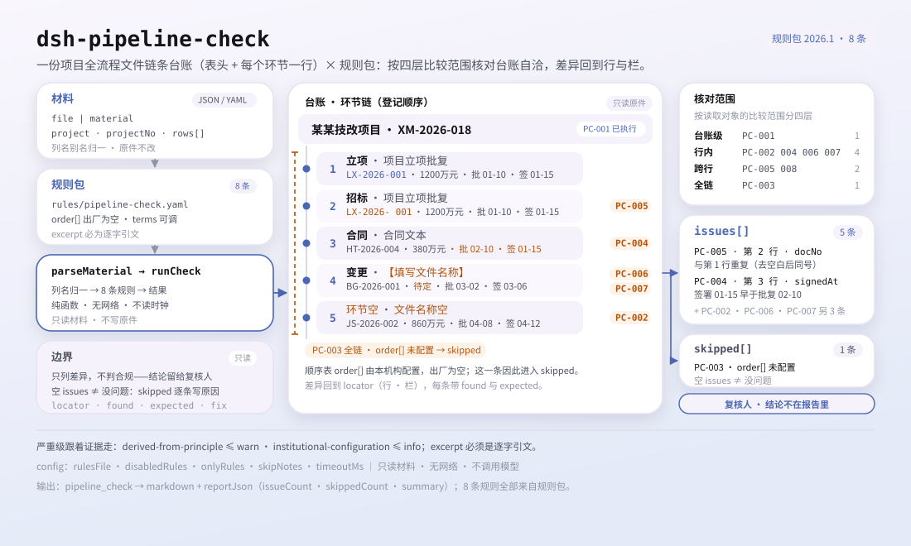

<div align="center">

<picture>
  <source media="(prefers-color-scheme: dark)" srcset="docs/assets/dsh-pipeline-check-hero-en-dark.webp">
  
</picture>

# dsh-pipeline-check

**Sepa exactamente qué le falta al registro — antes de que empiece la revisión, fila por fila y columna por columna.**

Un verificador del registro de la cadena documental de todo el proceso de un proyecto para DeepSeek Harness: lee la cabecera del proyecto más una fila por documento de etapa, aplica ocho reglas a nivel de registro y devuelve solo diferencias, nunca un veredicto de cumplimiento.

[Instalar](#instalación-en-tres-pasos) · [Configuración](#configuración) · [FAQ](#faq) · [简体中文](README.md) · [English](README.en.md) · [Español](README.es.md) · [Português](README.pt.md) · [हिन्दी](README.hi.md)

[](LICENSE)
[](#compatibilidad)
[](https://www.npmjs.com/package/dsh-pipeline-check)
[](https://github.com/PerryLink/dsh-pipeline-check/actions/workflows/ci.yml)
[](#compatibilidad)

[](https://github.com/PerryLink/dsh-pipeline-check/stargazers)
[](https://www.npmjs.com/package/dsh-pipeline-check)
[](https://dshfind.com/plugins/PerryLink/dsh-pipeline-check?ref=badge)
[](https://securityscorecards.dev/viewer/?uri=github.com/PerryLink/dsh-pipeline-check)
[](https://dsh.market/)
[](https://gitee.com/perrylink/dsh-pipeline-check)

```sh
dsh plugin --profile <name> add dsh-pipeline-check
```

</div>

<sub>Plugin de la comunidad, no afiliado a DeepSeek. Repositorio canónico: <https://github.com/PerryLink/dsh-pipeline-check> (Gitee es un espejo).</sub>

## Qué es

`dsh-pipeline-check` lee un registro de la cadena documental de todo el proceso de un proyecto —la cabecera del proyecto más una fila por documento de etapa— y comprueba la completitud y la coherencia interna de ese registro: que el proyecto esté identificado, que cada fila nombre su etapa o su documento, que las etapas sigan la secuencia que usted declara, que las fechas de aprobación y de firma se puedan analizar y respeten su orden, que los números de documento sean únicos, que los importes se analicen como números y que no quede ningún marcador de plantilla en el nombre de un documento.

El material es JSON o YAML. La herramienta lee el `file` o el `material` que usted pasa y nunca modifica el original; Excel debe convertirse antes a JSON/YAML, algo que también puede hacerse en el chat.

<picture>
  <source media="(prefers-color-scheme: dark)" srcset="docs/assets/dsh-pipeline-check-flow-v5-dark.svg">
  
</picture>

## Instalación en tres pasos

1. **Instala** (elige un canal):

   ```sh
   # canal git (último main)
   dsh plugin --profile <name> add github:PerryLink/dsh-pipeline-check
   # canal npm (versiones publicadas)
   dsh plugin --profile <name> add dsh-pipeline-check
   # canal tarball: pnpm pack en este repo y luego
   dsh plugin --profile <name> add ./dsh-pipeline-check-<version>.tgz
   ```

   Desde un checkout de código fuente, ejecute primero `pnpm install` (`prepare` lanza la compilación `tsdown` que produce `lib/`).

2. **Configuración mínima** (los valores por defecto ya funcionan; este ejemplo ejecuta tres reglas y añade una nota a cada motivo `skipped`):

   ```yaml
   - insert:
       - id: dsh-pipeline-check
         name: dsh-pipeline-check
         config:
           onlyRules: [PC-001, PC-002, PC-004]
           skipNotes: normativa interna 2026
   ```

3. **Verifica que está activo**:

   ```sh
   dsh --profile <name> --dump-config | grep 'dsh-pipeline-check'
   ```

   Después pida al modelo que llame una vez a la herramienta `pipeline_check` con una entrada mínima:

   ```json
   {"project":"某某技改项目","projectNo":"XM-2026-018","rows":[{"序号":"1","环节":"立项","文件名称":"项目立项批复","文件编号":"LX-2026-001"}]}
   ```

   El informe lleva `issueCount`, `summary` y `skippedCount`; los hallazgos individuales se renderizan en `markdown` y `reportJson`. Un checkout de código fuente puede ejecutar el ejemplo incluido directamente (compile antes): `node samples/quickstart/run.mjs --check`; la entrada y la salida esperada están en `samples/quickstart/`.

**Desinstalar**: `dsh plugin --profile <name> remove dsh-pipeline-check`.

<details>
<summary>Formato del material (JSON / YAML)</summary>

La herramienta acepta JSON o YAML:

```yaml
project: 某某技改项目
projectNo: XM-2026-018
rows:
  - { 序号: '1', 环节: 立项, 文件名称: 项目立项批复, 文件编号: LX-2026-001,
      金额: 1200万元, 批复日期: 2026-01-10, 签署日期: 2026-01-15, 生效日期: 2026-01-16 }
```

Los nombres de columna se comparan sin distinguir mayúsculas y minúsculas y omitiendo espacios, guiones bajos y guiones; se conservan los nombres propios del registro, así que cada hallazgo indica la columna que leyó. Los importes pueden llevar separador de miles o unidad: se aceptan ambas formas del ejemplo anterior. La cabecera y las filas admiten alias en inglés y en chino (por ejemplo `project`, `stage` y `docNo`); los campos son opcionales en la capa de lectura, de modo que una exportación parcial produce hallazgos de campo ausente en lugar de un fallo.

</details>

## Capacidades clave

`dsh-pipeline-check` convierte un registro en una lista de diferencias revisable línea por línea:

- **Verificación a nivel de registro** — lee solo el registro que usted pasa; cada hallazgo lleva `locator` (fila/columna), `found`, `expected` y `fix`, y apunta a una fila y una columna concretas.
- **Ocho reglas y el paquete de reglas como dato** — cada comprobación se declara en `rules/pipeline-check.yaml`; sustituir ese YAML cambia la versión del conjunto sin tocar TypeScript.
- **Sin aprobación silenciosa** — una comprobación sin configurar, desactivada o que no puede ejecutarse entra en `skipped` con su motivo; una lista de problemas vacía nunca debe leerse como «no hay nada mal».
- **Solo diferencias** — sin veredicto de cumplimiento, sin atribución de responsabilidad, sin sustituir al revisor; la conclusión queda en quien tiene competencia.
- **Local y sin efectos secundarios** — sin red, sin llamada al modelo, sin escrituras en el archivo de material; el análisis y la comprobación son funciones puras locales.

| Regla | Qué comprueba | Nivel | Base |
|---|---|---|---|
| `PC-001` | el registro nombra el proyecto y su número | warn | trazabilidad |
| `PC-002` | cada fila nombra su etapa o su documento | warn | completitud |
| `PC-003` | las etapas siguen la secuencia que usted configura (apagada por defecto) | info | tabla de orden local |
| `PC-004` | la firma no es anterior a la aprobación | warn | coherencia de fechas |
| `PC-005` | los números de documento son únicos dentro de una etapa | warn | unicidad del registro |
| `PC-006` | los importes se analizan como números | warn | comparabilidad |
| `PC-007` | los nombres de documento no conservan marcadores sin sustituir | warn | integridad del registro |
| `PC-008` | los números de etapa son únicos | warn | unicidad del registro |

### Una ejecución real

**Herramienta** `pipeline_check`

**Entrada**

~~~json
{"project":"某某技改项目","projectNo":"XM-2026-018","rows":[{"序号":"1","环节":"","文件名称":"","文件编号":"LX-2026-001"}]}
~~~

**Salida**

~~~json
{
  "id": "dsh-pipeline-check.PC-002.de09b5a6",
  "ruleId": "PC-002",
  "severity": "warn",
  "locator": {
    "row": 1,
    "field": "stage"
  },
  "found": "第 1 行 stage、document 都为空",
  "expected": "stage、document 至少应填写一项",
  "fix": "补填环节名称与文件名称；本条只核对是否填写，不判断该环节是否应当办理"
}
~~~

*Observed from `dsh-pipeline-check/tests/fixtures/PC-002/PC-002-unsafe.json (cases.json expects 1×PC-002); executed parseMaterial+runCheck, checkedAt=2026-10-06T00:00:00.000Z`*

### Seis preguntas que responde

| Usted pregunta | Qué responde |
|---|---|
| La regla del orden de etapas informa `skipped` en una instalación nueva. ¿Hay algo roto? | No. `PC-003` compara las etapas del registro con la lista `order` del paquete de reglas, y esa lista viene vacía, es decir sin configurar, así que la regla se informa a sí misma en `skipped` en lugar de pasar en silencio. Rellene `order` con la secuencia de su institución (el ejemplo del paquete es la secuencia de diez etapas del bloque YAML de «Normas que sigue») y entonces solo comprueba que las etapas que aparecen en el registro sigan ese orden, admitiéndose un salto; nunca juzga si saltarse una etapa era admisible, y su base deja constancia de que no existe cláusula citable, por lo que está limitada a `info`. |
| La fecha de firma del registro es anterior a la de aprobación, ¿se detecta? | Sí. `PC-004` compara `signedAt` con `approvedAt`: ambas deben analizarse como fechas y la firma no debe ser anterior a la aprobación, y el mismo día cuenta como no posterior. Una fecha que no puede analizar se informa por separado en lugar de dejarse pasar. Solo compara esas dos fechas: no juzga si la firma excedió la competencia ni si la aprobación era válida. |
| Un importe lleva separador de miles o unidad, ¿se lee igualmente? | Sí. `PC-006` acepta importes con separador de miles o con unidad (las formas aceptadas figuran bajo la tabla) e informa solo del importe que no puede analizar como número. Comprueba únicamente que sea analizable: si el importe rebasa el presupuesto o si requería aprobación no lo decide esta regla. |
| Una fila no trae nombre de etapa ni nombre de documento. | `PC-002` exige al menos uno de los dos, `stage` o `document`, en cada fila, e informa de la fila que no trae ninguno. Comprueba que al menos uno esté relleno; no juzga si esa etapa debía tramitarse ni si los documentos de esa etapa están completos. |
| El mismo número de documento aparece en dos filas. | `PC-005` informa de un `docNo` repetido e ignora los espacios en blanco al comparar, porque la repetición impide la deduplicación y hace que los importes se cuenten dos veces. No distingue un registro duplicado de dos documentos a los que se dio por error el mismo número, así que una coincidencia requiere confirmación humana. |
| El nombre del documento aún es un marcador de plantilla. | `PC-007` informa de toda fila cuyo `document` contenga uno de los términos de plantilla del paquete: corchetes de plantilla, marcas de «a rellenar», `{{`, `}}`, XXX, xxx, TBD, todo y la palabra «ejemplo». Un registro copiado de una plantilla hace que una etapa no tramitada parezca resuelta. Solo se buscan los términos listados, y `terms` puede ajustarse a su plantilla; la lista exacta está en el bloque de código siguiente. |

```text
【 】 {{ }} XXX xxx 待填 待补充 TBD todo 示例
```

```text
1,200.50
1200万元
```

## Normas que sigue

| Documento | Número | Reglas que lo citan |
|---|---|---|
| normas de gestión de proyectos e inversiones de la institución (sin norma nacional) | sin estándar unificado (base: trazabilidad del registro) | PC-001 |
| normas de gestión de proyectos e inversiones de la institución (sin norma nacional) | sin estándar unificado (base: completitud de la cadena) | PC-002 |
| normas de gestión de proyectos e inversiones de la institución (sin norma nacional) | sin estándar unificado (base: tabla de orden de la propia institución) | PC-003 |
| normas de gestión de proyectos e inversiones de la institución (sin norma nacional) | sin estándar unificado (base: coherencia de fechas) | PC-004 |
| normas de gestión de proyectos e inversiones de la institución (sin norma nacional) | sin estándar unificado (base: unicidad del registro) | PC-005, PC-008 |
| normas de gestión de proyectos e inversiones de la institución (sin norma nacional) | sin estándar unificado (base: comparabilidad de importes) | PC-006 |
| normas de gestión de proyectos e inversiones de la institución (sin norma nacional) | sin estándar unificado (base: integridad del registro) | PC-007 |

**Boundary:** este plugin comprueba un **registro de la cadena documental de todo el proceso de un proyecto** por lo que un registro puede exigir — que el proyecto esté identificado, que cada fila nombre su etapa o su documento, que las etapas sigan la secuencia que usted declara, que las fechas de aprobación y firma se analicen y respeten su orden, que los números de documento sean únicos, que los importes se analicen y que no sobreviva ningún marcador de plantilla. **No** decide si un proyecto cumple la normativa, si una aprobación excedió la competencia, si el gasto rebasó el presupuesto ni quién es responsable. **Eso depende de las normas de inversión y los límites de aprobación de la institución.**

> ### ⚠️ No existe una norma nacional para esto, y el paquete no finge lo contrario
>
> **Qué etapas atraviesa un proyecto y en qué orden lo fija la normativa de proyectos e inversiones de cada institución** — y varía mucho entre industrias (energía, municipal, edificación, agua) y entre proyectos con financiación pública y empresarial. **No existe una norma nacional unificada**, así que este paquete no inventa un número de norma: el `excerpt` de cada regla dice con claridad que su base es la coherencia o la trazabilidad de la cadena y que **no existe cláusula citable**. Una prueba verifica que cada excerpt lleva esa declaración.
>
> **El plugin no incluye una lista de etapas.** El `order` de `PC-003` viene **vacío** y, sin nada configurado, la regla se informa en `skipped` en lugar de inventar una secuencia. Configúrelo así:
>

```yaml
order: [立项, 可行性研究, 初步设计, 概算, 招标, 合同, 开工, 变更, 结算, 决算]
```

> La comprobación verifica entonces que las etapas que aparecen en el registro estén **en** ese orden, omitiendo las etapas que el proyecto legítimamente no atravesó; nunca juzga si omitir una etapa era admisible.

**Los datos de las reglas están separados del código.** Los datos viven en `rules/pipeline-check.yaml`; como ninguna norma nacional unificada regula la cadena de etapas, las entradas `basis` del paquete lo dicen explícitamente en lugar de citar una. El cargador sigue exigiendo documento, número, cláusula, extracto y fuente en cada regla (un extracto de menos de ocho caracteres hace fallar la carga), y sigue prohibiendo que una comprobación `derived-from-principle` o configurada localmente sea `error`. El registro de verificación por regla está en `rules/evidence/`.

## Configuración

Todos los parámetros ajustables son campos Schemastery de `src/config.ts`, modificables desde `cordis.yml` sin tocar el código; los umbrales por regla están en el paquete de reglas bajo `rules/`.

| Clave | Tipo | Predeterminado | Descripción |
|---|---|---|---|
| `rulesFile` | string | `rules/pipeline-check.yaml` | Ruta del paquete de reglas, relativa a la raíz del paquete |
| `disabledRules` | string[] | `[]` | Ids de reglas que se dejan de ejecutar; cada una aparece en `skipped` |
| `onlyRules` | string[] | `[]` | Ejecutar solo estas reglas; vacío ejecuta todas |
| `skipNotes` | string | `""` | Nota añadida a cada motivo de `skipped` |
| `timeoutMs` | number | `120000` | Presupuesto de tiempo de espera cooperativo de la herramienta, en milisegundos |

Parámetros por regla:

- `PC-003` `order` — su secuencia de etapas. Vacío significa que la regla no se ejecuta. Una etapa escrita con una nota final coincide por su nombre base (la forma siguiente es un ejemplo).
- `PC-004` `field` / `notBeforeField` — el par de fechas a comparar; por defecto, firma frente a aprobación. Añada una segunda regla para comprobar la fecha de entrada en vigor.
- `PC-007` `terms` — los términos de plantilla que se buscan.

```text
招标（二次）
```

Ejemplo de sobrescritura en el patch del perfil:

```yaml
- insert:
    - id: dsh-pipeline-check
      name: dsh-pipeline-check
      config:
        rulesFile: rules/pipeline-check.yaml
        onlyRules: [PC-002, PC-004, PC-006]
        timeoutMs: 60000
```

## FAQ

<details>
<summary>¿Se sube el material o el plugin se conecta a la red?</summary>

No. `dsh-pipeline-check` es un verificador local: solo lee el material que se pasa a su herramienta (`file` o `material`) y no lo sube; no hace peticiones de red y no incluye telemetría, analítica ni reporte en segundo plano; no escribe datos fuera del resultado de la herramienta y del almacenamiento de sesión/log del propio host DSH. El host controla ese almacenamiento y su retención; este paquete no añade una segunda copia.

</details>

<details>
<summary>Una lista de problemas vacía, ¿significa que no hay nada mal?</summary>

No. Una comprobación que no pudo ejecutarse entra en `skipped` con su motivo — por ejemplo, el `order` de `PC-003` viene vacío, así que la regla se informa en `skipped` en lugar de pasar en silencio. Una lista vacía solo significa que las reglas que sí se ejecutaron no encontraron diferencias; lea `skippedCount` y `skipped` antes de `issueCount`.

</details>

<details>
<summary>¿Compite con otros plugins por nombres de herramienta, servicios o slots?</summary>

No. Registra una sola herramienta, `pipeline_check`, no provee ninguna clave de servicio, no registra slots de cliente ni prefijo `webServer`, no escucha eventos compartidos y no muta globales. El registro de la herramienta es un efecto Cordis que se retira al parar o recargar en caliente.

</details>

<details>
<summary>¿Cuánto cuesta y puede agotar el tiempo de espera?</summary>

El análisis y la comprobación son locales: sin peticiones de red, sin llamadas al modelo. La herramienta lleva un presupuesto cooperativo `timeoutMs` (120000 ms por defecto) y `PC-003` es un único recorrido lineal. El coste crece con el número de filas del registro, no con el modelo.

</details>

<details>
<summary>¿Puede sustituir al revisor?</summary>

No. Solo enumera diferencias que el propio registro puede sostener; no decide cumplimiento, responsabilidad, si una aprobación excedió la competencia ni si el gasto rebasó el presupuesto. Eso depende de la normativa de inversión, los límites de aprobación y las reglas sectoriales de la institución, y corresponde a los revisores de gestión de inversiones y auditoría.

</details>

## Límites de seguridad

- **Material de solo lectura, original intacto.** La herramienta lee el `file` o el `material` que usted pasa; el archivo del registro nunca se reescribe, mueve ni elimina.
- **Sin red, sin llamada al modelo, sin telemetría.** No hay peticiones de red, analítica ni reporte en segundo plano; no se escribe nada fuera del resultado de la herramienta y del almacenamiento de sesión/log del host.
- **Sin lenguaje adjudicador.** El informe solo enumera diferencias; no se pronuncia sobre cumplimiento, competencia, exceso de presupuesto ni responsabilidad, y un guardián de redacción mantiene el descargo en cada informe.
- **Sin base fabricada.** El paquete se valida al cargar: cada regla debe llevar documento, número, cláusula, extracto y fuente, y el extracto debe ser una cita literal. Cuando no existe cláusula citable, el paquete lo dice en lugar de inventar un número de norma; `derived-from-principle` tiene tope `warn` y `institutional-configuration`, tope `info`.
- **Sin aprobación silenciosa.** Una comprobación sin configurar, desactivada o que no puede ejecutarse entra en `skipped` con su motivo; una lista vacía nunca puede leerse como «no hay nada mal».
- **El paquete de reglas es dato.** Sustituir `rules/*.yaml` cambia la versión del conjunto sin tocar código; el paquete se valida al cargar en lugar de confiarse.

## Limitaciones conocidas

- **La coherencia del registro no es verificación de hechos.** El plugin lee solo el registro; no abre los documentos a los que apunta, no verifica que esos archivos existan, no comprueba sellos ni firmas y no compara el contenido de los documentos con el registro.
- **No existe una norma nacional unificada.** Qué etapas atraviesa un proyecto y en qué orden lo fija la normativa de cada institución y la práctica del sector; el plugin no incluye una lista de etapas ni prescribe un proceso.
- **`PC-003` viene sin configurar.** Con `order` vacío la regla se informa en `skipped`; una vez configurada solo comprueba que las etapas que aparecen en el registro estén en orden, nunca si omitir una era admisible.
- **Las fechas son aritmética de reloj de pared sobre las cadenas de entrada.** Sin conversión de zona horaria; una fecha imposible de analizar se informa por separado en lugar de omitirse, y no se infiere validez de la aprobación ni de la firma.
- **Los importes solo se comprueban por analizabilidad.** Formas como `1,200.50` y `1200万元` se leen; un rango o una celda con nota se informa como no analizable a propósito, y no se juzga si hay exceso de presupuesto ni si hacía falta aprobación.
- **Los números duplicados necesitan confirmación humana.** El mismo número en dos filas puede ser un registro duplicado o una enmienda que reutiliza el número original; `PC-005` informa de la repetición y no decide cuál es.
- **El formato del material es limitado.** Solo JSON o YAML; Excel debe convertirse antes. Los campos de la capa de lectura son opcionales, así que una exportación parcial produce hallazgos de campo ausente en lugar de un fallo.
- **Solo ocho reglas.** El conjunto es sustituible, pero el predeterminado cubre completitud, orden, fechas, números, importes y marcadores de plantilla a nivel de registro — no la autenticidad de los documentos subyacentes, la competencia de aprobación ni el cumplimiento.

### Comprobaciones habituales

- **El plugin se instala pero la herramienta no aparece.** Compruebe que `main` resuelve a `lib/index.mjs` y que `pnpm run build` lo generó; un `main` incorrecto hace que el cargador omita la entrada en silencio.
- **`dsh plugin add` rechaza el paquete por incompatibilidad.** El rango de peers cubre `0.1.x` y `0.2.x`; si su runtime está fuera, conceda una exención explícita: `dsh plugin --profile <name> allow-version dsh-pipeline-check@0.1.0 --dsh-version <runtime> --accept-risk`.
- **`check` informa `manifest-peers` como fallo.** El verificador estático compara con un rango de peers codificado que es anterior a la línea 0.2; el runtime aplica la compatibilidad de peers al instalar. Es un problema conocido de `dsh-plugin-dev`.
- **Una regla no se ejecutó.** Lea el arreglo `skipped`: indica el id de la regla y el motivo.
- **`PC-003` se dispara con un nombre de etapa.** Ese nombre no está en su tabla de orden; corrija el registro o añada la etapa — el hallazgo dice qué nombre no pudo situar.

## Compatibilidad

| Superficie | Estado |
|---|---|
| Harness | Rango de peers `>=0.1.2-rc.1 <0.2.0 \|\| >=0.2.0-0 <0.3.0` — verificado para aceptar tanto `0.2.0-rc.2` como `0.2.1-rc.2`. `engines.dsh` se declara como `>=0.2.1-0 <0.3.0` y el host lo aplica desde 0.2.1 |
| Node | `^22.19.0 \|\| >=24.0.0` |
| Plataformas | Todas (ESM puro; sin código nativo, sin red, sin llamada al modelo) |
| Modo de herramienta | Funciona en `native` y `ptc`; para una cartera de proyectos use `ptc` |

## Ecosistema y calidad

- [Espejo de Gitee](https://gitee.com/perrylink/dsh-pipeline-check) (espejo sincronizado; GitHub es el canónico)
- [Página del plugin en dshfind](https://dshfind.com/plugins/PerryLink/dsh-pipeline-check) (instalaciones y ranking)
- [Informe de OpenSSF Scorecard](https://securityscorecards.dev/viewer/?uri=github.com/PerryLink/dsh-pipeline-check) (impulsado por [.github/workflows/scorecard.yml](.github/workflows/scorecard.yml))
- [DSH Market](https://dsh.market/) (listado)
- [Base de conocimiento del ecosistema](https://perrylink.github.io/zh/checkers/choose/) — datos medidos, no marketing: elegir un verificador por material · datos de selección · criterios de mantenimiento

## Desarrollo

```sh
pnpm install                                   # node ^22.19 || >=24
pnpm run typecheck                             # tsc --noEmit
pnpm test                                      # vitest: suite compartida de plugins de tabla + fixtures emparejados
pnpm run build                                 # tsdown -> lib/index.mjs + lib/index.d.mts
pnpm run verify:self-contained                 # las dependencias se resuelven desde el registry
pnpm run check:lockfile                        # comprobación de deriva del lockfile
pnpm run check:readmes                         # puerta de consistencia de los README
pnpm run check:citations                       # citas frente al registro de verificación
node ../scripts/sync-shared.mjs dsh-pipeline-check   # refrescar src/shared desde ../_shared
node samples/quickstart/run.mjs --check        # ejemplo incluido (compile antes)
```

`sync-shared` copia el kit compartido de `../_shared` a `src/shared/`; vuelva a ejecutarlo tras cada cambio compartido.

Estructura:

| Ruta | Función |
|---|---|
| `src/index.ts` | contrato de plugin de función: registra la herramienta `pipeline_check` y resuelve la ruta del paquete de reglas |
| `src/config.ts` | esquema Schemastery; aquí vive cada parámetro ajustable |
| `src/model.ts` | forma de la tabla y contrato del material: alias de columnas, campos requeridos y punto de entrada del análisis |
| `src/view.ts` | proyección del informe para el modelo; `output.schema` la refleja |
| `src/shared/` | kit compartido (cargador de reglas, forma del informe, subconjunto YAML, aritmética de calendario, guardián de redacción, ayudas de tabla), incluido para ser autocontenido |
| `rules/pipeline-check.yaml` | el paquete de reglas, ocho reglas |
| `rules/evidence/` | el registro de verificación de cada cita |
| `tests/` | vitest; cada regla tiene una pareja de fixtures conforme/violante |

El resultado del ejemplo incluido puede compararse con `samples/quickstart/expected/result.json`; hay una captura en [`docs/assets/quickstart.png`](docs/assets/quickstart.png). Las imágenes del README se generan programáticamente con [`scripts/gen-readme-assets.py`](scripts/gen-readme-assets.py) — el banner hero con Pillow y el diagrama de estructura como SVG escrito a mano — y se pueden reejecutar sin riesgo; los README solo referencian el hero (zh/en, claro y oscuro) y el diagrama de estructura flow-v5 (claro y oscuro, compartido por los cinco idiomas), mientras que el antiguo flujo de una sola piel y las imágenes de demostración se conservan en `docs/assets/` para los enlaces externos.

## Familia y agradecimientos

Este proyecto forma parte de la familia de plugins de DeepSeek Harness de [PerryLink](https://github.com/PerryLink) (todos Apache-2.0). Si te resulta útil, **una estrella ayuda a que la siguiente persona lo encuentre** — no hay nada bloqueado tras ella.

- [@PerryLink](https://github.com/PerryLink) — creador y mantenedor: las ocho reglas `PC-*` y el paquete de reglas, la herramienta `pipeline_check`, y la documentación en cinco idiomas y la cadena de imágenes.

<details>
<summary>Expandir todos los plugins</summary>

| Plugin | Estado |
|---|---|
| **[dsh-aqua-input-check](https://github.com/PerryLink/dsh-aqua-input-check)** |  |
| **[dsh-archive-check](https://github.com/PerryLink/dsh-archive-check)** |  |
| **[dsh-auto-review](https://github.com/PerryLink/dsh-auto-review)** |  |
| **[dsh-autotier](https://github.com/PerryLink/dsh-autotier)** | 🧊 CONGELADO — ver el README del repo |
| **[dsh-bid-ca-precheck](https://github.com/PerryLink/dsh-bid-ca-precheck)** |  |
| **[dsh-bid-qual-check](https://github.com/PerryLink/dsh-bid-qual-check)** |  |
| **[dsh-cert-mcp](https://github.com/PerryLink/dsh-cert-mcp)** | 🧊 CONGELADO — ver el README del repo |
| **[dsh-checkpoint-rewind](https://github.com/PerryLink/dsh-checkpoint-rewind)** |  |
| **[dsh-click](https://github.com/PerryLink/dsh-click)** |  |
| **[dsh-composer-history](https://github.com/PerryLink/dsh-composer-history)** |  |
| **[dsh-contract-stance](https://github.com/PerryLink/dsh-contract-stance)** |  |
| **[dsh-customs-doc-check](https://github.com/PerryLink/dsh-customs-doc-check)** |  |
| **[dsh-data-quality](https://github.com/PerryLink/dsh-data-quality)** | 🧊 CONGELADO — ver el README del repo |
| **[dsh-demurrage-ledger](https://github.com/PerryLink/dsh-demurrage-ledger)** |  |
| **[dsh-doublecheck](https://github.com/PerryLink/dsh-doublecheck)** |  |
| **[dsh-drill-script-check](https://github.com/PerryLink/dsh-drill-script-check)** |  |
| **[dsh-eia-guide-check](https://github.com/PerryLink/dsh-eia-guide-check)** |  |
| **[dsh-emergency-plan](https://github.com/PerryLink/dsh-emergency-plan)** |  |
| **[dsh-essay-rubric-check](https://github.com/PerryLink/dsh-essay-rubric-check)** |  |
| **[dsh-evidence-check](https://github.com/PerryLink/dsh-evidence-check)** |  |
| **[dsh-export-ctl-check](https://github.com/PerryLink/dsh-export-ctl-check)** |  |
| **[dsh-fast](https://github.com/PerryLink/dsh-fast)** |  |
| **[dsh-fmea-table-check](https://github.com/PerryLink/dsh-fmea-table-check)** |  |
| **[dsh-forecast-penalty](https://github.com/PerryLink/dsh-forecast-penalty)** |  |
| **[dsh-fund-research](https://github.com/PerryLink/dsh-fund-research)** |  |
| **[dsh-github](https://github.com/PerryLink/dsh-github)** |  |
| **[dsh-gongwen-flow-check](https://github.com/PerryLink/dsh-gongwen-flow-check)** |  |
| **[dsh-gongwen-word-check](https://github.com/PerryLink/dsh-gongwen-word-check)** |  |
| **[dsh-guard-plan-qc](https://github.com/PerryLink/dsh-guard-plan-qc)** |  |
| **[dsh-hazchem-check](https://github.com/PerryLink/dsh-hazchem-check)** |  |
| **[dsh-hazplan-check](https://github.com/PerryLink/dsh-hazplan-check)** |  |
| **[dsh-hidden-risk-map](https://github.com/PerryLink/dsh-hidden-risk-map)** |  |
| **[dsh-hs-classify](https://github.com/PerryLink/dsh-hs-classify)** |  |
| **[dsh-icd-rule-check](https://github.com/PerryLink/dsh-icd-rule-check)** |  |
| **[dsh-industry-research](https://github.com/PerryLink/dsh-industry-research)** |  |
| **[dsh-lawcite-adapter](https://github.com/PerryLink/dsh-lawcite-adapter)** |  |
| **[dsh-laya](https://github.com/PerryLink/dsh-laya)** |  |
| **[dsh-lc-doc-check](https://github.com/PerryLink/dsh-lc-doc-check)** |  |
| **[dsh-learning-gap-check](https://github.com/PerryLink/dsh-learning-gap-check)** |  |
| **[dsh-library](https://github.com/PerryLink/dsh-library)** |  |
| **[dsh-local-ai](https://github.com/PerryLink/dsh-local-ai)** |  |
| **[dsh-lsp-actions](https://github.com/PerryLink/dsh-lsp-actions)** |  |
| **[dsh-mask](https://github.com/PerryLink/dsh-mask)** |  |
| **[dsh-mcp-panel](https://github.com/PerryLink/dsh-mcp-panel)** |  |
| **[dsh-medrec-qc](https://github.com/PerryLink/dsh-medrec-qc)** |  |
| **[dsh-memento](https://github.com/PerryLink/dsh-memento)** | 🧊 CONGELADO — ver el README del repo |
| **[dsh-nsfc-form-check](https://github.com/PerryLink/dsh-nsfc-form-check)** |  |
| **[dsh-nurse-record-check](https://github.com/PerryLink/dsh-nurse-record-check)** |  |
| **[dsh-observe](https://github.com/PerryLink/dsh-observe)** |  |
| **[dsh-origin-rvc-check](https://github.com/PerryLink/dsh-origin-rvc-check)** |  |
| **[dsh-ota-review-check](https://github.com/PerryLink/dsh-ota-review-check)** |  |
| **[dsh-output-styles](https://github.com/PerryLink/dsh-output-styles)** |  |
| **[dsh-paper-doc-adapter](https://github.com/PerryLink/dsh-paper-doc-adapter)** |  |
| **[dsh-permission-rules](https://github.com/PerryLink/dsh-permission-rules)** |  |
| **[dsh-permit-report-check](https://github.com/PerryLink/dsh-permit-report-check)** |  |
| **[dsh-pipeline-check](https://github.com/PerryLink/dsh-pipeline-check)** |  |
| **[dsh-pleading-draft](https://github.com/PerryLink/dsh-pleading-draft)** |  |
| **[dsh-plugin-doctor](https://github.com/PerryLink/dsh-plugin-doctor)** | 🚫 RETIRADO (repo archivado) |
| **[dsh-plugin-guide](https://github.com/PerryLink/dsh-plugin-guide)** |  |
| **[dsh-plugin-kit](https://github.com/PerryLink/dsh-plugin-kit)** | 🚫 RETIRADO (repo archivado) |
| **[dsh-plugin-upgrade](https://github.com/PerryLink/dsh-plugin-upgrade)** | 🚫 RETIRADO (repo archivado) |
| **[dsh-policy-brief-draft](https://github.com/PerryLink/dsh-policy-brief-draft)** |  |
| **[dsh-power-loss-split](https://github.com/PerryLink/dsh-power-loss-split)** |  |
| **[dsh-power-ticket-check](https://github.com/PerryLink/dsh-power-ticket-check)** |  |
| **[dsh-ppap-check](https://github.com/PerryLink/dsh-ppap-check)** |  |
| **[dsh-protest-deadline](https://github.com/PerryLink/dsh-protest-deadline)** |  |
| **[dsh-railway-window](https://github.com/PerryLink/dsh-railway-window)** |  |
| **[dsh-repair-order-qc](https://github.com/PerryLink/dsh-repair-order-qc)** |  |
| **[dsh-research-report](https://github.com/PerryLink/dsh-research-report)** |  |
| **[dsh-review-reply-check](https://github.com/PerryLink/dsh-review-reply-check)** |  |
| **[dsh-rulefile-check](https://github.com/PerryLink/dsh-rulefile-check)** |  |
| **[dsh-safety-brief-check](https://github.com/PerryLink/dsh-safety-brief-check)** |  |
| **[dsh-score](https://github.com/PerryLink/dsh-score)** | 🧊 CONGELADO — ver el README del repo |
| **[dsh-session-sync](https://github.com/PerryLink/dsh-session-sync)** |  |
| **[dsh-site-log-check](https://github.com/PerryLink/dsh-site-log-check)** |  |
| **[dsh-skill-pack-security](https://github.com/PerryLink/dsh-skill-pack-security)** |  |
| **[dsh-soe-decision-check](https://github.com/PerryLink/dsh-soe-decision-check)** |  |
| **[dsh-soilwater-check](https://github.com/PerryLink/dsh-soilwater-check)** |  |
| **[dsh-sop-sync-check](https://github.com/PerryLink/dsh-sop-sync-check)** |  |
| **[dsh-spc-gbt-adapter](https://github.com/PerryLink/dsh-spc-gbt-adapter)** |  |
| **[dsh-talk](https://github.com/PerryLink/dsh-talk)** |  |
| **[dsh-tender-extract](https://github.com/PerryLink/dsh-tender-extract)** |  |
| **[dsh-tender-matrix](https://github.com/PerryLink/dsh-tender-matrix)** |  |
| **[dsh-test-drive](https://github.com/PerryLink/dsh-test-drive)** |  |
| **[dsh-ticktick](https://github.com/PerryLink/dsh-ticktick)** | 🚫 RETIRADO (repo archivado) |
| **[dsh-translate](https://github.com/PerryLink/dsh-translate)** |  |
| **[dsh-warranty-calc](https://github.com/PerryLink/dsh-warranty-calc)** |  |
| **[dsh-budget](https://github.com/PerryLink/dsh-budget)** | 🧊 CONGELADO — ver el README del repo |
| **[dsh-claude-move](https://github.com/PerryLink/dsh-claude-move)** | 🧊 CONGELADO — ver el README del repo |
| **[dsh-defend](https://github.com/PerryLink/dsh-defend)** | 🧊 CONGELADO — ver el README del repo |
| **[dsh-draw](https://github.com/PerryLink/dsh-draw)** | 🧊 CONGELADO — ver el README del repo |
| **[dsh-reach](https://github.com/PerryLink/dsh-reach)** | 🧊 CONGELADO — ver el README del repo |
| **[dsh-background-agents](https://github.com/PerryLink/dsh-background-agents)** | 🚫 RETIRADO (repo archivado) |
| **[dsh-session-pin](https://github.com/PerryLink/dsh-session-pin)** | 🚫 RETIRADO (repo archivado) |
| **[dsh-team-rooms](https://github.com/PerryLink/dsh-team-rooms)** | 🚫 RETIRADO (repo archivado) |

</details>

## Licencia

[LICENSE](LICENSE) (Apache License 2.0) © 2026 dsh-pipeline-check contributors

<p align="center"><sub>Apache-2.0 · Plugin de la comunidad, no afiliado a DeepSeek.</sub></p>
