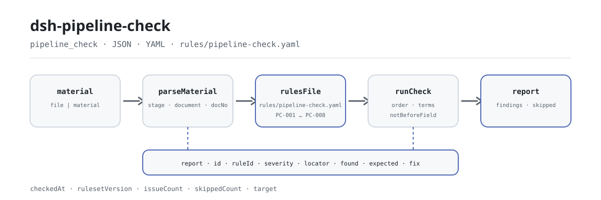

<div align="center">

<picture>
  <source media="(prefers-color-scheme: dark)" srcset="docs/assets/dsh-pipeline-check-flow-dark.svg">
  
</picture>

# dsh-pipeline-check

**समीक्षा शुरू होने से पहले ही जानें कि रजिस्टर में क्या छूटा है — पंक्ति-दर-पंक्ति और कॉलम-दर-कॉलम।**

DeepSeek Harness के लिए परियोजना की संपूर्ण प्रक्रिया की दस्तावेज़ शृंखला रजिस्टर की जाँच: परियोजना हेडर और प्रत्येक चरण-दस्तावेज़ की एक पंक्ति पढ़कर आठ नियम लागू करता है, और केवल अंतर लौटाता है — अनुपालन का निर्णय कभी नहीं।

[इंस्टॉल](#तीन-चरणों-में-शुरुआत) · [कॉन्फ़िगरेशन](#कॉन्फ़िगरेशन) · [FAQ](#faq) · [简体中文](README.md) · [English](README.en.md) · [Español](README.es.md) · [Português](README.pt.md) · [हिन्दी](README.hi.md)

[](LICENSE)
[](#संगतता)
[](https://www.npmjs.com/package/dsh-pipeline-check)
[](https://github.com/PerryLink/dsh-pipeline-check/actions/workflows/ci.yml)
[](#संगतता)

[](https://github.com/PerryLink/dsh-pipeline-check/stargazers)
[](https://www.npmjs.com/package/dsh-pipeline-check)
[](https://dshfind.com/plugins/PerryLink/dsh-pipeline-check?ref=badge)
[](https://securityscorecards.dev/viewer/?uri=github.com/PerryLink/dsh-pipeline-check)
[](https://dsh.market/)
[](https://gitee.com/perrylink/dsh-pipeline-check)

```sh
dsh plugin --profile <name> add dsh-pipeline-check
```

</div>

<sub>सामुदायिक प्लगइन, DeepSeek से असंबद्ध। कैनोनिकल रिपॉज़िटरी: <https://github.com/PerryLink/dsh-pipeline-check> (Gitee एक मिरर है)।</sub>

## यह क्या है

`dsh-pipeline-check` परियोजना की संपूर्ण प्रक्रिया की दस्तावेज़ शृंखला का एक रजिस्टर पढ़ता है — परियोजना हेडर और प्रत्येक चरण-दस्तावेज़ की एक पंक्ति — और उसी रजिस्टर की पूर्णता तथा आंतरिक सुसंगति की जाँच करता है: क्या परियोजना अंकित है, क्या हर पंक्ति अपना चरण या दस्तावेज़ बताती है, क्या चरण आपके घोषित क्रम में आते हैं, क्या अनुमोदन और हस्ताक्षर की तिथियाँ पढ़ी जा सकती हैं और उनका क्रम बनता है, क्या दस्तावेज़ क्रमांक अद्वितीय हैं, क्या राशियाँ संख्या के रूप में पढ़ी जा सकती हैं, और क्या किसी दस्तावेज़ के नाम में टेम्पलेट प्लेसहोल्डर शेष नहीं है।

सामग्री JSON या YAML है। उपकरण आपके द्वारा दिए गए `file` या `material` को पढ़ता है और मूल को कभी नहीं बदलता; Excel को पहले JSON/YAML में बदलें — यह चैट में भी हो सकता है।

## तीन चरणों में शुरुआत

1. **इंस्टॉल करें** (एक चैनल चुनें):

   ```sh
   # git चैनल (नवीनतम main)
   dsh plugin --profile <name> add github:PerryLink/dsh-pipeline-check
   # npm चैनल (प्रकाशित रिलीज़)
   dsh plugin --profile <name> add dsh-pipeline-check
   # tarball चैनल: इस रेपो में pnpm pack करके
   dsh plugin --profile <name> add ./dsh-pipeline-check-<version>.tgz
   ```

   सोर्स चेकआउट से उपयोग करते समय पहले `pnpm install` चलाएँ (`prepare` वह `tsdown` बिल्ड चलाता है जो `lib/` बनाता है)।

2. **न्यूनतम कॉन्फ़िग** (डिफ़ॉल्ट से ही चलता है; यह उदाहरण तीन नियम चलाता है और हर `skipped` कारण के आगे टिप्पणी जोड़ता है):

   ```yaml
   - insert:
       - id: dsh-pipeline-check
         name: dsh-pipeline-check
         config:
           onlyRules: [PC-001, PC-002, PC-004]
           skipNotes: संस्थागत नियमावली 2026
   ```

3. **सत्यापित करें कि सक्रिय है**:

   ```sh
   dsh --profile <name> --dump-config | grep 'dsh-pipeline-check'
   ```

   फिर मॉडल से एक बार `pipeline_check` टूल को न्यूनतम इनपुट के साथ चलवाएँ:

   ```json
   {"project":"某某技改项目","projectNo":"XM-2026-018","rows":[{"序号":"1","环节":"立项","文件名称":"项目立项批复","文件编号":"LX-2026-001"}]}
   ```

   रिपोर्ट में `issueCount`, `summary` और `skippedCount` होते हैं; अलग-अलग निष्कर्ष `markdown` और `reportJson` में आते हैं। सोर्स चेकआउट साथ दिया नमूना सीधे चला सकता है (पहले बिल्ड करें): `node samples/quickstart/run.mjs --check`; इनपुट और अपेक्षित आउटपुट `samples/quickstart/` में हैं।

**अनइंस्टॉल**: `dsh plugin --profile <name> remove dsh-pipeline-check`।

<details>
<summary>सामग्री का प्रारूप (JSON / YAML)</summary>

उपकरण JSON या YAML स्वीकार करता है:

```yaml
project: 某某技改项目
projectNo: XM-2026-018
rows:
  - { 序号: '1', 环节: 立项, 文件名称: 项目立项批复, 文件编号: LX-2026-001,
      金额: 1200万元, 批复日期: 2026-01-10, 签署日期: 2026-01-15, 生效日期: 2026-01-16 }
```

कॉलम नाम बड़े-छोटे अक्षरों में अंतर नहीं करते और स्थान, अंडरस्कोर व हाइफ़न छोड़ देते हैं; रजिस्टर के अपने कॉलम नाम सुरक्षित रहते हैं, इसलिए हर निष्कर्ष बताता है कि उसने कौन-सा कॉलम पढ़ा। राशियों में हज़ार-विभाजक या इकाई हो सकती है: ऊपर के उदाहरण के दोनों रूप स्वीकार्य हैं। हेडर और पंक्तियाँ अंग्रेज़ी व चीनी उपनाम स्वीकार करती हैं (जैसे `project`, `stage` और `docNo`); पढ़ने की परत में फ़ील्ड वैकल्पिक हैं, इसलिए आंशिक निर्यात क्रैश के बजाय अनुपस्थित-फ़ील्ड निष्कर्ष देता है।

</details>

## मुख्य क्षमताएँ

`dsh-pipeline-check` एक रजिस्टर को पंक्ति-दर-पंक्ति जाँचने योग्य अंतर-सूची में बदलता है:

- **रजिस्टर-स्तरीय जाँच** — केवल आपके दिए रजिस्टर को पढ़ता है; हर निष्कर्ष में `locator` (पंक्ति/कॉलम), `found`, `expected` और `fix` होते हैं और वह ठीक एक पंक्ति व एक कॉलम की ओर इशारा करता है।
- **आठ नियम, और नियम-पैक ही डेटा है** — हर जाँच `rules/pipeline-check.yaml` में घोषित है; उस YAML को बदलने से TypeScript छुए बिना नियम-सेट का संस्करण बदल जाता है।
- **चुपचाप पास नहीं** — अनकॉन्फ़िगर, बंद या न चल पाई जाँच `skipped` में कारण के साथ जाती है; खाली समस्या-सूची को कभी «कुछ गड़बड़ नहीं» नहीं पढ़ना चाहिए।
- **केवल अंतर** — अनुपालन का निर्णय नहीं, ज़िम्मेदारी का निर्धारण नहीं, समीक्षक का विकल्प नहीं; निष्कर्ष उसी के पास रहता है जिसके पास अधिकार है।
- **स्थानीय, बिना दुष्प्रभाव** — कोई नेटवर्क नहीं, कोई मॉडल कॉल नहीं, सामग्री फ़ाइल में कोई लेखन नहीं; पार्सिंग और जाँच स्थानीय शुद्ध फ़ंक्शन हैं।

| नियम | क्या जाँचता है | स्तर | आधार |
|---|---|---|---|
| `PC-001` | रजिस्टर परियोजना और उसका क्रमांक बताता है | warn | ट्रेसबिलिटी |
| `PC-002` | हर पंक्ति अपना चरण या दस्तावेज़ बताती है | warn | पूर्णता |
| `PC-003` | चरण आपके कॉन्फ़िगर क्रम में आते हैं (डिफ़ॉल्ट रूप से बंद) | info | स्थानीय क्रम-तालिका |
| `PC-004` | हस्ताक्षर अनुमोदन से पहले नहीं | warn | तिथि-सुसंगति |
| `PC-005` | किसी चरण में दस्तावेज़ क्रमांक अद्वितीय हैं | warn | रजिस्टर की अद्वितीयता |
| `PC-006` | राशियाँ संख्या के रूप में पढ़ी जा सकती हैं | warn | तुलनीयता |
| `PC-007` | दस्तावेज़ नामों में अपरिवर्तित प्लेसहोल्डर नहीं | warn | रजिस्टर की अखंडता |
| `PC-008` | चरण क्रमांक अद्वितीय हैं | warn | रजिस्टर की अद्वितीयता |

### एक वास्तविक रन

**उपकरण** `pipeline_check`

**इनपुट**

~~~json
{"project":"某某技改项目","projectNo":"XM-2026-018","rows":[{"序号":"1","环节":"","文件名称":"","文件编号":"LX-2026-001"}]}
~~~

**आउटपुट**

~~~json
{
  "id": "dsh-pipeline-check.PC-002.de09b5a6",
  "ruleId": "PC-002",
  "severity": "warn",
  "locator": {
    "row": 1,
    "field": "stage"
  },
  "found": "第 1 行 stage、document 都为空",
  "expected": "stage、document 至少应填写一项",
  "fix": "补填环节名称与文件名称；本条只核对是否填写，不判断该环节是否应当办理"
}
~~~

*Observed from `dsh-pipeline-check/tests/fixtures/PC-002/PC-002-unsafe.json (cases.json expects 1×PC-002); executed parseMaterial+runCheck, checkedAt=2026-10-06T00:00:00.000Z`*

### छह सवाल जिनका यह जवाब देता है

| आपका सवाल | इसका जवाब |
|---|---|
| नई स्थापना पर चरण-क्रम वाला नियम `skipped` बताता है। कुछ टूटा हुआ है क्या? | नहीं। `PC-003` रजिस्टर के चरणों की तुलना नियम-पैक की `order` सूची से करता है, और वह सूची खाली यानी अनकॉन्फ़िगर आती है, इसलिए यह नियम चुपचाप पास होने के बजाय स्वयं को `skipped` में बताता है। `order` में अपनी संस्था का चरण-क्रम भरें (पैक का उदाहरण «यह किन मानकों पर आधारित है» के YAML ब्लॉक में दस चरणों का क्रम है), फिर यह केवल देखता है कि रजिस्टर में आए चरण उसी क्रम में हैं और बीच का चरण छोड़ना स्वीकार्य है; किसी चरण को छोड़ना उचित था या नहीं, यह नहीं आँकता, और इसका आधार बताता है कि कोई उद्धरण-योग्य धारा नहीं है, इसलिए यह `info` तक सीमित है। |
| रजिस्टर में हस्ताक्षर की तिथि अनुमोदन की तिथि से पहले है — क्या यह पकड़ में आता है? | हाँ। `PC-004` `signedAt` की तुलना `approvedAt` से करता है: दोनों तिथियाँ पढ़ी जा सकें और हस्ताक्षर अनुमोदन से पहले न पड़े; एक ही दिन को बाद का नहीं माना जाता। जो तिथि पढ़ी न जा सके वह अलग से दर्ज होती है, चुपचाप छोड़ी नहीं जाती। यह केवल इन दो तिथियों की तुलना करता है: हस्ताक्षर अधिकार-सीमा से बाहर था या अनुमोदन वैध था, यह नहीं आँकता। |
| राशि में हज़ार-विभाजक या इकाई है — क्या वह पढ़ी जाएगी? | हाँ। `PC-006` हज़ार-विभाजक या इकाई सहित राशि स्वीकार करता है (स्वीकार्य रूप तालिका के नीचे हैं) और केवल वह राशि दर्ज करता है जिसे संख्या के रूप में न पढ़ा जा सके। यह केवल पढ़े जाने की जाँच करता है: राशि प्राक्कलन से अधिक है या उसके लिए अनुमोदन चाहिए था, यह यह नियम तय नहीं करता। |
| किसी पंक्ति में न चरण का नाम है, न दस्तावेज़ का नाम। | `PC-002` हर पंक्ति में `stage` या `document` में से कम से कम एक भरा होने की अपेक्षा करता है और जिस पंक्ति में दोनों न हों उसे दर्ज करता है। यह देखता है कि कम से कम एक भरा है; वह चरण होना ही चाहिए था या नहीं, और उसके दस्तावेज़ पूरे हैं या नहीं, यह नहीं आँकता। |
| एक ही दस्तावेज़ क्रमांक दो पंक्तियों में आया है। | `PC-005` दोहराया गया `docNo` दर्ज करता है और तुलना करते समय खाली स्थान छोड़ देता है, क्योंकि दोहराव से न दोहराव हटता है न राशियों का जोड़ सही रहता है। यह नहीं बता सकता कि यह दोहरा पंजीकरण है या दो दस्तावेज़ों को गलती से एक ही क्रमांक दिया गया, इसलिए मिलान पर मानवीय पुष्टि चाहिए। |
| दस्तावेज़ का नाम अब भी टेम्पलेट प्लेसहोल्डर है। | `PC-007` हर उस पंक्ति को दर्ज करता है जिसके `document` में पैक का कोई टेम्पलेट-शब्द हो: टेम्पलेट कोष्ठक, «भरा जाना है» के चिह्न, `{{`, `}}`, XXX, xxx, TBD, todo और «उदाहरण» शब्द। टेम्पलेट से उतारा रजिस्टर बिना निपटाए चरण को निपटा हुआ दिखाता है। केवल सूचीबद्ध शब्द खोजे जाते हैं, और `terms` अपने टेम्पलेट के अनुसार बदला जा सकता है; सटीक सूची नीचे के कोड ब्लॉक में है। |

```text
【 】 {{ }} XXX xxx 待填 待补充 TBD todo 示例
```

```text
1,200.50
1200万元
```

## यह किन मानकों पर आधारित है

| दस्तावेज़ | संख्यांक | इन्हें उद्धृत करने वाले नियम |
|---|---|---|
| संस्था के परियोजना प्रबंधन और निवेश नियम (कोई राष्ट्रीय मानक नहीं) | कोई एकीकृत मानक नहीं (आधार: रजिस्टर की ट्रेसबिलिटी) | PC-001 |
| संस्था के परियोजना प्रबंधन और निवेश नियम (कोई राष्ट्रीय मानक नहीं) | कोई एकीकृत मानक नहीं (आधार: शृंखला की पूर्णता) | PC-002 |
| संस्था के परियोजना प्रबंधन और निवेश नियम (कोई राष्ट्रीय मानक नहीं) | कोई एकीकृत मानक नहीं (आधार: संस्था की अपनी चरण-क्रम तालिका) | PC-003 |
| संस्था के परियोजना प्रबंधन और निवेश नियम (कोई राष्ट्रीय मानक नहीं) | कोई एकीकृत मानक नहीं (आधार: तिथि-सुसंगति) | PC-004 |
| संस्था के परियोजना प्रबंधन और निवेश नियम (कोई राष्ट्रीय मानक नहीं) | कोई एकीकृत मानक नहीं (आधार: रजिस्टर की अद्वितीयता) | PC-005, PC-008 |
| संस्था के परियोजना प्रबंधन और निवेश नियम (कोई राष्ट्रीय मानक नहीं) | कोई एकीकृत मानक नहीं (आधार: राशियों की तुलनीयता) | PC-006 |
| संस्था के परियोजना प्रबंधन और निवेश नियम (कोई राष्ट्रीय मानक नहीं) | कोई एकीकृत मानक नहीं (आधार: रजिस्टर की अखंडता) | PC-007 |

**सीमा:** यह प्लगइन एक **परियोजना की संपूर्ण प्रक्रिया की दस्तावेज़ शृंखला रजिस्टर** की वह जाँच करता है जो रजिस्टर से अपेक्षित हो सकता है — कि परियोजना अंकित है, हर पंक्ति अपना चरण या दस्तावेज़ बताती है, चरण आपके घोषित क्रम में आते हैं, अनुमोदन व हस्ताक्षर की तिथियाँ पढ़ी जा सकती हैं और क्रम बनता है, दस्तावेज़ क्रमांक अद्वितीय हैं, राशियाँ पढ़ी जा सकती हैं, और कोई टेम्पलेट प्लेसहोल्डर शेष नहीं है। यह **यह** तय नहीं करता कि परियोजना अनुपालन करती है या नहीं, किसी अनुमोदन ने अधिकार-सीमा लाँघी या नहीं, व्यय प्राक्कलन से बढ़ा या नहीं, या ज़िम्मेदार कौन है। **ये संस्था के निवेश नियमों और अनुमोदन-सीमाओं पर निर्भर हैं।**

> ### ⚠️ इसके लिए कोई राष्ट्रीय मानक नहीं है, और पैक ऐसा दिखावा नहीं करता
>
> **परियोजना किन चरणों से गुज़रती है और किस क्रम में, यह हर संस्था के परियोजना व निवेश नियम तय करते हैं** — और यह उद्योगों (बिजली, नगरपालिका, भवन, जल) तथा सरकारी व निजी निवेश वाली परियोजनाओं के बीच बहुत बदलता है। **कोई एकीकृत राष्ट्रीय मानक नहीं है**, इसलिए यह पैक कोई मानक-संख्या नहीं गढ़ता: हर नियम का `excerpt` स्पष्ट कहता है कि उसका आधार शृंखला की सुसंगति या ट्रेसबिलिटी है और **कोई उद्धरण-योग्य धारा नहीं है**। एक परीक्षण जाँचता है कि हर excerpt में यह स्वीकारोक्ति है।
>
> **प्लगइन कोई चरण-सूची नहीं भेजता।** `PC-003` का `order` **खाली** आता है, और कुछ भी कॉन्फ़िगर न होने पर यह चरण-क्रम गढ़ने के बजाय स्वयं को `skipped` में बताता है। इसे ऐसे कॉन्फ़िगर करें:
>

```yaml
order: [立项, 可行性研究, 初步设计, 概算, 招标, 合同, 开工, 变更, 结算, 决算]
```

> फिर जाँच देखती है कि रजिस्टर में आए चरण **उसी** क्रम में हैं, और परियोजना द्वारा वैध रूप से न किए गए चरण छोड़ देती है; किसी चरण को छोड़ना अनुमत था या नहीं, यह कभी नहीं आँकती।

**नियम-डेटा कोड से अलग है।** नियम-डेटा `rules/pipeline-check.yaml` में है; चूँकि परियोजना की चरण-शृंखला पर कोई एकीकृत राष्ट्रीय मानक लागू नहीं होता, पैक की `basis` प्रविष्टियाँ कोई मानक उद्धृत करने के बजाय यह स्पष्ट कहती हैं। लोडर अब भी हर नियम में दस्तावेज़, संख्या, धारा, उद्धरण और स्रोत अनिवार्य करता है (आठ अक्षरों से छोटा उद्धरण लोड ही विफल कर देता है), और `derived-from-principle` या स्थानीय कॉन्फ़िगरेशन वाली जाँच को `error` बताना प्रतिबंधित रखता है। प्रति-नियम सत्यापन रिकॉर्ड `rules/evidence/` में है।

## कॉन्फ़िगरेशन

सभी समायोज्य पैरामीटर `src/config.ts` की Schemastery स्कीमा में हैं, कोड बदले बिना `cordis.yml` से बदले जा सकते हैं; प्रति-नियम सीमाएँ `rules/` के नियम-पैक में हैं।

| कुंजी | प्रकार | डिफ़ॉल्ट | विवरण |
|---|---|---|---|
| `rulesFile` | string | `rules/pipeline-check.yaml` | नियम-पैक का पथ, पैकेज रूट के सापेक्ष |
| `disabledRules` | string[] | `[]` | बंद करने वाले नियम id; प्रत्येक `skipped` में दिखता है |
| `onlyRules` | string[] | `[]` | केवल ये नियम चलाएँ; खाली होने पर सभी नियम चलते हैं |
| `skipNotes` | string | `""` | हर `skipped` कारण के आगे जोड़ी जाने वाली टिप्पणी |
| `timeoutMs` | number | `120000` | उपकरण का सहकारी समय-सीमा बजट, मिलीसेकंड में |

प्रति-नियम पैरामीटर:

- `PC-003` `order` — आपका चरण-क्रम। खाली होने पर नियम नहीं चलता। अंत में टिप्पणी वाला चरण अपने मूल नाम से मेल खाता है (नीचे दिया रूप एक उदाहरण है)।
- `PC-004` `field` / `notBeforeField` — तुलना करने वाली तिथि-जोड़ी; डिफ़ॉल्ट रूप से हस्ताक्षर बनाम अनुमोदन। प्रभावी तिथि जाँचने के लिए दूसरा नियम जोड़ें।
- `PC-007` `terms` — खोजे जाने वाले प्लेसहोल्डर शब्द।

```text
招标（二次）
```

प्रोफ़ाइल पैच में ओवरराइड का उदाहरण:

```yaml
- insert:
    - id: dsh-pipeline-check
      name: dsh-pipeline-check
      config:
        rulesFile: rules/pipeline-check.yaml
        onlyRules: [PC-002, PC-004, PC-006]
        timeoutMs: 60000
```

## FAQ

<details>
<summary>क्या सामग्री अपलोड होती है या प्लगइन नेटवर्क पर जाता है?</summary>

नहीं। `dsh-pipeline-check` स्थानीय जाँचकर्ता है: केवल वह सामग्री पढ़ता है जो उसके टूल को दी जाती है (`file` या `material`) और उसे अपलोड नहीं करता; कोई नेटवर्क अनुरोध नहीं करता और कोई टेलीमेट्री, एनालिटिक्स या पृष्ठभूमि रिपोर्टिंग नहीं भेजता; टूल परिणाम और DSH होस्ट के अपने सत्र/लॉग स्टोरेज के बाहर कोई डेटा नहीं लिखता। वह स्टोरेज और उसकी अवधि होस्ट नियंत्रित करता है; यह पैकेज दूसरी प्रति नहीं जोड़ता।

</details>

<details>
<summary>खाली समस्या-सूची का मतलब है कि कुछ गड़बड़ नहीं?</summary>

नहीं। जो जाँच नहीं चल पाई वह कारण के साथ `skipped` में जाती है — उदाहरण के लिए `PC-003` का `order` खाली आता है, इसलिए वह चुपचाप पास होने के बजाय स्वयं को `skipped` में बताता है। खाली सूची का अर्थ केवल यह है कि जो नियम चले उन्हें कोई अंतर नहीं मिला; `issueCount` से पहले `skippedCount` और `skipped` पढ़ें।

</details>

<details>
<summary>क्या यह अन्य प्लगइनों से टूल नाम, सेवा या स्लॉट के लिए टकराता है?</summary>

नहीं। यह केवल एक टूल `pipeline_check` पंजीकृत करता है, कोई सर्विस key प्रदान नहीं करता, कोई क्लाइंट slot या `webServer` प्रीफ़िक्स पंजीकृत नहीं करता, किसी साझा ईवेंट को नहीं सुनता और ग्लोबल नहीं बदलता। टूल पंजीकरण एक Cordis effect है जो रोकने या हॉट-रिलोड पर हट जाता है।

</details>

<details>
<summary>खर्च कितना है, और क्या समय-सीमा समाप्त हो सकती है?</summary>

पार्सिंग और जाँच स्थानीय हैं: कोई नेटवर्क अनुरोध नहीं, कोई मॉडल कॉल नहीं। टूल में सहकारी `timeoutMs` बजट (डिफ़ॉल्ट 120000 ms) है और `PC-003` एक रैखिक स्कैन है। खर्च रजिस्टर की पंक्तियों के साथ बढ़ता है, मॉडल के साथ नहीं।

</details>

<details>
<summary>क्या यह समीक्षक का विकल्प हो सकता है?</summary>

नहीं। यह केवल वे अंतर सूचीबद्ध करता है जो रजिस्टर स्वयं पर लागू हो सकते हैं; अनुपालन, ज़िम्मेदारी, अनुमोदन द्वारा अधिकार-सीमा लाँघना या व्यय का प्राक्कलन से बढ़ना तय नहीं करता। ये संस्था के निवेश नियमों, अनुमोदन-सीमाओं और उद्योग नियमों पर निर्भर हैं और निवेश-प्रबंधन व लेखा-परीक्षा समीक्षकों के निर्णय हैं।

</details>

## सुरक्षा सीमाएँ

- **केवल-पठन सामग्री, मूल अछूता।** टूल आपके दिए `file` या `material` को पढ़ता है; रजिस्टर फ़ाइल कभी वापस नहीं लिखी, हटाई या स्थानांतरित नहीं होती।
- **कोई नेटवर्क नहीं, कोई मॉडल कॉल नहीं, कोई टेलीमेट्री नहीं।** नेटवर्क अनुरोध, एनालिटिक्स या पृष्ठभूमि रिपोर्टिंग नहीं; टूल परिणाम और होस्ट के सत्र/लॉग स्टोरेज के बाहर कुछ नहीं लिखा जाता।
- **कोई निर्णायक भाषा नहीं।** रिपोर्ट केवल अंतर सूचीबद्ध करती है; अनुपालन, अधिकार, बजट-अतिक्रमण या ज़िम्मेदारी पर निर्णय नहीं देती, और एक शब्द-गार्ड हर रिपोर्ट पर अस्वीकरण रखता है।
- **कोई गढ़ा आधार नहीं।** पैक लोड पर सत्यापित होता है: हर नियम में दस्तावेज़, संख्या, धारा, उद्धरण और स्रोत होना चाहिए, और उद्धरण शब्दशः होना चाहिए। जब कोई उद्धरण-योग्य धारा न हो तो पैक मानक-संख्या गढ़ने के बजाय यह कहता है; `derived-from-principle` अधिकतम `warn` और `institutional-configuration` अधिकतम `info` है।
- **चुपचाप पास नहीं।** अनकॉन्फ़िगर, बंद या न चल पाई जाँच कारण के साथ `skipped` में जाती है; खाली सूची को कभी «कुछ गड़बड़ नहीं» नहीं पढ़ा जा सकता।
- **नियम-पैक डेटा है।** `rules/*.yaml` बदलने से बिना कोड बदले नियम-सेट का संस्करण बदल जाता है; पैक लोड पर सत्यापित होता है, पर भरोसे पर नहीं छोड़ा जाता।

## ज्ञात सीमाएँ

- **रजिस्टर की सुसंगति तथ्य-जाँच नहीं है।** प्लगइन केवल रजिस्टर पढ़ता है; रजिस्टर जिन दस्तावेज़ों की ओर इशारा करता है उन्हें नहीं खोलता, उन फ़ाइलों का अस्तित्व नहीं जाँचता, मुहर या हस्ताक्षर नहीं देखता और दस्तावेज़ की सामग्री की रजिस्टर से तुलना नहीं करता।
- **कोई एकीकृत राष्ट्रीय मानक नहीं है।** परियोजना किन चरणों से गुज़रती है और किस क्रम में, यह हर संस्था के नियम और उद्योग-अभ्यास तय करते हैं; प्लगइन कोई चरण-सूची नहीं भेजता और प्रक्रिया निर्धारित नहीं करता।
- **`PC-003` बिना कॉन्फ़िगरेशन आता है।** खाली `order` के साथ नियम स्वयं को `skipped` में बताता है; कॉन्फ़िगर होने पर यह केवल देखता है कि रजिस्टर में आए चरण क्रम में हैं, कभी नहीं कि कोई चरण छोड़ना अनुमत था।
- **तिथियाँ इनपुट स्ट्रिंग पर वॉल-क्लॉक गणना हैं।** कोई टाइमज़ोन रूपांतरण नहीं; न पढ़ी जा सकने वाली तिथि छोड़ने के बजाय अलग से दर्ज होती है, और अनुमोदन या हस्ताक्षर की वैधता नहीं निकाली जाती।
- **राशियाँ केवल पढ़े जाने की जाँच से गुज़रती हैं।** `1,200.50` और `1200万元` जैसे रूप पढ़े जाते हैं; सीमा (रेंज) या टिप्पणी वाला सेल जान-बूझकर अपठनीय बताया जाता है, और बजट-अतिक्रमण या अनुमोदन की ज़रूरत का निर्णय नहीं होता।
- **दोहरे क्रमांक के लिए मानवीय पुष्टि चाहिए।** एक ही क्रमांक दो पंक्तियों में दोहरा पंजीकरण हो सकता है या मूल क्रमांक दोहराने वाला संशोधन; `PC-005` दोहराव दर्ज करता है और तय नहीं करता कि कौन-सा है।
- **सामग्री का प्रारूप सीमित है।** केवल JSON या YAML; Excel पहले बदलना होगा। पढ़ने की परत के फ़ील्ड वैकल्पिक हैं, इसलिए आंशिक निर्यात क्रैश के बजाय अनुपस्थित-फ़ील्ड निष्कर्ष देता है।
- **केवल आठ नियम।** नियम-सेट बदला जा सकता है, पर डिफ़ॉल्ट रजिस्टर-स्तर की पूर्णता, क्रम, तिथियाँ, क्रमांक, राशियाँ और टेम्पलेट प्लेसहोल्डर कवर करता है — अंतर्निहित दस्तावेज़ों की प्रामाणिकता, अनुमोदन-अधिकार या अनुपालन नहीं।

### सामान्य जाँच

- **प्लगइन इंस्टॉल हो गया पर टूल दिखता नहीं।** जाँचें कि `main` `lib/index.mjs` पर जाता है और `pnpm run build` ने उसे बनाया है; गलत `main` लोडर को प्रविष्टि चुपचाप छोड़ने पर मजबूर करता है।
- **`dsh plugin add` असंगत बताकर मना करता है।** peer रेंज `0.1.x` और `0.2.x` दोनों को कवर करती है; यदि आपका रनटाइम बाहर है तो स्पष्ट छूट दें: `dsh plugin --profile <name> allow-version dsh-pipeline-check@0.1.0 --dsh-version <runtime> --accept-risk`।
- **`check` में `manifest-peers` विफल दिखता है।** स्थैतिक जाँचकर्ता 0.2 लाइन से पुरानी हार्डकोडेड peer रेंज से तुलना करता है; रनटाइम इंस्टॉल के समय peer अनुकूलता लागू करता है। यह `dsh-plugin-dev` की ज्ञात अपस्ट्रीम समस्या है।
- **कोई नियम नहीं चला।** `skipped` सरणी पढ़ें: वह नियम id और कारण बताती है।
- **`PC-003` किसी चरण नाम पर चलता है।** वह नाम आपकी क्रम-तालिका में नहीं है; रजिस्टर सुधारें या चरण जोड़ें — निष्कर्ष बताता है कि कौन-सा नाम नहीं बैठाया जा सका।

## संगतता

| सतह | स्थिति |
|---|---|
| Harness | peer रेंज `>=0.1.2-rc.1 <0.2.0 \|\| >=0.2.0-0 <0.3.0` — `0.2.0-rc.2` और `0.2.1-rc.2` दोनों को स्वीकार करने के लिए सत्यापित। `engines.dsh` `>=0.2.1-0 <0.3.0` के रूप में घोषित है और 0.2.1 से होस्ट इसे लागू करता है |
| Node | `^22.19.0 \|\| >=24.0.0` |
| प्लेटफ़ॉर्म | सभी (शुद्ध ESM; कोई नेटिव कोड नहीं, कोई नेटवर्क नहीं, कोई मॉडल कॉल नहीं) |
| टूल मोड | `native` और `ptc` में काम करता है; परियोजनाओं के पोर्टफ़ोलियो के लिए `ptc` चुनें |

## इकोसिस्टम और गुणवत्ता

- [Gitee मिरर](https://gitee.com/perrylink/dsh-pipeline-check) (सिंक मिरर; GitHub कैनोनिकल है)
- [dshfind प्लगइन पेज](https://dshfind.com/plugins/PerryLink/dsh-pipeline-check) (इंस्टॉल और रैंकिंग)
- [OpenSSF Scorecard रिपोर्ट](https://securityscorecards.dev/viewer/?uri=github.com/PerryLink/dsh-pipeline-check) ([.github/workflows/scorecard.yml](.github/workflows/scorecard.yml) द्वारा संचालित)
- [DSH Market](https://dsh.market/) (सूचीबद्ध)
- [इकोसिस्टम नॉलेज बेस](https://perrylink.github.io/zh/checkers/choose/) — मापे गए आँकड़े, मार्केटिंग नहीं: सामग्री के अनुसार चेकर चुनें · चयन डेटा · रखरखाव मानदंड

## डेवलपमेंट

```sh
pnpm install                                   # node ^22.19 || >=24
pnpm run typecheck                             # tsc --noEmit
pnpm test                                      # vitest: साझा टेबल-प्लगइन सूट + युग्मित फ़िक्स्चर
pnpm run build                                 # tsdown -> lib/index.mjs + lib/index.d.mts
pnpm run verify:self-contained                 # निर्भरताएँ registry से हल होती हैं
pnpm run check:lockfile                        # lockfile ड्रिफ्ट जाँच
pnpm run check:readmes                         # README संगति गेट
pnpm run check:citations                       # सत्यापन रिकॉर्ड के विरुद्ध उद्धरण
node ../scripts/sync-shared.mjs dsh-pipeline-check   # ../_shared से src/shared ताज़ा करें
node samples/quickstart/run.mjs --check        # साथ दिया नमूना (पहले build)
```

`sync-shared` साझा किट को `../_shared` से `src/shared/` में कॉपी करता है; हर साझा बदलाव के बाद इसे दोबारा चलाएँ।

संरचना:

| पथ | कार्य |
|---|---|
| `src/index.ts` | फ़ंक्शन-प्लगइन अनुबंध: `pipeline_check` टूल पंजीकृत करता है और नियम-पैक पथ हल करता है |
| `src/config.ts` | Schemastery स्कीमा; हर समायोज्य पैरामीटर यहीं है |
| `src/model.ts` | तालिका का आकार और सामग्री अनुबंध: कॉलम उपनाम, अनिवार्य फ़ील्ड और पार्स प्रवेश बिंदु |
| `src/view.ts` | मॉडल के लिए रिपोर्ट का प्रक्षेपण; `output.schema` इसका प्रतिबिंब है |
| `src/shared/` | साझा किट (नियम लोडर, रिपोर्ट आकार, YAML उपसमुच्चय, कैलेंडर गणना, शब्द-गार्ड, तालिका सहायक), स्वयंपूर्णता के लिए साथ भेजा गया |
| `rules/pipeline-check.yaml` | नियम-पैक, आठ नियम |
| `rules/evidence/` | हर उद्धरण का सत्यापन रिकॉर्ड |
| `tests/` | vitest; हर नियम के लिए अनुरूप/उल्लंघनकारी फ़िक्स्चर की जोड़ी |

साथ दिए नमूने के परिणाम की तुलना `samples/quickstart/expected/result.json` से की जा सकती है; स्क्रीनशॉट [`docs/assets/quickstart.png`](docs/assets/quickstart.png) में है। README की छवियाँ [`scripts/gen-readme-assets.py`](scripts/gen-readme-assets.py) (Python + Pillow) से प्रोग्रामेटिक रूप में बनती हैं और सुरक्षित रूप से दोबारा चलाई जा सकती हैं; बिना UI वाले प्लगइन को पाँचों भाषाओं द्वारा साझा हल्का/गहरा SVG फ़्लो जोड़ा मिलता है।

## परिवार और आभार

यह प्रोजेक्ट [PerryLink](https://github.com/PerryLink) के DeepSeek Harness प्लगइन परिवार का हिस्सा है (सभी Apache-2.0)। अगर यह उपयोगी लगे, तो **एक स्टार अगले व्यक्ति को इसे खोजने में मदद करता है** — इसके पीछे कुछ भी लॉक नहीं है।

- [@PerryLink](https://github.com/PerryLink) — निर्माता और रखरखावकर्ता: आठ `PC-*` नियम और नियम-पैक, `pipeline_check` टूल, और पाँच-भाषा दस्तावेज़ व छवि पाइपलाइन।

<details>
<summary>सभी प्लगइन खोलें</summary>

| प्लगइन | स्थिति |
|---|---|
| **[dsh-aqua-input-check](https://github.com/PerryLink/dsh-aqua-input-check)** |  |
| **[dsh-archive-check](https://github.com/PerryLink/dsh-archive-check)** |  |
| **[dsh-auto-review](https://github.com/PerryLink/dsh-auto-review)** |  |
| **[dsh-autotier](https://github.com/PerryLink/dsh-autotier)** | 🧊 फ़्रोज़न — रेपो README देखें |
| **[dsh-bid-ca-precheck](https://github.com/PerryLink/dsh-bid-ca-precheck)** |  |
| **[dsh-bid-qual-check](https://github.com/PerryLink/dsh-bid-qual-check)** |  |
| **[dsh-cert-mcp](https://github.com/PerryLink/dsh-cert-mcp)** | 🧊 फ़्रोज़न — रेपो README देखें |
| **[dsh-checkpoint-rewind](https://github.com/PerryLink/dsh-checkpoint-rewind)** |  |
| **[dsh-click](https://github.com/PerryLink/dsh-click)** |  |
| **[dsh-composer-history](https://github.com/PerryLink/dsh-composer-history)** |  |
| **[dsh-contract-stance](https://github.com/PerryLink/dsh-contract-stance)** |  |
| **[dsh-customs-doc-check](https://github.com/PerryLink/dsh-customs-doc-check)** |  |
| **[dsh-data-quality](https://github.com/PerryLink/dsh-data-quality)** | 🧊 फ़्रोज़न — रेपो README देखें |
| **[dsh-demurrage-ledger](https://github.com/PerryLink/dsh-demurrage-ledger)** |  |
| **[dsh-doublecheck](https://github.com/PerryLink/dsh-doublecheck)** |  |
| **[dsh-drill-script-check](https://github.com/PerryLink/dsh-drill-script-check)** |  |
| **[dsh-eia-guide-check](https://github.com/PerryLink/dsh-eia-guide-check)** |  |
| **[dsh-emergency-plan](https://github.com/PerryLink/dsh-emergency-plan)** |  |
| **[dsh-essay-rubric-check](https://github.com/PerryLink/dsh-essay-rubric-check)** |  |
| **[dsh-evidence-check](https://github.com/PerryLink/dsh-evidence-check)** |  |
| **[dsh-export-ctl-check](https://github.com/PerryLink/dsh-export-ctl-check)** |  |
| **[dsh-fast](https://github.com/PerryLink/dsh-fast)** |  |
| **[dsh-fmea-table-check](https://github.com/PerryLink/dsh-fmea-table-check)** |  |
| **[dsh-forecast-penalty](https://github.com/PerryLink/dsh-forecast-penalty)** |  |
| **[dsh-fund-research](https://github.com/PerryLink/dsh-fund-research)** |  |
| **[dsh-github](https://github.com/PerryLink/dsh-github)** |  |
| **[dsh-gongwen-flow-check](https://github.com/PerryLink/dsh-gongwen-flow-check)** |  |
| **[dsh-gongwen-word-check](https://github.com/PerryLink/dsh-gongwen-word-check)** |  |
| **[dsh-guard-plan-qc](https://github.com/PerryLink/dsh-guard-plan-qc)** |  |
| **[dsh-hazchem-check](https://github.com/PerryLink/dsh-hazchem-check)** |  |
| **[dsh-hazplan-check](https://github.com/PerryLink/dsh-hazplan-check)** |  |
| **[dsh-hidden-risk-map](https://github.com/PerryLink/dsh-hidden-risk-map)** |  |
| **[dsh-hs-classify](https://github.com/PerryLink/dsh-hs-classify)** |  |
| **[dsh-icd-rule-check](https://github.com/PerryLink/dsh-icd-rule-check)** |  |
| **[dsh-industry-research](https://github.com/PerryLink/dsh-industry-research)** |  |
| **[dsh-lawcite-adapter](https://github.com/PerryLink/dsh-lawcite-adapter)** |  |
| **[dsh-laya](https://github.com/PerryLink/dsh-laya)** |  |
| **[dsh-lc-doc-check](https://github.com/PerryLink/dsh-lc-doc-check)** |  |
| **[dsh-learning-gap-check](https://github.com/PerryLink/dsh-learning-gap-check)** |  |
| **[dsh-library](https://github.com/PerryLink/dsh-library)** |  |
| **[dsh-local-ai](https://github.com/PerryLink/dsh-local-ai)** |  |
| **[dsh-lsp-actions](https://github.com/PerryLink/dsh-lsp-actions)** |  |
| **[dsh-mask](https://github.com/PerryLink/dsh-mask)** |  |
| **[dsh-mcp-panel](https://github.com/PerryLink/dsh-mcp-panel)** |  |
| **[dsh-medrec-qc](https://github.com/PerryLink/dsh-medrec-qc)** |  |
| **[dsh-memento](https://github.com/PerryLink/dsh-memento)** | 🧊 फ़्रोज़न — रेपो README देखें |
| **[dsh-nsfc-form-check](https://github.com/PerryLink/dsh-nsfc-form-check)** |  |
| **[dsh-nurse-record-check](https://github.com/PerryLink/dsh-nurse-record-check)** |  |
| **[dsh-observe](https://github.com/PerryLink/dsh-observe)** |  |
| **[dsh-origin-rvc-check](https://github.com/PerryLink/dsh-origin-rvc-check)** |  |
| **[dsh-ota-review-check](https://github.com/PerryLink/dsh-ota-review-check)** |  |
| **[dsh-output-styles](https://github.com/PerryLink/dsh-output-styles)** |  |
| **[dsh-paper-doc-adapter](https://github.com/PerryLink/dsh-paper-doc-adapter)** |  |
| **[dsh-permission-rules](https://github.com/PerryLink/dsh-permission-rules)** |  |
| **[dsh-permit-report-check](https://github.com/PerryLink/dsh-permit-report-check)** |  |
| **[dsh-pipeline-check](https://github.com/PerryLink/dsh-pipeline-check)** |  |
| **[dsh-pleading-draft](https://github.com/PerryLink/dsh-pleading-draft)** |  |
| **[dsh-plugin-doctor](https://github.com/PerryLink/dsh-plugin-doctor)** | 🚫 रिटायर्ड (रेपो संग्रहीत) |
| **[dsh-plugin-guide](https://github.com/PerryLink/dsh-plugin-guide)** |  |
| **[dsh-plugin-kit](https://github.com/PerryLink/dsh-plugin-kit)** | 🚫 रिटायर्ड (रेपो संग्रहीत) |
| **[dsh-plugin-upgrade](https://github.com/PerryLink/dsh-plugin-upgrade)** | 🚫 रिटायर्ड (रेपो संग्रहीत) |
| **[dsh-policy-brief-draft](https://github.com/PerryLink/dsh-policy-brief-draft)** |  |
| **[dsh-power-loss-split](https://github.com/PerryLink/dsh-power-loss-split)** |  |
| **[dsh-power-ticket-check](https://github.com/PerryLink/dsh-power-ticket-check)** |  |
| **[dsh-ppap-check](https://github.com/PerryLink/dsh-ppap-check)** |  |
| **[dsh-protest-deadline](https://github.com/PerryLink/dsh-protest-deadline)** |  |
| **[dsh-railway-window](https://github.com/PerryLink/dsh-railway-window)** |  |
| **[dsh-repair-order-qc](https://github.com/PerryLink/dsh-repair-order-qc)** |  |
| **[dsh-research-report](https://github.com/PerryLink/dsh-research-report)** |  |
| **[dsh-review-reply-check](https://github.com/PerryLink/dsh-review-reply-check)** |  |
| **[dsh-rulefile-check](https://github.com/PerryLink/dsh-rulefile-check)** |  |
| **[dsh-safety-brief-check](https://github.com/PerryLink/dsh-safety-brief-check)** |  |
| **[dsh-score](https://github.com/PerryLink/dsh-score)** | 🧊 फ़्रोज़न — रेपो README देखें |
| **[dsh-session-sync](https://github.com/PerryLink/dsh-session-sync)** |  |
| **[dsh-site-log-check](https://github.com/PerryLink/dsh-site-log-check)** |  |
| **[dsh-skill-pack-security](https://github.com/PerryLink/dsh-skill-pack-security)** |  |
| **[dsh-soe-decision-check](https://github.com/PerryLink/dsh-soe-decision-check)** |  |
| **[dsh-soilwater-check](https://github.com/PerryLink/dsh-soilwater-check)** |  |
| **[dsh-sop-sync-check](https://github.com/PerryLink/dsh-sop-sync-check)** |  |
| **[dsh-spc-gbt-adapter](https://github.com/PerryLink/dsh-spc-gbt-adapter)** |  |
| **[dsh-talk](https://github.com/PerryLink/dsh-talk)** |  |
| **[dsh-tender-extract](https://github.com/PerryLink/dsh-tender-extract)** |  |
| **[dsh-tender-matrix](https://github.com/PerryLink/dsh-tender-matrix)** |  |
| **[dsh-test-drive](https://github.com/PerryLink/dsh-test-drive)** |  |
| **[dsh-ticktick](https://github.com/PerryLink/dsh-ticktick)** | 🚫 रिटायर्ड (रेपो संग्रहीत) |
| **[dsh-translate](https://github.com/PerryLink/dsh-translate)** |  |
| **[dsh-warranty-calc](https://github.com/PerryLink/dsh-warranty-calc)** |  |
| **[dsh-budget](https://github.com/PerryLink/dsh-budget)** | 🧊 फ़्रोज़न — रेपो README देखें |
| **[dsh-claude-move](https://github.com/PerryLink/dsh-claude-move)** | 🧊 फ़्रोज़न — रेपो README देखें |
| **[dsh-defend](https://github.com/PerryLink/dsh-defend)** | 🧊 फ़्रोज़न — रेपो README देखें |
| **[dsh-draw](https://github.com/PerryLink/dsh-draw)** | 🧊 फ़्रोज़न — रेपो README देखें |
| **[dsh-reach](https://github.com/PerryLink/dsh-reach)** | 🧊 फ़्रोज़न — रेपो README देखें |
| **[dsh-background-agents](https://github.com/PerryLink/dsh-background-agents)** | 🚫 रिटायर्ड (रेपो संग्रहीत) |
| **[dsh-session-pin](https://github.com/PerryLink/dsh-session-pin)** | 🚫 रिटायर्ड (रेपो संग्रहीत) |
| **[dsh-team-rooms](https://github.com/PerryLink/dsh-team-rooms)** | 🚫 रिटायर्ड (रेपो संग्रहीत) |

</details>

## लाइसेंस

[LICENSE](LICENSE) (Apache License 2.0) © 2026 dsh-pipeline-check contributors

<p align="center"><sub>Apache-2.0 · सामुदायिक प्लगइन, DeepSeek से असंबद्ध।</sub></p>
