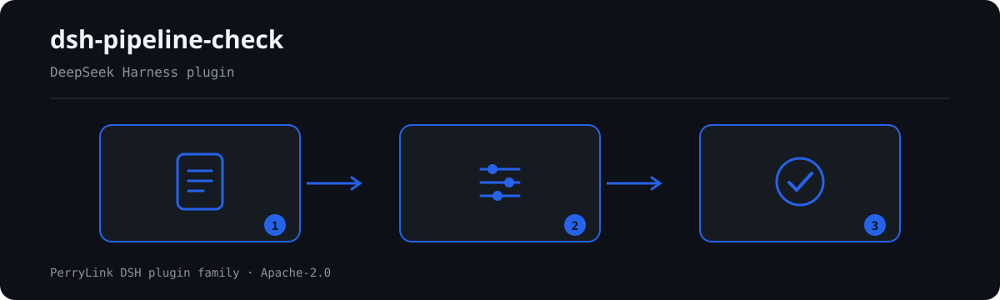

# dsh-pipeline-check — Project whole-process document chain register check

[English](README.md) · [简体中文](README-zh.md) · [Español](README-es.md) · [Português](README-pt.md) · [हिन्दी](README-hi.md)

[](https://dsh.market/)
[](https://dshfind.com/en/plugins/PerryLink/dsh-pipeline-check?ref=badge)

`dsh-pipeline-check` reads one project whole-process document chain register — the project header plus one row per stage document — and checks that register's own completeness and internal consistency: that the project is identified, that each row names its stage or its document, that the stages follow the sequence you declare, that approval and signing dates parse and follow each other, that document numbers are unique, that amounts parse as numbers, and that no template placeholder survives in a document name.

## Install

```sh
dsh plugin --profile <name> add dsh-pipeline-check
dsh --profile <name> --dump-config | grep 'dsh-pipeline-check'
```

## What it looks like



*Workflow overview: document → rule pack → findings. The examples below use the real command surface.*


## What it answers

### Examples

The table below is the example set: the first row is the detailed walkthrough, the remaining rows are short cases.

#### Detailed output

**Tool** `pipeline_check`

**Input**

~~~json
{"project":"某某技改项目","projectNo":"XM-2026-018","rows":[{"序号":"1","环节":"","文件名称":"","文件编号":"LX-2026-001"}]}
~~~
 
**Output**

~~~json
{
  "id": "dsh-pipeline-check.PC-002.de09b5a6",
  "ruleId": "PC-002",
  "severity": "warn",
  "locator": {
    "row": 1,
    "field": "stage"
  },
  "found": "第 1 行 stage、document 都为空",
  "expected": "stage、document 至少应填写一项",
  "fix": "补填环节名称与文件名称；本条只核对是否填写，不判断该环节是否应当办理"
}
~~~

*Observed from `dsh-pipeline-check/tests/fixtures/PC-002/PC-002-unsafe.json (cases.json expects 1×PC-002); executed parseMaterial+runCheck, checkedAt=2026-10-06T00:00:00.000Z`*

| You ask | What it answers |
|---|---|
| The stage-order rule reports `skipped` on a fresh install. Is something broken? | No. `PC-003` compares the register's stages against the `order` list in the rule pack, and that list ships empty, meaning unconfigured, so the rule reports itself in `skipped` instead of passing silently. Fill `order` with your institution's own sequence (the pack's example is 立项, 可行性研究, 初步设计, 概算, 招标, 合同, 开工, 变更, 结算, 决算) and it then checks only that the stages appearing in the register follow that order, a gap being allowed; it never judges whether skipping a stage was permissible, and its basis records that no citable clause exists, so it is capped at `info`. |
| The signing date in the register is earlier than the approval date — is that caught? | Yes. `PC-004` compares `signedAt` with `approvedAt`: both must parse as dates and the signing date must not fall before the approval date, the same day counting as not later. A date it cannot parse is reported on its own rather than passed over in silence. It compares those two dates only — it does not judge whether the signing exceeded authority or whether the approval itself was valid. |
| An amount is written as `1,200.50` or `1200万元`. Will it still be read? | Yes. `PC-006` accepts amounts carrying thousands separators or a unit and reports only an amount it cannot parse as a number. It checks parseability alone: whether the amount breaches the estimate, or whether it needed approval, is not something this rule decides. |
| A row carries neither a stage name nor a document name. | `PC-002` requires at least one of `stage` or `document` on every row and reports the row that has neither. It checks that at least one of them is filled; whether that stage should have been handled at all, and whether the documents for it are complete, are not judged. |
| The same document number appears on two rows. | `PC-005` reports a repeated `docNo`, ignoring whitespace when it compares, because a repeat defeats de-duplication and double-counts the amounts. It cannot tell a duplicate registration from two documents wrongly given one number, so a hit needs human confirmation. |
| The document name still reads `【待填】` or `TBD`. | `PC-007` reports any row whose `document` contains one of the pack's template terms — 【, 】, `{{`, `}}`, XXX, xxx, 待填, 待补充, TBD, todo, 示例 — because a register copied from a template makes an unhandled stage look settled. Only the listed terms are searched, and `terms` can be adjusted to your own template. |

## Standards it follows

| Document | Number | Cited by rules |
|---|---|---|
| 本机构项目管理办法与投资管理制度（无国家标准） | 无统一标准（本条依据为台账可追溯性） | PC-001 |
| 本机构项目管理办法与投资管理制度（无国家标准） | 无统一标准（本条依据为链条齐备性） | PC-002 |
| 本机构项目管理办法与投资管理制度（无国家标准） | 无统一标准（本条依据为本机构配置的环节顺序表） | PC-003 |
| 本机构项目管理办法与投资管理制度（无国家标准） | 无统一标准（本条依据为日期自洽） | PC-004 |
| 本机构项目管理办法与投资管理制度（无国家标准） | 无统一标准（本条依据为台账唯一性） | PC-005, PC-008 |
| 本机构项目管理办法与投资管理制度（无国家标准） | 无统一标准（本条依据为金额可比性） | PC-006 |
| 本机构项目管理办法与投资管理制度（无国家标准） | 无统一标准（本条依据为台账真实性） | PC-007 |

**Boundary:** this plugin checks a **项目全流程文件链条台账** for what a register can be held to — that the
project is identified, that each row names its stage or document, that the stages follow the sequence you
declare, that approval and signing dates parse and follow each other, that document numbers are unique, that
amounts parse, and that no template placeholder survives. It does **not** decide whether a project is
compliant, whether an approval exceeded authority, whether spending breached the estimate, or who is
accountable. **Those depend on the institution's investment rules and approval limits.**

> ### ⚠️ There is no national standard for this, and the pack does not pretend otherwise
>
> **Which stages a project passes through, and in what order, is set by each institution's project and
> investment rules** — and it differs sharply between industries (power, municipal, building, water) and
> between government-funded and enterprise-funded projects. **No unified national standard exists**, so this
> pack does not fabricate a standard number: every rule's `excerpt` states plainly that its basis is chain
> self-consistency or traceability and that **no citable clause exists**. A test asserts that every excerpt
> carries such an admission.
>
> **The plugin ships no stage list.** `PC-003`'s `stageOrder` ships **empty**, and with nothing configured it
> reports itself in `skipped` rather than inventing a stage sequence. Configure it like this:
>
> ```yaml
> order: [立项, 可行性研究, 初步设计, 概算, 招标, 合同, 开工, 变更, 结算, 决算]
> ```
>
> The check then verifies that the stages appearing in the register are **in** that order, skipping stages the
> project legitimately did not pass through; it never judges whether a skip was permissible.

## Compatibility

| Surface | Status |
|---|---|
| Harness | Peer range `>=0.1.2-rc.1 <0.2.0 \|\| >=0.2.0-0 <0.3.0` — verified to accept both `0.2.0-rc.2` and `0.2.1-rc.2`. `engines.dsh` is declared as `>=0.2.1-0 <0.3.0` and is enforced by the host since 0.2.1 |
| Node | `^22.19.0 || >=24.0.0` |
| Platforms | All (plain ESM; no native code, no network, no model call) |
| Tool mode | Works in `native` and `ptc`; for a portfolio of projects use `ptc` |

## What it does

Registers the `pipeline_check` tool. It reads one project-chain register — the project header plus one row per
stage document — applies a versioned rule pack, and returns a report.

| Rule | Check | Severity | Basis |
|---|---|---|---|
| `PC-001` | the register names its project and number | warn | traceability |
| `PC-002` | each row names its stage or document | warn | completeness |
| `PC-003` | stages follow your configured sequence (off by default) | info | local order table |
| `PC-004` | signing is not earlier than approval | warn | date consistency |
| `PC-005` | document numbers are unique | warn | register uniqueness |
| `PC-006` | amounts parse as numbers | warn | comparability |
| `PC-007` | document names hold no unreplaced placeholder | warn | register integrity |
| `PC-008` | stage numbers are unique | warn | register uniqueness |

## Configuration

| Key | Type | Default | Description |
|---|---|---|---|
| `rulesFile` | string | `rules/pipeline-check.yaml` | Rule-pack path, relative to the package root |
| `disabledRules` | string[] | `[]` | Rule ids to stop running; each appears in `skipped` |
| `onlyRules` | string[] | `[]` | Run only these rule ids; empty runs every rule |
| `skipNotes` | string | `""` | Note appended to every `skipped` reason |
| `timeoutMs` | number | `120000` | Cooperative tool timeout budget |

Rule-level parameters worth knowing:

- `PC-003` `order` — your stage sequence. Empty means the rule does not run. A stage written with a trailing
  note (`招标（二次）`) matches its base name.
- `PC-004` `field` / `notBeforeField` — the date pair to compare, defaults to signing against approval. Add a
  second rule for the effective date.
- `PC-007` `terms` — the placeholders to look for.

## Material format

The tool accepts JSON or YAML:

```yaml
project: 某某技改项目
projectNo: XM-2026-018
rows:
  - { 序号: '1', 环节: 立项, 文件名称: 项目立项批复, 文件编号: LX-2026-001,
      金额: 1200万元, 批复日期: 2026-01-10, 签署日期: 2026-01-15, 生效日期: 2026-01-16 }
```

Column names are matched case-insensitively and ignoring spaces, underscores and hyphens; the register's own
column names are kept, so a finding names the column it read. Amounts may carry thousands separators and
units (`1,200.50`, `1200万元`).

## Rule sources

Rule data lives in `rules/pipeline-check.yaml`. Because no national standard governs a project's stage chain,
the pack's `basis` entries say so explicitly instead of citing one. The load-time guard still requires every
rule to carry a document, a clause, an excerpt and a source, and still forbids a `derived-from-principle` or
locally configured check from being `error`.

## Troubleshooting

- **`PC-003` reports itself as skipped.** Its order table is empty. Which stages a project passes through is
  your institution's rule, and the plugin will not guess it.
- **`PC-003` fires on a stage name.** The name is not in your order table. Either correct the register or add
  the stage — the finding says which name it could not place.
- **`PC-006` fires on an amount I can read.** The reader accepts `1,200.50` and `1200万元`; a cell holding a
  range (`约 1200 万`) or a note is reported as unparseable on purpose.
- **`PC-005` fires twice on one document.** That can be legitimate for an amendment reusing a number. Say so
  in the remark rather than deleting a row.
- **The plugin installs but the tool never appears.** Check that `main` resolves to `lib/index.mjs` and
  that `pnpm run build` produced it; a wrong `main` makes the loader skip the entry silently.
- **`dsh plugin add` refuses the package as incompatible.** The peer range covers `0.1.x` and `0.2.x`; if
  your runtime sits outside it, grant an explicit exemption:
  `dsh plugin --profile <name> allow-version dsh-pipeline-check@0.1.0 --dsh-version <runtime> --accept-risk`
- **`check` reports `manifest-peers` as failed.** The static checker compares against a hard-coded peer
  range that predates the 0.2 line. The runtime enforces peer compatibility at install time, so the
  declared range is the correct one; this is a known upstream issue in `dsh-plugin-dev`.

## Development

```sh
pnpm install
pnpm run typecheck   # tsc --noEmit
pnpm test            # vitest, the shared table-plugin suite plus paired fixtures
pnpm run build       # tsdown -> lib/index.mjs + lib/index.d.mts
node ../scripts/sync-shared.mjs dsh-pipeline-check   # refresh src/shared from ../_shared
```

The plugin is **data-only**: `src/model.ts` declares the table shape, the shared kit supplies the reader and
the check engine, and the rule pack declares every check.

## PerryLink DSH Plugin Family

This project is part of the DeepSeek Harness plugin family from [PerryLink](https://github.com/PerryLink). The roster stays collapsed below so every README keeps a short first screen; expand it to see every row and its status.

<details>
<summary>Expand all plugins</summary>

| Plugin | Status |
|---|---|
| **[dsh-aqua-input-check](https://github.com/PerryLink/dsh-aqua-input-check)** |  |
| **[dsh-archive-check](https://github.com/PerryLink/dsh-archive-check)** |  |
| **[dsh-auto-review](https://github.com/PerryLink/dsh-auto-review)** |  |
| **[dsh-autotier](https://github.com/PerryLink/dsh-autotier)** |  |
| **[dsh-bid-ca-precheck](https://github.com/PerryLink/dsh-bid-ca-precheck)** |  |
| **[dsh-bid-qual-check](https://github.com/PerryLink/dsh-bid-qual-check)** |  |
| **[dsh-cert-mcp](https://github.com/PerryLink/dsh-cert-mcp)** |  |
| **[dsh-checkpoint-rewind](https://github.com/PerryLink/dsh-checkpoint-rewind)** |  |
| **[dsh-click](https://github.com/PerryLink/dsh-click)** |  |
| **[dsh-composer-history](https://github.com/PerryLink/dsh-composer-history)** |  |
| **[dsh-contract-stance](https://github.com/PerryLink/dsh-contract-stance)** |  |
| **[dsh-customs-doc-check](https://github.com/PerryLink/dsh-customs-doc-check)** |  |
| **[dsh-data-quality](https://github.com/PerryLink/dsh-data-quality)** |  |
| **[dsh-demurrage-ledger](https://github.com/PerryLink/dsh-demurrage-ledger)** |  |
| **[dsh-doublecheck](https://github.com/PerryLink/dsh-doublecheck)** |  |
| **[dsh-drill-script-check](https://github.com/PerryLink/dsh-drill-script-check)** |  |
| **[dsh-eia-guide-check](https://github.com/PerryLink/dsh-eia-guide-check)** |  |
| **[dsh-emergency-plan](https://github.com/PerryLink/dsh-emergency-plan)** |  |
| **[dsh-essay-rubric-check](https://github.com/PerryLink/dsh-essay-rubric-check)** |  |
| **[dsh-evidence-check](https://github.com/PerryLink/dsh-evidence-check)** |  |
| **[dsh-export-ctl-check](https://github.com/PerryLink/dsh-export-ctl-check)** |  |
| **[dsh-fast](https://github.com/PerryLink/dsh-fast)** |  |
| **[dsh-fmea-table-check](https://github.com/PerryLink/dsh-fmea-table-check)** |  |
| **[dsh-forecast-penalty](https://github.com/PerryLink/dsh-forecast-penalty)** |  |
| **[dsh-fund-research](https://github.com/PerryLink/dsh-fund-research)** |  |
| **[dsh-github](https://github.com/PerryLink/dsh-github)** |  |
| **[dsh-gongwen-flow-check](https://github.com/PerryLink/dsh-gongwen-flow-check)** |  |
| **[dsh-gongwen-word-check](https://github.com/PerryLink/dsh-gongwen-word-check)** |  |
| **[dsh-guard-plan-qc](https://github.com/PerryLink/dsh-guard-plan-qc)** |  |
| **[dsh-hazchem-check](https://github.com/PerryLink/dsh-hazchem-check)** |  |
| **[dsh-hazplan-check](https://github.com/PerryLink/dsh-hazplan-check)** |  |
| **[dsh-hidden-risk-map](https://github.com/PerryLink/dsh-hidden-risk-map)** |  |
| **[dsh-hs-classify](https://github.com/PerryLink/dsh-hs-classify)** |  |
| **[dsh-icd-rule-check](https://github.com/PerryLink/dsh-icd-rule-check)** |  |
| **[dsh-industry-research](https://github.com/PerryLink/dsh-industry-research)** |  |
| **[dsh-lawcite-adapter](https://github.com/PerryLink/dsh-lawcite-adapter)** |  |
| **[dsh-laya](https://github.com/PerryLink/dsh-laya)** |  |
| **[dsh-lc-doc-check](https://github.com/PerryLink/dsh-lc-doc-check)** |  |
| **[dsh-learning-gap-check](https://github.com/PerryLink/dsh-learning-gap-check)** |  |
| **[dsh-library](https://github.com/PerryLink/dsh-library)** |  |
| **[dsh-local-ai](https://github.com/PerryLink/dsh-local-ai)** |  |
| **[dsh-lsp-actions](https://github.com/PerryLink/dsh-lsp-actions)** |  |
| **[dsh-mask](https://github.com/PerryLink/dsh-mask)** |  |
| **[dsh-mcp-panel](https://github.com/PerryLink/dsh-mcp-panel)** |  |
| **[dsh-medrec-qc](https://github.com/PerryLink/dsh-medrec-qc)** |  |
| **[dsh-memento](https://github.com/PerryLink/dsh-memento)** |  |
| **[dsh-nsfc-form-check](https://github.com/PerryLink/dsh-nsfc-form-check)** |  |
| **[dsh-nurse-record-check](https://github.com/PerryLink/dsh-nurse-record-check)** |  |
| **[dsh-observe](https://github.com/PerryLink/dsh-observe)** |  |
| **[dsh-origin-rvc-check](https://github.com/PerryLink/dsh-origin-rvc-check)** |  |
| **[dsh-ota-review-check](https://github.com/PerryLink/dsh-ota-review-check)** |  |
| **[dsh-output-styles](https://github.com/PerryLink/dsh-output-styles)** |  |
| **[dsh-paper-doc-adapter](https://github.com/PerryLink/dsh-paper-doc-adapter)** |  |
| **[dsh-permission-rules](https://github.com/PerryLink/dsh-permission-rules)** |  |
| **[dsh-permit-report-check](https://github.com/PerryLink/dsh-permit-report-check)** |  |
| **[dsh-pipeline-check](https://github.com/PerryLink/dsh-pipeline-check)** |  |
| **[dsh-pleading-draft](https://github.com/PerryLink/dsh-pleading-draft)** |  |
| **[dsh-plugin-doctor](https://github.com/PerryLink/dsh-plugin-doctor)** |  |
| **[dsh-plugin-guide](https://github.com/PerryLink/dsh-plugin-guide)** |  |
| **[dsh-plugin-kit](https://github.com/PerryLink/dsh-plugin-kit)** |  |
| **[dsh-plugin-upgrade](https://github.com/PerryLink/dsh-plugin-upgrade)** |  |
| **[dsh-policy-brief-draft](https://github.com/PerryLink/dsh-policy-brief-draft)** |  |
| **[dsh-power-loss-split](https://github.com/PerryLink/dsh-power-loss-split)** |  |
| **[dsh-power-ticket-check](https://github.com/PerryLink/dsh-power-ticket-check)** |  |
| **[dsh-ppap-check](https://github.com/PerryLink/dsh-ppap-check)** |  |
| **[dsh-protest-deadline](https://github.com/PerryLink/dsh-protest-deadline)** |  |
| **[dsh-railway-window](https://github.com/PerryLink/dsh-railway-window)** |  |
| **[dsh-repair-order-qc](https://github.com/PerryLink/dsh-repair-order-qc)** |  |
| **[dsh-research-report](https://github.com/PerryLink/dsh-research-report)** |  |
| **[dsh-review-reply-check](https://github.com/PerryLink/dsh-review-reply-check)** |  |
| **[dsh-rulefile-check](https://github.com/PerryLink/dsh-rulefile-check)** |  |
| **[dsh-safety-brief-check](https://github.com/PerryLink/dsh-safety-brief-check)** |  |
| **[dsh-score](https://github.com/PerryLink/dsh-score)** |  |
| **[dsh-session-sync](https://github.com/PerryLink/dsh-session-sync)** |  |
| **[dsh-site-log-check](https://github.com/PerryLink/dsh-site-log-check)** |  |
| **[dsh-skill-pack-security](https://github.com/PerryLink/dsh-skill-pack-security)** |  |
| **[dsh-soe-decision-check](https://github.com/PerryLink/dsh-soe-decision-check)** |  |
| **[dsh-soilwater-check](https://github.com/PerryLink/dsh-soilwater-check)** |  |
| **[dsh-sop-sync-check](https://github.com/PerryLink/dsh-sop-sync-check)** |  |
| **[dsh-spc-gbt-adapter](https://github.com/PerryLink/dsh-spc-gbt-adapter)** |  |
| **[dsh-talk](https://github.com/PerryLink/dsh-talk)** |  |
| **[dsh-tender-extract](https://github.com/PerryLink/dsh-tender-extract)** |  |
| **[dsh-tender-matrix](https://github.com/PerryLink/dsh-tender-matrix)** |  |
| **[dsh-test-drive](https://github.com/PerryLink/dsh-test-drive)** |  |
| **[dsh-ticktick](https://github.com/PerryLink/dsh-ticktick)** |  |
| **[dsh-translate](https://github.com/PerryLink/dsh-translate)** |  |
| **[dsh-warranty-calc](https://github.com/PerryLink/dsh-warranty-calc)** |  |
| **[dsh-budget](https://github.com/PerryLink/dsh-budget)** | 🧊 FROZEN — see the repo README |
| **[dsh-claude-move](https://github.com/PerryLink/dsh-claude-move)** | 🧊 FROZEN — see the repo README |
| **[dsh-defend](https://github.com/PerryLink/dsh-defend)** | 🧊 FROZEN — see the repo README |
| **[dsh-draw](https://github.com/PerryLink/dsh-draw)** | 🧊 FROZEN — see the repo README |
| **[dsh-reach](https://github.com/PerryLink/dsh-reach)** | 🧊 FROZEN — see the repo README |
| **[dsh-background-agents](https://github.com/PerryLink/dsh-background-agents)** | 🚫 RETIRED — see the repo README |
| **[dsh-session-pin](https://github.com/PerryLink/dsh-session-pin)** | 🚫 RETIRED — see the repo README |
| **[dsh-team-rooms](https://github.com/PerryLink/dsh-team-rooms)** | 🚫 RETIRED — see the repo README |

</details>

## License

[Apache License 2.0](LICENSE) © 2026 dsh-pipeline-check contributors.
