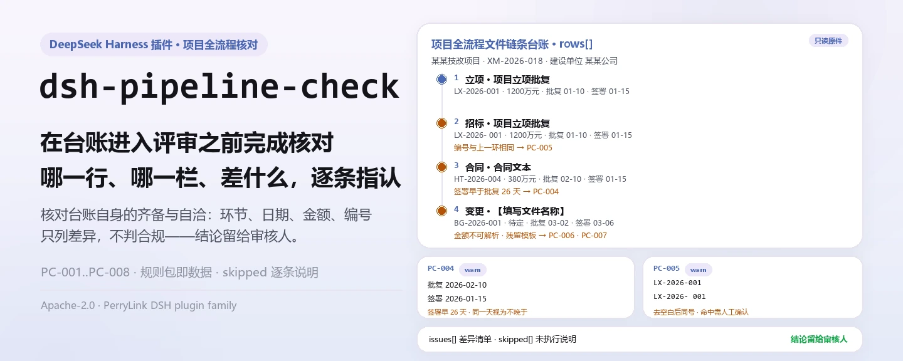
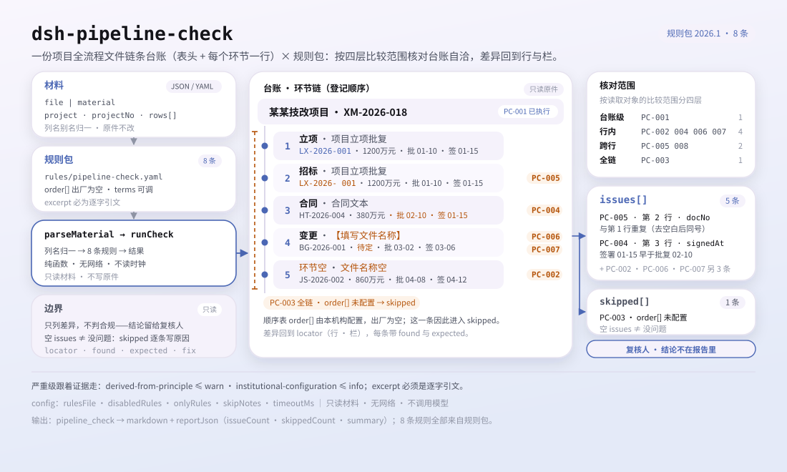

<div align="center">

<picture>
  <source media="(prefers-color-scheme: dark)" srcset="docs/assets/dsh-pipeline-check-hero-zh-dark.webp">
  
</picture>

# dsh-pipeline-check

**在项目台账进入评审之前完成核对——哪一行、哪一栏、差什么，逐条指认。**

面向 DeepSeek Harness 的项目全流程文件链条台账检查器：读入项目表头与逐环节文件行，按 8 条规则核对台账的齐备与自洽，只列差异，不判合规。

[安装](#三步上手) · [配置](#配置) · [FAQ](#faq) · [简体中文](README.md) · [English](README.en.md) · [Español](README.es.md) · [Português](README.pt.md) · [हिन्दी](README.hi.md)

[](LICENSE)
[](#兼容性)
[](https://www.npmjs.com/package/dsh-pipeline-check)
[](https://github.com/PerryLink/dsh-pipeline-check/actions/workflows/ci.yml)
[](#兼容性)

[](https://github.com/PerryLink/dsh-pipeline-check/stargazers)
[](https://www.npmjs.com/package/dsh-pipeline-check)
[](https://dshfind.com/plugins/PerryLink/dsh-pipeline-check?ref=badge)
[](https://securityscorecards.dev/viewer/?uri=github.com/PerryLink/dsh-pipeline-check)
[](https://dsh.market/)
[](https://gitee.com/perrylink/dsh-pipeline-check)

```sh
dsh plugin --profile <name> add dsh-pipeline-check
```

</div>

<sub>社区插件，与 DeepSeek 官方无关。唯一仓库：<https://github.com/PerryLink/dsh-pipeline-check>（Gitee 为镜像）。</sub>

## 它是什么

`dsh-pipeline-check` 读取一份项目全流程文件链条台账——项目表头加每个环节文件一行——核对这份台账自身的齐备与自洽：是否写明项目、每行是否填写环节或文件、环节是否按你配置的顺序出现、批复与签署日期是否可解析且先后成立、文件编号是否唯一、金额是否可解析为数值、文件名称栏是否残留模板占位符。

材料是 JSON 或 YAML；工具读取你传入的 `file` 或 `material`，原文件不会被修改。Excel 可先转成 JSON/YAML，对话里也能代转。

<picture>
  <source media="(prefers-color-scheme: dark)" srcset="docs/assets/dsh-pipeline-check-flow-v5-dark.svg">
  
</picture>

## 三步上手

1. **安装**（三选一）：

   ```sh
   # git 通道（最新 main）
   dsh plugin --profile <name> add github:PerryLink/dsh-pipeline-check
   # npm 通道（已发布版本）
   dsh plugin --profile <name> add dsh-pipeline-check
   # tarball 通道：本仓库 pnpm pack 后
   dsh plugin --profile <name> add ./dsh-pipeline-check-<version>.tgz
   ```

   从源码检出使用时先 `pnpm install`（`prepare` 会执行 `tsdown` 构建出 `lib/`）。

2. **最小配置**（默认可直接用；下面只跑三条规则，并给 `skipped` 加备注）：

   ```yaml
   - insert:
       - id: dsh-pipeline-check
         name: dsh-pipeline-check
         config:
           onlyRules: [PC-001, PC-002, PC-004]
           skipNotes: 本机构实施细则 2026 版
   ```

3. **验证已生效**：

   ```sh
   dsh --profile <name> --dump-config | grep 'dsh-pipeline-check'
   ```

   然后让模型调用一次 `pipeline_check` 工具，最小输入：

   ```json
   {"project":"某某技改项目","projectNo":"XM-2026-018","rows":[{"序号":"1","环节":"立项","文件名称":"项目立项批复","文件编号":"LX-2026-001"}]}
   ```

   报告里应有 `issueCount`、`summary` 与 `skippedCount`，逐条发现写在 `markdown` 与 `reportJson` 中。源码检出可直接跑自带样例（先构建）：`node samples/quickstart/run.mjs --check`，输入与期望输出在 `samples/quickstart/`。

**卸载**：`dsh plugin --profile <name> remove dsh-pipeline-check`。

<details>
<summary>材料格式（JSON / YAML）</summary>

工具接受 JSON 或 YAML：

```yaml
project: 某某技改项目
projectNo: XM-2026-018
rows:
  - { 序号: '1', 环节: 立项, 文件名称: 项目立项批复, 文件编号: LX-2026-001,
      金额: 1200万元, 批复日期: 2026-01-10, 签署日期: 2026-01-15, 生效日期: 2026-01-16 }
```

列名大小写不敏感，并忽略空格、下划线与连字符；台账自己的列名会被保留，因此每条发现都写明它读的是哪一栏。金额可带千分位与单位（`1,200.50`、`1200万元`）。表头与行都支持中英文别名（如 `project`/`项目名称`、`stage`/`环节`、`docNo`/`文件编号`）；读取层字段是可选的，缺失项会作为差异报出，而不是让程序崩溃。

</details>

## 核心能力

`dsh-pipeline-check` 把一份台账读成可逐条复核的差异清单：

- **台账级核对** —— 只读你给的台账，每条发现带 `locator`（行/栏）、`found`、`expected` 与 `fix`，定位到具体一行一栏。
- **8 条规则，规则包即数据** —— 全部检查声明在 `rules/pipeline-check.yaml`；替换 YAML 即可切换规则集版本，不需要改 TypeScript。
- **不静默通过** —— 未配置、被停用或无法执行的检查都会进入 `skipped` 并写明原因；空的问题列表不能读成「没有问题」。
- **只列差异** —— 不判合规、不认定责任、不替代审核人；结论留给有权限的人。
- **本地、无副作用** —— 不联网、不调用模型、不写材料文件；解析与检查都是本地纯函数。

| 规则 | 核对内容 | 级别 | 依据 |
|---|---|---|---|
| `PC-001` | 台账写明项目与项目编号 | warn | 可追溯性 |
| `PC-002` | 每行至少填写环节或文件之一 | warn | 齐备性 |
| `PC-003` | 环节按你配置的顺序出现（默认关闭） | info | 本机构顺序表 |
| `PC-004` | 签署日期不早于批复日期 | warn | 日期自洽 |
| `PC-005` | 同一环节的文件编号不重复 | warn | 台账唯一性 |
| `PC-006` | 金额可解析为数值 | warn | 可比性 |
| `PC-007` | 文件名称不残留模板占位符 | warn | 台账真实性 |
| `PC-008` | 环节序号不重复 | warn | 台账唯一性 |

### 一次真实运行

**工具** `pipeline_check`

**输入**

~~~json
{"project":"某某技改项目","projectNo":"XM-2026-018","rows":[{"序号":"1","环节":"","文件名称":"","文件编号":"LX-2026-001"}]}
~~~

**输出**

~~~json
{
  "id": "dsh-pipeline-check.PC-002.de09b5a6",
  "ruleId": "PC-002",
  "severity": "warn",
  "locator": {
    "row": 1,
    "field": "stage"
  },
  "found": "第 1 行 stage、document 都为空",
  "expected": "stage、document 至少应填写一项",
  "fix": "补填环节名称与文件名称；本条只核对是否填写，不判断该环节是否应当办理"
}
~~~

*Observed from `dsh-pipeline-check/tests/fixtures/PC-002/PC-002-unsafe.json (cases.json expects 1×PC-002); executed parseMaterial+runCheck, checkedAt=2026-10-06T00:00:00.000Z`*

### 六个常见问与答

| 你会问 | 它怎么答 |
|---|---|
| 新装上台账后，环节顺序那条规则报的是 `skipped`，是坏了吗？ | 不是。`PC-003` 拿台账里的环节与规则库的 `order` 清单比对，而这份清单出厂为空、即未配置，因此本条报告自己进入 `skipped`，而不是静默通过。把本单位的环节顺序填进 `order`（规则库的示例是 立项、可行性研究、初步设计、概算、招标、合同、开工、变更、结算、决算），它就只核对台账里出现的环节是否按这个顺序出现、允许中间跳过；跳过是否合规它不判断，其依据也写明没有可引条文，故封顶 `info`。 |
| 台账里的签署日期早于批复日期，能查出来吗？ | 能。`PC-004` 比较 `signedAt` 与 `approvedAt`：两个日期都要能解析，且签署日期不得早于批复日期，同一天视为不晚于。解析不了的日期会单独报出，不会静默跳过。它只比较这两个日期，不判断签署是否越权、批复是否有效。 |
| 金额写成 `1,200.50` 或 `1200万元`，还读得出来吗？ | 读得出来。`PC-006` 接受带千分位或带单位的写法，只有解析不成数值的金额才报出。它只核对可解析性：金额是否超过概算、是否应当审批，本条不作判断。 |
| 某一行既没填环节名称，也没填文件名称。 | `PC-002` 要求每行至少填写 `stage` 与 `document` 中的一项，两项都没有就报出该行。它只核对是否至少填了一项；该环节是否应当办理、该环节的文件是否齐全，它不作判断。 |
| 同一个文件编号在两行里各出现一次。 | `PC-005` 会报出重复的 `docNo`，比较时忽略空白字符；重复既妨碍去重，也让金额累计被重复计算。它分不清是重复登记还是两份文件被错编成同一号，命中需人工确认。 |
| 文件名称栏还写着 `【待填】` 或 `TBD`。 | `PC-007` 会报出 `document` 含有规则库所列模板词的行：【、】、`{{`、`}}`、XXX、xxx、待填、待补充、TBD、todo、示例；照抄模板的台账会让没办的环节看起来已经办结。它只检索所列的词，`terms` 可按本单位模板调整。 |

## 依据的标准

| 文件 | 文号 | 引用它的规则 |
|---|---|---|
| 本机构项目管理办法与投资管理制度（无国家标准） | 无统一标准（本条依据为台账可追溯性） | PC-001 |
| 本机构项目管理办法与投资管理制度（无国家标准） | 无统一标准（本条依据为链条齐备性） | PC-002 |
| 本机构项目管理办法与投资管理制度（无国家标准） | 无统一标准（本条依据为本机构配置的环节顺序表） | PC-003 |
| 本机构项目管理办法与投资管理制度（无国家标准） | 无统一标准（本条依据为日期自洽） | PC-004 |
| 本机构项目管理办法与投资管理制度（无国家标准） | 无统一标准（本条依据为台账唯一性） | PC-005, PC-008 |
| 本机构项目管理办法与投资管理制度（无国家标准） | 无统一标准（本条依据为金额可比性） | PC-006 |
| 本机构项目管理办法与投资管理制度（无国家标准） | 无统一标准（本条依据为台账真实性） | PC-007 |

**边界：** 本插件核对一份 **项目全流程文件链条台账** 在台账层面可以要求到的内容——是否写明项目，每行是否填写环节或文件，环节是否按你声明的顺序出现，批复与签署日期是否可解析且先后成立，文件编号是否唯一，金额是否可解析，以及是否残留模板占位符。它**不**判定项目是否合规、批复是否越权、支出是否超出概算，或应由谁负责。**这些取决于本机构的投资制度与审批权限。**

> ### ⚠️ 此事没有国家标准，本规则库也不假装有
>
> **项目经过哪些环节、顺序如何，由各机构的项目与投资制度设定**——而且行业之间（电力、市政、建筑、水利）、政府投资项目与企业投资项目之间差异很大。**并不存在统一的国家标准**，因此本规则库不会伪造一个标准号：每条规则的 `excerpt` 都明确写出，其依据是链条自洽或可追溯性，并且**不存在可引用的条款**。有一项测试断言每条 excerpt 都带有这类声明。
>
> **本插件不附带环节清单。** `PC-003` 的 `order` 出厂为**空**，在未配置任何内容时，它会把自己记入 `skipped`，而不是编造一个环节顺序。配置方式如下：
>

```yaml
order: [立项, 可行性研究, 初步设计, 概算, 招标, 合同, 开工, 变更, 结算, 决算]
```

> 此后的核对会确认台账中出现的环节是否**按**该顺序出现，并跳过项目确实没有经过的环节；它从不判断跳过是否被允许。

**规则数据与代码分离。** 规则数据在 `rules/pipeline-check.yaml`；因为项目环节链条没有统一国家标准，规则库的 `basis` 明确写出这一点，而不是引用一个标准号。加载期仍强制每条规则带 document、number、clause、excerpt 与 source（摘录少于八个字符即加载期失败），并禁止把 `derived-from-principle` 或本机构配置的检查标为 `error`。逐条核验记录在 `rules/evidence/`。

## 配置

全部可调参数都在 `src/config.ts` 的 Schemastery schema 中，只改 `cordis.yml` 即可生效，无需改代码；逐条阈值在 `rules/` 下的规则库文件里。

| 键 | 类型 | 默认值 | 说明 |
|---|---|---|---|
| `rulesFile` | string | `rules/pipeline-check.yaml` | 规则库文件路径，相对插件包根目录 |
| `disabledRules` | string[] | `[]` | 要停用的规则 id 列表；每条都会出现在 `skipped` 中 |
| `onlyRules` | string[] | `[]` | 只执行这些规则 id；留空表示执行全部规则 |
| `skipNotes` | string | `""` | 附加到每条 `skipped` 说明后的备注 |
| `timeoutMs` | number | `120000` | 工具协作式超时预算（毫秒） |

规则级参数：

- `PC-003` `order` —— 你的环节顺序。为空表示本条不运行；带尾注的环节名（如 `招标（二次）`）按基名匹配。
- `PC-004` `field` / `notBeforeField` —— 要比较的日期对，默认比较签署与批复；再加一条规则可核对生效日期。
- `PC-007` `terms` —— 要检索的占位符词表。

profile patch 覆盖示例：

```yaml
- insert:
    - id: dsh-pipeline-check
      name: dsh-pipeline-check
      config:
        rulesFile: rules/pipeline-check.yaml
        onlyRules: [PC-002, PC-004, PC-006]
        timeoutMs: 60000
```

## FAQ

<details>
<summary>材料会被上传或联网吗？</summary>

不会。`dsh-pipeline-check` 是本地检查器：只读取传给工具的材料（`file` 或 `material`），不上传；不发起网络请求，不带遥测、分析或后台回传；除工具结果与 DSH 宿主自己的会话/日志存储外不写任何数据。宿主控制那份存储及其保留策略，本包不另存副本。

</details>

<details>
<summary>问题列表为空，是不是就代表没问题？</summary>

不能这么读。无法执行的检查会逐条进入 `skipped` 并写明原因——例如 `PC-003` 的 `order` 出厂为空，它就把自己记进 `skipped`，而不是静默通过。空的问题列表只说明已执行的那些规则没有发现差异；先看 `skippedCount` 与 `skipped`，再读 `issueCount`。

</details>

<details>
<summary>会不会和其他插件抢工具名、服务或 slot？</summary>

不会。它只注册一个 `pipeline_check` 工具，不提供服务键，不注册客户端 slot，不注册 `webServer` 前缀，不监听共享事件，也不修改全局对象。工具注册是 Cordis effect，停止或热重载即撤销。

</details>

<details>
<summary>性能开销多大？会超时吗？</summary>

解析与检查都在本地完成，无网络请求、无模型调用；工具带 `timeoutMs`（默认 120000 毫秒）的协作式预算，`PC-003` 的比对是一次线性扫描。开销随台账行数增长，与模型无关。

</details>

<details>
<summary>能替代审核人吗？</summary>

不能。它只列出台账内部能逐条指认的差异，不判合规、不认定责任、不判断批复是否越权或支出是否超概算；这些取决于本机构的投资制度、审批权限与行业规定，是投资管理与审计部门的判断。

</details>

## 安全边界

- **只读材料，不改原件。** 工具读取你传入的 `file` 或 `material`；台账原文件不会被写回、移动或删除。
- **不联网、不调用模型、无遥测。** 没有网络请求，没有分析或后台回传；除工具结果与宿主自己的会话/日志存储外不写数据。
- **不作出定性结论。** 报告只列差异，不判定项目合规、批复越权、支出超概算或责任归属；渲染层有措辞守卫，报告始终带免责声明。
- **不伪造依据。** 规则包加载期逐条校验：每条规则必须带 document、number、clause、excerpt 与 source；摘录必须是逐字引文。没有可引条文时明确写出，而不是编一个标准号；`derived-from-principle` 封顶 `warn`，`institutional-configuration` 封顶 `info`。
- **不静默通过。** 未配置、被停用或无法执行的检查进入 `skipped` 并写明理由；空的问题列表不能被读成「没有问题」。
- **规则包是数据。** 替换 `rules/*.yaml` 即可切换规则集版本，无需改代码；规则包在加载期被校验，而不是被信任。

## 已知限制

- **台账自洽 ≠ 事实核对。** 本插件只读台账本身，不打开台账指向的文件，不验证文件是否真实存在、是否盖章签字，也不核对文件内容与台账是否一致。
- **没有统一的国家标准。** 项目应经过哪些环节、顺序如何，由各机构制度与行业规定决定；本插件不附带环节清单，也不替使用方规定流程。
- **`PC-003` 出厂不配置环节顺序。** `order` 为空时本条进入 `skipped`；填入本机构顺序后才开始比对，且只核对台账中出现的环节先后，不判断跳过是否合规。
- **日期是对输入字符串做墙上时钟运算。** 不做时区换算；解析不了的日期会单独报出，不会静默跳过，也不会据此推断签署或批复是否有效。
- **金额只核对可解析性。** `1,200.50`、`1200万元` 这类写法可读；区间（`约 1200 万`）或带说明的单元格会按不可解析报出，这是刻意行为，不判断金额是否超概算或是否应审批。
- **重复编号需要人工确认。** 同一编号出现在两行，可能是重复登记，也可能是补充协议沿用了原编号；`PC-005` 只报出重复，不替人判断哪一种。
- **材料格式有限。** 只接受 JSON 或 YAML；Excel 需先转换。读取层字段是可选的，部分导出会产出「缺项」类差异，而不是让程序崩溃。
- **只覆盖 8 条规则。** 规则集可以替换，但默认只核对台账层面的齐备、顺序、日期、编号、金额与模板占位符，不覆盖实体文件的真实性、审批权限与合规性。

### 常见排查

- **插件装上了但工具不出现**：确认 `main` 指向 `lib/index.mjs` 且 `pnpm run build` 已生成该文件；`main` 写错会让加载器静默跳过该条目。
- **`dsh plugin add` 报版本不兼容**：peer 范围覆盖 `0.1.x` 与 `0.2.x`；若运行时在其之外，可显式豁免：`dsh plugin --profile <name> allow-version dsh-pipeline-check@0.1.0 --dsh-version <runtime> --accept-risk`。
- **`check` 报 `manifest-peers` 失败**：静态检查器比对的是一份早于 0.2 世代的硬编码 peer 范围；安装期的 peer 校验以运行时为准。这是 `dsh-plugin-dev` 的已知上游问题。
- **某条规则没有执行**：查看 `skipped` 数组，其中写明了规则 id 与原因。
- **`PC-003` 对某个环节报错**：该名称不在你的顺序表里；改正台账或把该环节加进 `order`，发现里会写明它无法归位的名称。

## 兼容性

| 维度 | 状态 |
|---|---|
| Harness | Peer 范围 `>=0.1.2-rc.1 <0.2.0 \|\| >=0.2.0-0 <0.3.0` —— 已实测同时接受 `0.2.0-rc.2` 与 `0.2.1-rc.2`。`engines.dsh` 声明为 `>=0.2.1-0 <0.3.0`，0.2.1 起由宿主单独裁决 |
| Node | `^22.19.0 \|\| >=24.0.0` |
| 平台 | 全平台（纯 ESM；无原生代码、无联网、不调用模型） |
| 工具模式 | `native` / `ptc` 均可；批量校验整个目录时建议 `ptc`，schema 成本只付一次 |

## 生态与质量

- [Gitee 镜像](https://gitee.com/perrylink/dsh-pipeline-check)（同步镜像，以 GitHub 为准）
- [dshfind 插件页](https://dshfind.com/plugins/PerryLink/dsh-pipeline-check)（安装量与排名）
- [OpenSSF Scorecard 报告](https://securityscorecards.dev/viewer/?uri=github.com/PerryLink/dsh-pipeline-check)（由 [.github/workflows/scorecard.yml](.github/workflows/scorecard.yml) 驱动）
- [DSH Market](https://dsh.market/)（已上架）
- [生态知识库](https://perrylink.github.io/zh/checkers/choose/)：按材料选核查器 · 选型实测数据 · 维护取舍判据

## 开发

```sh
pnpm install                                   # node ^22.19 || >=24
pnpm run typecheck                             # tsc --noEmit
pnpm test                                      # vitest：共享表插件套件 + 成对夹具
pnpm run build                                 # tsdown -> lib/index.mjs + lib/index.d.mts
pnpm run verify:self-contained                 # 依赖 spec 均来自 registry
pnpm run check:lockfile                        # lockfile 漂移检查
pnpm run check:readmes                         # README 一致性门禁
pnpm run check:citations                       # 引文与核验记录对照
node ../scripts/sync-shared.mjs dsh-pipeline-check   # 从 ../_shared 刷新 src/shared
node samples/quickstart/run.mjs --check        # 自带样例（先 build）
```

`sync-shared` 把 `../_shared` 的共享件同步进 `src/shared/`；每次改动共享件后都要重跑。

目录布局：

| 路径 | 作用 |
|---|---|
| `src/index.ts` | 函数插件契约：注册 `pipeline_check` 工具，解析规则包路径 |
| `src/config.ts` | Schemastery schema；全部可调项都在这里 |
| `src/model.ts` | 表形状与材料契约；列别名、必填项与解析入口 |
| `src/view.ts` | 报告对模型的投影；`output.schema` 与之对应 |
| `src/shared/` | 共享件（规则加载、报告形状、YAML 子集、日历算术、措辞守卫、表助手），随包自包含 |
| `rules/pipeline-check.yaml` | 规则包，8 条规则 |
| `rules/evidence/` | 每条引文的核验记录 |
| `tests/` | vitest；每条规则一对合规/违规夹具 |

自带样例的运行结果可对照 `samples/quickstart/expected/result.json`，截图见 [`docs/assets/quickstart.png`](docs/assets/quickstart.png)。配图由 [`scripts/gen-readme-assets.py`](scripts/gen-readme-assets.py) 程序化生成——hero 横幅用 Pillow 绘制、结构图用手写 SVG 绘制——可重复执行；README 只引用 hero（中英双版、深浅各一）与 flow-v5 结构图（深浅两版，五语共用），旧的单版流程图与演示图保留在 `docs/assets/` 供外链使用。

## 家族与致谢

本项目是 [PerryLink](https://github.com/PerryLink) 维护的 DeepSeek Harness 插件家族成员（全部 Apache-2.0）。如果这个插件帮到了你，**给个 star**——它不解锁任何功能，但会让下一个人更容易找到它。

- [@PerryLink](https://github.com/PerryLink) —— 创建者与维护者：8 条 `PC-*` 规则与规则包、`pipeline_check` 工具、五语文档与配图流水线。

<details>
<summary>展开全部插件</summary>

| 插件 | 状态 |
|---|---|
| **[dsh-aqua-input-check](https://github.com/PerryLink/dsh-aqua-input-check)** |  |
| **[dsh-archive-check](https://github.com/PerryLink/dsh-archive-check)** |  |
| **[dsh-auto-review](https://github.com/PerryLink/dsh-auto-review)** |  |
| **[dsh-autotier](https://github.com/PerryLink/dsh-autotier)** | 🧊 已冻结 — 见仓库 README |
| **[dsh-bid-ca-precheck](https://github.com/PerryLink/dsh-bid-ca-precheck)** |  |
| **[dsh-bid-qual-check](https://github.com/PerryLink/dsh-bid-qual-check)** |  |
| **[dsh-cert-mcp](https://github.com/PerryLink/dsh-cert-mcp)** | 🧊 已冻结 — 见仓库 README |
| **[dsh-checkpoint-rewind](https://github.com/PerryLink/dsh-checkpoint-rewind)** |  |
| **[dsh-click](https://github.com/PerryLink/dsh-click)** |  |
| **[dsh-composer-history](https://github.com/PerryLink/dsh-composer-history)** |  |
| **[dsh-contract-stance](https://github.com/PerryLink/dsh-contract-stance)** |  |
| **[dsh-customs-doc-check](https://github.com/PerryLink/dsh-customs-doc-check)** |  |
| **[dsh-data-quality](https://github.com/PerryLink/dsh-data-quality)** | 🧊 已冻结 — 见仓库 README |
| **[dsh-demurrage-ledger](https://github.com/PerryLink/dsh-demurrage-ledger)** |  |
| **[dsh-doublecheck](https://github.com/PerryLink/dsh-doublecheck)** |  |
| **[dsh-drill-script-check](https://github.com/PerryLink/dsh-drill-script-check)** |  |
| **[dsh-eia-guide-check](https://github.com/PerryLink/dsh-eia-guide-check)** |  |
| **[dsh-emergency-plan](https://github.com/PerryLink/dsh-emergency-plan)** |  |
| **[dsh-essay-rubric-check](https://github.com/PerryLink/dsh-essay-rubric-check)** |  |
| **[dsh-evidence-check](https://github.com/PerryLink/dsh-evidence-check)** |  |
| **[dsh-export-ctl-check](https://github.com/PerryLink/dsh-export-ctl-check)** |  |
| **[dsh-fast](https://github.com/PerryLink/dsh-fast)** |  |
| **[dsh-fmea-table-check](https://github.com/PerryLink/dsh-fmea-table-check)** |  |
| **[dsh-forecast-penalty](https://github.com/PerryLink/dsh-forecast-penalty)** |  |
| **[dsh-fund-research](https://github.com/PerryLink/dsh-fund-research)** |  |
| **[dsh-github](https://github.com/PerryLink/dsh-github)** |  |
| **[dsh-gongwen-flow-check](https://github.com/PerryLink/dsh-gongwen-flow-check)** |  |
| **[dsh-gongwen-word-check](https://github.com/PerryLink/dsh-gongwen-word-check)** |  |
| **[dsh-guard-plan-qc](https://github.com/PerryLink/dsh-guard-plan-qc)** |  |
| **[dsh-hazchem-check](https://github.com/PerryLink/dsh-hazchem-check)** |  |
| **[dsh-hazplan-check](https://github.com/PerryLink/dsh-hazplan-check)** |  |
| **[dsh-hidden-risk-map](https://github.com/PerryLink/dsh-hidden-risk-map)** |  |
| **[dsh-hs-classify](https://github.com/PerryLink/dsh-hs-classify)** |  |
| **[dsh-icd-rule-check](https://github.com/PerryLink/dsh-icd-rule-check)** |  |
| **[dsh-industry-research](https://github.com/PerryLink/dsh-industry-research)** |  |
| **[dsh-lawcite-adapter](https://github.com/PerryLink/dsh-lawcite-adapter)** |  |
| **[dsh-laya](https://github.com/PerryLink/dsh-laya)** |  |
| **[dsh-lc-doc-check](https://github.com/PerryLink/dsh-lc-doc-check)** |  |
| **[dsh-learning-gap-check](https://github.com/PerryLink/dsh-learning-gap-check)** |  |
| **[dsh-library](https://github.com/PerryLink/dsh-library)** |  |
| **[dsh-local-ai](https://github.com/PerryLink/dsh-local-ai)** |  |
| **[dsh-lsp-actions](https://github.com/PerryLink/dsh-lsp-actions)** |  |
| **[dsh-mask](https://github.com/PerryLink/dsh-mask)** |  |
| **[dsh-mcp-panel](https://github.com/PerryLink/dsh-mcp-panel)** |  |
| **[dsh-medrec-qc](https://github.com/PerryLink/dsh-medrec-qc)** |  |
| **[dsh-memento](https://github.com/PerryLink/dsh-memento)** | 🧊 已冻结 — 见仓库 README |
| **[dsh-nsfc-form-check](https://github.com/PerryLink/dsh-nsfc-form-check)** |  |
| **[dsh-nurse-record-check](https://github.com/PerryLink/dsh-nurse-record-check)** |  |
| **[dsh-observe](https://github.com/PerryLink/dsh-observe)** |  |
| **[dsh-origin-rvc-check](https://github.com/PerryLink/dsh-origin-rvc-check)** |  |
| **[dsh-ota-review-check](https://github.com/PerryLink/dsh-ota-review-check)** |  |
| **[dsh-output-styles](https://github.com/PerryLink/dsh-output-styles)** |  |
| **[dsh-paper-doc-adapter](https://github.com/PerryLink/dsh-paper-doc-adapter)** |  |
| **[dsh-permission-rules](https://github.com/PerryLink/dsh-permission-rules)** |  |
| **[dsh-permit-report-check](https://github.com/PerryLink/dsh-permit-report-check)** |  |
| **[dsh-pipeline-check](https://github.com/PerryLink/dsh-pipeline-check)** |  |
| **[dsh-pleading-draft](https://github.com/PerryLink/dsh-pleading-draft)** |  |
| **[dsh-plugin-doctor](https://github.com/PerryLink/dsh-plugin-doctor)** | 🚫 已退役（仓库已归档） |
| **[dsh-plugin-guide](https://github.com/PerryLink/dsh-plugin-guide)** |  |
| **[dsh-plugin-kit](https://github.com/PerryLink/dsh-plugin-kit)** | 🚫 已退役（仓库已归档） |
| **[dsh-plugin-upgrade](https://github.com/PerryLink/dsh-plugin-upgrade)** | 🚫 已退役（仓库已归档） |
| **[dsh-policy-brief-draft](https://github.com/PerryLink/dsh-policy-brief-draft)** |  |
| **[dsh-power-loss-split](https://github.com/PerryLink/dsh-power-loss-split)** |  |
| **[dsh-power-ticket-check](https://github.com/PerryLink/dsh-power-ticket-check)** |  |
| **[dsh-ppap-check](https://github.com/PerryLink/dsh-ppap-check)** |  |
| **[dsh-protest-deadline](https://github.com/PerryLink/dsh-protest-deadline)** |  |
| **[dsh-railway-window](https://github.com/PerryLink/dsh-railway-window)** |  |
| **[dsh-repair-order-qc](https://github.com/PerryLink/dsh-repair-order-qc)** |  |
| **[dsh-research-report](https://github.com/PerryLink/dsh-research-report)** |  |
| **[dsh-review-reply-check](https://github.com/PerryLink/dsh-review-reply-check)** |  |
| **[dsh-rulefile-check](https://github.com/PerryLink/dsh-rulefile-check)** |  |
| **[dsh-safety-brief-check](https://github.com/PerryLink/dsh-safety-brief-check)** |  |
| **[dsh-score](https://github.com/PerryLink/dsh-score)** | 🧊 已冻结 — 见仓库 README |
| **[dsh-session-sync](https://github.com/PerryLink/dsh-session-sync)** |  |
| **[dsh-site-log-check](https://github.com/PerryLink/dsh-site-log-check)** |  |
| **[dsh-skill-pack-security](https://github.com/PerryLink/dsh-skill-pack-security)** |  |
| **[dsh-soe-decision-check](https://github.com/PerryLink/dsh-soe-decision-check)** |  |
| **[dsh-soilwater-check](https://github.com/PerryLink/dsh-soilwater-check)** |  |
| **[dsh-sop-sync-check](https://github.com/PerryLink/dsh-sop-sync-check)** |  |
| **[dsh-spc-gbt-adapter](https://github.com/PerryLink/dsh-spc-gbt-adapter)** |  |
| **[dsh-talk](https://github.com/PerryLink/dsh-talk)** |  |
| **[dsh-tender-extract](https://github.com/PerryLink/dsh-tender-extract)** |  |
| **[dsh-tender-matrix](https://github.com/PerryLink/dsh-tender-matrix)** |  |
| **[dsh-test-drive](https://github.com/PerryLink/dsh-test-drive)** |  |
| **[dsh-ticktick](https://github.com/PerryLink/dsh-ticktick)** | 🚫 已退役（仓库已归档） |
| **[dsh-translate](https://github.com/PerryLink/dsh-translate)** |  |
| **[dsh-warranty-calc](https://github.com/PerryLink/dsh-warranty-calc)** |  |
| **[dsh-budget](https://github.com/PerryLink/dsh-budget)** | 🧊 已冻结 — 见仓库 README |
| **[dsh-claude-move](https://github.com/PerryLink/dsh-claude-move)** | 🧊 已冻结 — 见仓库 README |
| **[dsh-defend](https://github.com/PerryLink/dsh-defend)** | 🧊 已冻结 — 见仓库 README |
| **[dsh-draw](https://github.com/PerryLink/dsh-draw)** | 🧊 已冻结 — 见仓库 README |
| **[dsh-reach](https://github.com/PerryLink/dsh-reach)** | 🧊 已冻结 — 见仓库 README |
| **[dsh-background-agents](https://github.com/PerryLink/dsh-background-agents)** | 🚫 已退役（仓库已归档） |
| **[dsh-session-pin](https://github.com/PerryLink/dsh-session-pin)** | 🚫 已退役（仓库已归档） |
| **[dsh-team-rooms](https://github.com/PerryLink/dsh-team-rooms)** | 🚫 已退役（仓库已归档） |

</details>

## License

[LICENSE](LICENSE)（Apache License 2.0）© 2026 dsh-pipeline-check contributors

<p align="center"><sub>Apache-2.0 · 社区插件，与 DeepSeek 无关。</sub></p>
