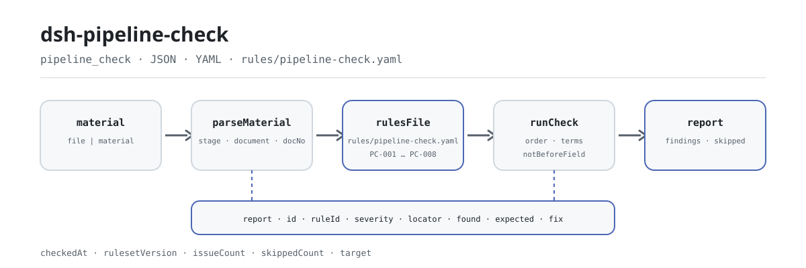

<div align="center">

<picture>
  <source media="(prefers-color-scheme: dark)" srcset="docs/assets/dsh-pipeline-check-flow-dark.svg">
  
</picture>

# dsh-pipeline-check

**Saiba exatamente o que falta no registo — antes de a revisão começar, linha por linha e coluna por coluna.**

Um verificador do registo da cadeia documental de todo o processo de um projeto para o DeepSeek Harness: lê o cabeçalho do projeto mais uma linha por documento de etapa, aplica oito regras ao nível do registo e devolve apenas diferenças, nunca um veredicto de conformidade.

[Instalar](#instalação-em-três-passos) · [Configuração](#configuração) · [FAQ](#faq) · [简体中文](README.md) · [English](README.en.md) · [Español](README.es.md) · [Português](README.pt.md) · [हिन्दी](README.hi.md)

[](LICENSE)
[](#compatibilidade)
[](https://www.npmjs.com/package/dsh-pipeline-check)
[](https://github.com/PerryLink/dsh-pipeline-check/actions/workflows/ci.yml)
[](#compatibilidade)

[](https://github.com/PerryLink/dsh-pipeline-check/stargazers)
[](https://www.npmjs.com/package/dsh-pipeline-check)
[](https://dshfind.com/plugins/PerryLink/dsh-pipeline-check?ref=badge)
[](https://securityscorecards.dev/viewer/?uri=github.com/PerryLink/dsh-pipeline-check)
[](https://dsh.market/)
[](https://gitee.com/perrylink/dsh-pipeline-check)

```sh
dsh plugin --profile <name> add dsh-pipeline-check
```

</div>

<sub>Plugin da comunidade, sem afiliação com a DeepSeek. Repositório canónico: <https://github.com/PerryLink/dsh-pipeline-check> (o Gitee é um espelho).</sub>

## O que é

O `dsh-pipeline-check` lê um registo da cadeia documental de todo o processo de um projeto — o cabeçalho do projeto mais uma linha por documento de etapa — e verifica a completude e a coerência interna desse registo: se o projeto está identificado, se cada linha nomeia a sua etapa ou o seu documento, se as etapas seguem a sequência que declara, se as datas de aprovação e de assinatura são analisáveis e respeitam a ordem, se os números de documento são únicos, se os montantes são analisáveis como números e se não resta nenhum marcador de modelo no nome de um documento.

O material é JSON ou YAML. A ferramenta lê o `file` ou o `material` que passa e nunca modifica o original; o Excel deve ser convertido antes para JSON/YAML, o que também pode acontecer no chat.

## Instalação em três passos

1. **Instale** (escolha um canal):

   ```sh
   # canal git (último main)
   dsh plugin --profile <name> add github:PerryLink/dsh-pipeline-check
   # canal npm (versões publicadas)
   dsh plugin --profile <name> add dsh-pipeline-check
   # canal tarball: pnpm pack neste repo e depois
   dsh plugin --profile <name> add ./dsh-pipeline-check-<version>.tgz
   ```

   A partir de um checkout de código-fonte, execute primeiro `pnpm install` (o `prepare` executa a compilação `tsdown` que produz `lib/`).

2. **Configuração mínima** (os padrões já funcionam; este exemplo executa três regras e acrescenta uma nota a cada motivo `skipped`):

   ```yaml
   - insert:
       - id: dsh-pipeline-check
         name: dsh-pipeline-check
         config:
           onlyRules: [PC-001, PC-002, PC-004]
           skipNotes: regulamento interno 2026
   ```

3. **Verifique que está ativo**:

   ```sh
   dsh --profile <name> --dump-config | grep 'dsh-pipeline-check'
   ```

   Depois peça ao modelo para chamar uma vez a ferramenta `pipeline_check` com uma entrada mínima:

   ```json
   {"project":"某某技改项目","projectNo":"XM-2026-018","rows":[{"序号":"1","环节":"立项","文件名称":"项目立项批复","文件编号":"LX-2026-001"}]}
   ```

   O relatório traz `issueCount`, `summary` e `skippedCount`; os achados individuais são renderizados em `markdown` e `reportJson`. Um checkout de código-fonte pode executar o exemplo incluído diretamente (compile antes): `node samples/quickstart/run.mjs --check`; a entrada e a saída esperada estão em `samples/quickstart/`.

**Desinstalar**: `dsh plugin --profile <name> remove dsh-pipeline-check`.

<details>
<summary>Formato do material (JSON / YAML)</summary>

A ferramenta aceita JSON ou YAML:

```yaml
project: 某某技改项目
projectNo: XM-2026-018
rows:
  - { 序号: '1', 环节: 立项, 文件名称: 项目立项批复, 文件编号: LX-2026-001,
      金额: 1200万元, 批复日期: 2026-01-10, 签署日期: 2026-01-15, 生效日期: 2026-01-16 }
```

Os nomes das colunas são comparados sem distinguir maiúsculas de minúsculas e ignorando espaços, sublinhados e hífenes; os nomes próprios do registo são preservados, pelo que cada achado indica a coluna que leu. Os montantes podem levar separador de milhares ou unidade: ambas as formas do exemplo acima são aceites. O cabeçalho e as linhas aceitam aliases em inglês e em chinês (por exemplo `project`, `stage` e `docNo`); os campos são opcionais na camada de leitura, pelo que uma exportação parcial produz achados de campo em falta em vez de uma falha.

</details>

## Capacidades principais

O `dsh-pipeline-check` transforma um registo numa lista de diferenças revisível linha a linha:

- **Verificação ao nível do registo** — lê apenas o registo que passa; cada achado traz `locator` (linha/coluna), `found`, `expected` e `fix`, e aponta para uma linha e uma coluna concretas.
- **Oito regras e o pacote de regras como dado** — cada verificação é declarada em `rules/pipeline-check.yaml`; substituir esse YAML troca a versão do conjunto sem tocar em TypeScript.
- **Sem aprovação silenciosa** — uma verificação sem configuração, desativada ou que não pode ser executada entra em `skipped` com o motivo; uma lista de problemas vazia nunca deve ser lida como «não há nada errado».
- **Apenas diferenças** — sem veredicto de conformidade, sem atribuição de responsabilidade, sem substituir o revisor; a conclusão fica com quem tem competência.
- **Local e sem efeitos secundários** — sem rede, sem chamada ao modelo, sem escritas no ficheiro de material; a análise e a verificação são funções puras locais.

| Regra | O que verifica | Nível | Base |
|---|---|---|---|
| `PC-001` | o registo nomeia o projeto e o seu número | warn | rastreabilidade |
| `PC-002` | cada linha nomeia a sua etapa ou o seu documento | warn | completude |
| `PC-003` | as etapas seguem a sequência que configura (desligada por padrão) | info | tabela de ordem local |
| `PC-004` | a assinatura não é anterior à aprovação | warn | coerência de datas |
| `PC-005` | os números de documento são únicos dentro de uma etapa | warn | unicidade do registo |
| `PC-006` | os montantes são analisáveis como números | warn | comparabilidade |
| `PC-007` | os nomes de documento não guardam marcadores por substituir | warn | integridade do registo |
| `PC-008` | os números de etapa são únicos | warn | unicidade do registo |

### Uma execução real

**Ferramenta** `pipeline_check`

**Entrada**

~~~json
{"project":"某某技改项目","projectNo":"XM-2026-018","rows":[{"序号":"1","环节":"","文件名称":"","文件编号":"LX-2026-001"}]}
~~~

**Saída**

~~~json
{
  "id": "dsh-pipeline-check.PC-002.de09b5a6",
  "ruleId": "PC-002",
  "severity": "warn",
  "locator": {
    "row": 1,
    "field": "stage"
  },
  "found": "第 1 行 stage、document 都为空",
  "expected": "stage、document 至少应填写一项",
  "fix": "补填环节名称与文件名称；本条只核对是否填写，不判断该环节是否应当办理"
}
~~~

*Observed from `dsh-pipeline-check/tests/fixtures/PC-002/PC-002-unsafe.json (cases.json expects 1×PC-002); executed parseMaterial+runCheck, checkedAt=2026-10-06T00:00:00.000Z`*

### Seis perguntas que responde

| Você pergunta | O que ele responde |
|---|---|
| A regra da ordem das etapas informa `skipped` numa instalação nova. Algo está avariado? | Não. `PC-003` compara as etapas do registo com a lista `order` do pacote de regras, e essa lista vem vazia, ou seja, por configurar, pelo que a regra se reporta a si mesma em `skipped` em vez de passar em silêncio. Preencha `order` com a sequência da sua instituição (o exemplo do pacote é a sequência de dez etapas do bloco YAML de «Normas que segue») e então verifica apenas que as etapas que aparecem no registo sigam essa ordem, sendo um salto permitido; nunca julga se saltar uma etapa era admissível, e a sua base regista que não existe cláusula citável, pelo que está limitada a `info`. |
| A data de assinatura no registo é anterior à da aprovação — isso é detetado? | Sim. `PC-004` compara `signedAt` com `approvedAt`: ambas têm de ser analisáveis como datas e a assinatura não pode ser anterior à aprovação, contando o mesmo dia como não posterior. Uma data que não consegue analisar é reportada à parte em vez de ser deixada passar. Compara apenas essas duas datas: não julga se a assinatura excedeu a competência nem se a aprovação era válida. |
| Um montante leva separador de milhares ou unidade — continua a ser lido? | Sim. `PC-006` aceita montantes com separador de milhares ou com unidade (as formas aceites estão abaixo da tabela) e reporta apenas o montante que não consegue analisar como número. Verifica só essa analisabilidade: se o montante excede o orçamento ou se exigia aprovação não é esta regra que decide. |
| Uma linha não traz nome de etapa nem nome de documento. | `PC-002` exige pelo menos um dos dois, `stage` ou `document`, em cada linha, e reporta a linha que não traz nenhum. Verifica que pelo menos um esteja preenchido; não julga se essa etapa devia ser tratada nem se os documentos dessa etapa estão completos. |
| O mesmo número de documento aparece em duas linhas. | `PC-005` reporta um `docNo` repetido e ignora os espaços em branco ao comparar, porque a repetição impede a deduplicação e faz com que os montantes sejam contados duas vezes. Não distingue um registo duplicado de dois documentos aos quais foi dado o mesmo número por erro, pelo que uma ocorrência exige confirmação humana. |
| O nome do documento ainda é um marcador de modelo. | `PC-007` reporta toda a linha cujo `document` contenha um dos termos de modelo do pacote: parênteses retos de modelo, marcas de «a preencher», `{{`, `}}`, XXX, xxx, TBD, todo e a palavra «exemplo». Um registo copiado de um modelo faz com que uma etapa não tratada pareça resolvida. Só os termos listados são procurados, e `terms` pode ser ajustado ao seu modelo; a lista exata está no bloco de código seguinte. |

```text
【 】 {{ }} XXX xxx 待填 待补充 TBD todo 示例
```

```text
1,200.50
1200万元
```

## Normas que segue

| Documento | Número | Regras que o citam |
|---|---|---|
| regulamento de gestão de projetos e investimentos da instituição (sem norma nacional) | sem padrão unificado (base: rastreabilidade do registo) | PC-001 |
| regulamento de gestão de projetos e investimentos da instituição (sem norma nacional) | sem padrão unificado (base: completude da cadeia) | PC-002 |
| regulamento de gestão de projetos e investimentos da instituição (sem norma nacional) | sem padrão unificado (base: tabela de ordem da própria instituição) | PC-003 |
| regulamento de gestão de projetos e investimentos da instituição (sem norma nacional) | sem padrão unificado (base: coerência de datas) | PC-004 |
| regulamento de gestão de projetos e investimentos da instituição (sem norma nacional) | sem padrão unificado (base: unicidade do registo) | PC-005, PC-008 |
| regulamento de gestão de projetos e investimentos da instituição (sem norma nacional) | sem padrão unificado (base: comparabilidade de montantes) | PC-006 |
| regulamento de gestão de projetos e investimentos da instituição (sem norma nacional) | sem padrão unificado (base: integridade do registo) | PC-007 |

**Limite:** este plugin verifica um **registo da cadeia documental de todo o processo de um projeto** pelo que um registo pode exigir — que o projeto esteja identificado, que cada linha nomeie a sua etapa ou o seu documento, que as etapas sigam a sequência que declara, que as datas de aprovação e assinatura sejam analisáveis e respeitem a ordem, que os números de documento sejam únicos, que os montantes sejam analisáveis e que não sobreviva nenhum marcador de modelo. **Não** decide se um projeto cumpre a norma, se uma aprovação excedeu a competência, se a despesa excedeu o orçamento ou quem é responsável. **Isso depende das regras de investimento e dos limites de aprovação da instituição.**

> ### ⚠️ Não existe uma norma nacional para isto, e o pacote não finge o contrário
>
> **Que etapas um projeto atravessa e em que ordem é definido pelo regulamento de projetos e investimentos de cada instituição** — e varia muito entre setores (energia, municipal, construção, água) e entre projetos com financiamento público e empresarial. **Não existe uma norma nacional unificada**, pelo que este pacote não inventa um número de norma: o `excerpt` de cada regra diz claramente que a sua base é a coerência ou a rastreabilidade da cadeia e que **não existe cláusula citável**. Um teste verifica que cada excerpt leva essa declaração.
>
> **O plugin não inclui uma lista de etapas.** O `order` de `PC-003` vem **vazio** e, sem nada configurado, a regra reporta-se em `skipped` em vez de inventar uma sequência. Configure assim:
>

```yaml
order: [立项, 可行性研究, 初步设计, 概算, 招标, 合同, 开工, 变更, 结算, 决算]
```

> A verificação confirma então que as etapas que aparecem no registo estão **nessa** ordem, saltando etapas que o projeto legitimamente não atravessou; nunca julga se saltar uma etapa era admissível.

**Os dados das regras estão separados do código.** Os dados vivem em `rules/pipeline-check.yaml`; como nenhuma norma nacional unificada regula a cadeia de etapas, as entradas `basis` do pacote dizem-no explicitamente em vez de citar uma. O carregador continua a exigir documento, número, cláusula, extrato e fonte em cada regra (um extrato com menos de oito caracteres faz falhar o carregamento), e continua a proibir que uma verificação `derived-from-principle` ou configurada localmente seja `error`. O registo de verificação por regra está em `rules/evidence/`.

## Configuração

Todos os parâmetros ajustáveis são campos Schemastery de `src/config.ts`, alteráveis a partir de `cordis.yml` sem tocar no código; os limites por regra estão no pacote de regras em `rules/`.

| Chave | Tipo | Padrão | Descrição |
|---|---|---|---|
| `rulesFile` | string | `rules/pipeline-check.yaml` | Caminho do pacote de regras, relativo à raiz do pacote |
| `disabledRules` | string[] | `[]` | Ids de regras a desativar; cada uma aparece em `skipped` |
| `onlyRules` | string[] | `[]` | Executar apenas estas regras; vazio executa todas |
| `skipNotes` | string | `""` | Nota acrescentada a cada motivo de `skipped` |
| `timeoutMs` | number | `120000` | Orçamento de tempo limite cooperativo da ferramenta, em milissegundos |

Parâmetros por regra:

- `PC-003` `order` — a sua sequência de etapas. Vazio significa que a regra não corre. Uma etapa escrita com uma nota final coincide pelo nome base (a forma seguinte é um exemplo).
- `PC-004` `field` / `notBeforeField` — o par de datas a comparar; por padrão, assinatura contra aprovação. Acrescente uma segunda regra para verificar a data de entrada em vigor.
- `PC-007` `terms` — os termos de modelo a procurar.

```text
招标（二次）
```

Exemplo de sobreposição no patch do perfil:

```yaml
- insert:
    - id: dsh-pipeline-check
      name: dsh-pipeline-check
      config:
        rulesFile: rules/pipeline-check.yaml
        onlyRules: [PC-002, PC-004, PC-006]
        timeoutMs: 60000
```

## FAQ

<details>
<summary>O material é enviado ou o plugin vai à rede?</summary>

Não. O `dsh-pipeline-check` é um verificador local: lê apenas o material passado à sua ferramenta (`file` ou `material`) e não o envia; não faz pedidos de rede e não inclui telemetria, análise nem reporte em segundo plano; não escreve dados fora do resultado da ferramenta e do armazenamento de sessão/log do próprio host DSH. O host controla esse armazenamento e a sua retenção; este pacote não acrescenta uma segunda cópia.

</details>

<details>
<summary>Uma lista de problemas vazia significa que não há nada errado?</summary>

Não. Uma verificação que não pôde ser executada entra em `skipped` com o motivo — por exemplo, o `order` de `PC-003` vem vazio, pelo que a regra se reporta em `skipped` em vez de passar em silêncio. Uma lista vazia significa apenas que as regras que correram não encontraram diferenças; leia `skippedCount` e `skipped` antes de `issueCount`.

</details>

<details>
<summary>Compete com outros plugins por nomes de ferramenta, serviços ou slots?</summary>

Não. Regista uma única ferramenta, `pipeline_check`, não fornece nenhuma chave de serviço, não regista slots de cliente nem prefixo `webServer`, não escuta eventos partilhados e não altera globais. O registo da ferramenta é um efeito Cordis retirado ao parar ou ao recarregar a quente.

</details>

<details>
<summary>Quanto custa e pode esgotar o tempo limite?</summary>

A análise e a verificação são locais: sem pedidos de rede, sem chamadas ao modelo. A ferramenta leva um orçamento cooperativo `timeoutMs` (120000 ms por padrão) e `PC-003` é uma única passagem linear. O custo cresce com o número de linhas do registo, não com o modelo.

</details>

<details>
<summary>Pode substituir o revisor?</summary>

Não. Apenas enumera diferenças que o próprio registo pode sustentar; não decide conformidade, responsabilidade, se uma aprovação excedeu a competência nem se a despesa excedeu o orçamento. Isso depende do regulamento de investimento, dos limites de aprovação e das regras setoriais da instituição, e pertence aos revisores de gestão de investimentos e auditoria.

</details>

## Limites de segurança

- **Material só de leitura, original intacto.** A ferramenta lê o `file` ou o `material` que passa; o ficheiro do registo nunca é reescrito, movido ou apagado.
- **Sem rede, sem chamada ao modelo, sem telemetria.** Não há pedidos de rede, análise nem reporte em segundo plano; nada é escrito fora do resultado da ferramenta e do armazenamento de sessão/log do host.
- **Sem linguagem adjudicatória.** O relatório apenas enumera diferenças; não se pronuncia sobre conformidade, competência, excesso de orçamento ou responsabilidade, e um guarda de redação mantém o aviso em cada relatório.
- **Sem base fabricada.** O pacote é validado ao carregar: cada regra tem de levar documento, número, cláusula, extrato e fonte, e o extrato tem de ser citação literal. Quando não existe cláusula citável, o pacote di-lo em vez de inventar um número de norma; `derived-from-principle` tem teto `warn` e `institutional-configuration`, teto `info`.
- **Sem aprovação silenciosa.** Uma verificação sem configuração, desativada ou que não pode ser executada entra em `skipped` com o motivo; uma lista vazia nunca pode ser lida como «não há nada errado».
- **O pacote de regras é dado.** Substituir `rules/*.yaml` troca a versão do conjunto sem tocar em código; o pacote é validado ao carregar em vez de ser confiado.

## Limitações conhecidas

- **A coerência do registo não é verificação de factos.** O plugin lê apenas o registo; não abre os documentos para os quais aponta, não verifica se esses ficheiros existem, não confere selos nem assinaturas e não compara o conteúdo dos documentos com o registo.
- **Não existe uma norma nacional unificada.** Que etapas um projeto atravessa e em que ordem é definido pelo regulamento de cada instituição e pela prática do setor; o plugin não inclui uma lista de etapas nem prescreve um processo.
- **`PC-003` vem sem configuração.** Com `order` vazio a regra reporta-se em `skipped`; uma vez configurada, verifica apenas que as etapas que aparecem no registo estão em ordem, nunca se saltar uma era admissível.
- **As datas são aritmética de relógio de parede sobre as strings de entrada.** Sem conversão de fuso horário; uma data impossível de analisar é reportada à parte em vez de omitida, e não se infere validade da aprovação nem da assinatura.
- **Os montantes só são verificados quanto à analisabilidade.** Formas como `1,200.50` e `1200万元` são lidas; um intervalo ou uma célula com nota é reportado como não analisável de propósito, e não se julga se há excesso de orçamento nem se era precisa aprovação.
- **Números duplicados precisam de confirmação humana.** O mesmo número em duas linhas pode ser um registo duplicado ou uma emenda que reutiliza o número original; `PC-005` reporta a repetição e não decide qual é.
- **O formato do material é limitado.** Apenas JSON ou YAML; o Excel tem de ser convertido antes. Os campos da camada de leitura são opcionais, pelo que uma exportação parcial produz achados de campo em falta em vez de uma falha.
- **Apenas oito regras.** O conjunto é substituível, mas o padrão cobre completude, ordem, datas, números, montantes e marcadores de modelo ao nível do registo — não a autenticidade dos documentos subjacentes, a competência de aprovação nem a conformidade.

### Verificações comuns

- **O plugin instala mas a ferramenta não aparece.** Confirme que `main` resolve para `lib/index.mjs` e que `pnpm run build` o gerou; um `main` errado faz o carregador omitir a entrada em silêncio.
- **`dsh plugin add` recusa o pacote por incompatibilidade.** O intervalo de peers cobre `0.1.x` e `0.2.x`; se o runtime estiver fora, conceda uma isenção explícita: `dsh plugin --profile <name> allow-version dsh-pipeline-check@0.1.0 --dsh-version <runtime> --accept-risk`.
- **`check` reporta `manifest-peers` como falha.** O verificador estático compara com um intervalo de peers codificado anterior à linha 0.2; o runtime aplica a compatibilidade de peers na instalação. É um problema conhecido do `dsh-plugin-dev`.
- **Uma regra não correu.** Leia o array `skipped`: indica o id da regra e o motivo.
- **`PC-003` dispara com um nome de etapa.** Esse nome não está na sua tabela de ordem; corrija o registo ou acrescente a etapa — o achado diz que nome não conseguiu situar.

## Compatibilidade

| Superfície | Estado |
|---|---|
| Harness | Intervalo de peers `>=0.1.2-rc.1 <0.2.0 \|\| >=0.2.0-0 <0.3.0` — verificado para aceitar tanto `0.2.0-rc.2` como `0.2.1-rc.2`. O `engines.dsh` é declarado como `>=0.2.1-0 <0.3.0` e o host aplica-o desde 0.2.1 |
| Node | `^22.19.0 \|\| >=24.0.0` |
| Plataformas | Todas (ESM puro; sem código nativo, sem rede, sem chamada ao modelo) |
| Modo de ferramenta | Funciona em `native` e `ptc`; para uma carteira de projetos use `ptc` |

## Ecossistema e qualidade

- [Espelho Gitee](https://gitee.com/perrylink/dsh-pipeline-check) (espelho sincronizado; o GitHub é o canónico)
- [Página do plugin no dshfind](https://dshfind.com/plugins/PerryLink/dsh-pipeline-check) (instalações e ranking)
- [Relatório OpenSSF Scorecard](https://securityscorecards.dev/viewer/?uri=github.com/PerryLink/dsh-pipeline-check) (alimentado por [.github/workflows/scorecard.yml](.github/workflows/scorecard.yml))
- [DSH Market](https://dsh.market/) (listado)
- [Base de conhecimento do ecossistema](https://perrylink.github.io/zh/checkers/choose/) — dados medidos, não marketing: escolher um verificador por material · dados de seleção · critérios de manutenção

## Desenvolvimento

```sh
pnpm install                                   # node ^22.19 || >=24
pnpm run typecheck                             # tsc --noEmit
pnpm test                                      # vitest: suíte partilhada de plugins de tabela + fixtures emparelhados
pnpm run build                                 # tsdown -> lib/index.mjs + lib/index.d.mts
pnpm run verify:self-contained                 # as dependências resolvem-se a partir do registry
pnpm run check:lockfile                        # verificação de deriva do lockfile
pnpm run check:readmes                         # porta de consistência dos README
pnpm run check:citations                       # citações face ao registo de verificação
node ../scripts/sync-shared.mjs dsh-pipeline-check   # atualizar src/shared a partir de ../_shared
node samples/quickstart/run.mjs --check        # exemplo incluído (compile antes)
```

O `sync-shared` copia o kit partilhado de `../_shared` para `src/shared/`; volte a executá-lo após cada alteração partilhada.

Estrutura:

| Caminho | Função |
|---|---|
| `src/index.ts` | contrato de plugin de função: regista a ferramenta `pipeline_check` e resolve o caminho do pacote de regras |
| `src/config.ts` | esquema Schemastery; aqui vive cada parâmetro ajustável |
| `src/model.ts` | forma da tabela e contrato do material: aliases de colunas, campos obrigatórios e ponto de entrada da análise |
| `src/view.ts` | projeção do relatório para o modelo; `output.schema` reflete-a |
| `src/shared/` | kit partilhado (carregador de regras, forma do relatório, subconjunto YAML, aritmética de calendário, guarda de redação, ajudas de tabela), incluído para ser autossuficiente |
| `rules/pipeline-check.yaml` | o pacote de regras, oito regras |
| `rules/evidence/` | o registo de verificação de cada citação |
| `tests/` | vitest; cada regra tem um par de fixtures conforme/violador |

O resultado do exemplo incluído pode ser comparado com `samples/quickstart/expected/result.json`; há uma captura em [`docs/assets/quickstart.png`](docs/assets/quickstart.png). As imagens do README são geradas programaticamente por [`scripts/gen-readme-assets.py`](scripts/gen-readme-assets.py) (Python + Pillow) e podem ser novamente executadas sem risco; um plugin sem UI recebe um par de SVG de fluxo claro/escuro partilhado pelos cinco idiomas.

## Família e agradecimentos

Este projeto faz parte da família de plugins do DeepSeek Harness da [PerryLink](https://github.com/PerryLink) (todos Apache-2.0). Se for útil, **uma estrela ajuda a próxima pessoa a encontrá-lo** — nada fica bloqueado atrás dela.

- [@PerryLink](https://github.com/PerryLink) — criador e mantenedor: as oito regras `PC-*` e o pacote de regras, a ferramenta `pipeline_check`, e a documentação em cinco idiomas e o pipeline de imagens.

<details>
<summary>Expandir todos os plugins</summary>

| Plugin | Status |
|---|---|
| **[dsh-aqua-input-check](https://github.com/PerryLink/dsh-aqua-input-check)** |  |
| **[dsh-archive-check](https://github.com/PerryLink/dsh-archive-check)** |  |
| **[dsh-auto-review](https://github.com/PerryLink/dsh-auto-review)** |  |
| **[dsh-autotier](https://github.com/PerryLink/dsh-autotier)** | 🧊 CONGELADO — ver o README do repo |
| **[dsh-bid-ca-precheck](https://github.com/PerryLink/dsh-bid-ca-precheck)** |  |
| **[dsh-bid-qual-check](https://github.com/PerryLink/dsh-bid-qual-check)** |  |
| **[dsh-cert-mcp](https://github.com/PerryLink/dsh-cert-mcp)** | 🧊 CONGELADO — ver o README do repo |
| **[dsh-checkpoint-rewind](https://github.com/PerryLink/dsh-checkpoint-rewind)** |  |
| **[dsh-click](https://github.com/PerryLink/dsh-click)** |  |
| **[dsh-composer-history](https://github.com/PerryLink/dsh-composer-history)** |  |
| **[dsh-contract-stance](https://github.com/PerryLink/dsh-contract-stance)** |  |
| **[dsh-customs-doc-check](https://github.com/PerryLink/dsh-customs-doc-check)** |  |
| **[dsh-data-quality](https://github.com/PerryLink/dsh-data-quality)** | 🧊 CONGELADO — ver o README do repo |
| **[dsh-demurrage-ledger](https://github.com/PerryLink/dsh-demurrage-ledger)** |  |
| **[dsh-doublecheck](https://github.com/PerryLink/dsh-doublecheck)** |  |
| **[dsh-drill-script-check](https://github.com/PerryLink/dsh-drill-script-check)** |  |
| **[dsh-eia-guide-check](https://github.com/PerryLink/dsh-eia-guide-check)** |  |
| **[dsh-emergency-plan](https://github.com/PerryLink/dsh-emergency-plan)** |  |
| **[dsh-essay-rubric-check](https://github.com/PerryLink/dsh-essay-rubric-check)** |  |
| **[dsh-evidence-check](https://github.com/PerryLink/dsh-evidence-check)** |  |
| **[dsh-export-ctl-check](https://github.com/PerryLink/dsh-export-ctl-check)** |  |
| **[dsh-fast](https://github.com/PerryLink/dsh-fast)** |  |
| **[dsh-fmea-table-check](https://github.com/PerryLink/dsh-fmea-table-check)** |  |
| **[dsh-forecast-penalty](https://github.com/PerryLink/dsh-forecast-penalty)** |  |
| **[dsh-fund-research](https://github.com/PerryLink/dsh-fund-research)** |  |
| **[dsh-github](https://github.com/PerryLink/dsh-github)** |  |
| **[dsh-gongwen-flow-check](https://github.com/PerryLink/dsh-gongwen-flow-check)** |  |
| **[dsh-gongwen-word-check](https://github.com/PerryLink/dsh-gongwen-word-check)** |  |
| **[dsh-guard-plan-qc](https://github.com/PerryLink/dsh-guard-plan-qc)** |  |
| **[dsh-hazchem-check](https://github.com/PerryLink/dsh-hazchem-check)** |  |
| **[dsh-hazplan-check](https://github.com/PerryLink/dsh-hazplan-check)** |  |
| **[dsh-hidden-risk-map](https://github.com/PerryLink/dsh-hidden-risk-map)** |  |
| **[dsh-hs-classify](https://github.com/PerryLink/dsh-hs-classify)** |  |
| **[dsh-icd-rule-check](https://github.com/PerryLink/dsh-icd-rule-check)** |  |
| **[dsh-industry-research](https://github.com/PerryLink/dsh-industry-research)** |  |
| **[dsh-lawcite-adapter](https://github.com/PerryLink/dsh-lawcite-adapter)** |  |
| **[dsh-laya](https://github.com/PerryLink/dsh-laya)** |  |
| **[dsh-lc-doc-check](https://github.com/PerryLink/dsh-lc-doc-check)** |  |
| **[dsh-learning-gap-check](https://github.com/PerryLink/dsh-learning-gap-check)** |  |
| **[dsh-library](https://github.com/PerryLink/dsh-library)** |  |
| **[dsh-local-ai](https://github.com/PerryLink/dsh-local-ai)** |  |
| **[dsh-lsp-actions](https://github.com/PerryLink/dsh-lsp-actions)** |  |
| **[dsh-mask](https://github.com/PerryLink/dsh-mask)** |  |
| **[dsh-mcp-panel](https://github.com/PerryLink/dsh-mcp-panel)** |  |
| **[dsh-medrec-qc](https://github.com/PerryLink/dsh-medrec-qc)** |  |
| **[dsh-memento](https://github.com/PerryLink/dsh-memento)** | 🧊 CONGELADO — ver o README do repo |
| **[dsh-nsfc-form-check](https://github.com/PerryLink/dsh-nsfc-form-check)** |  |
| **[dsh-nurse-record-check](https://github.com/PerryLink/dsh-nurse-record-check)** |  |
| **[dsh-observe](https://github.com/PerryLink/dsh-observe)** |  |
| **[dsh-origin-rvc-check](https://github.com/PerryLink/dsh-origin-rvc-check)** |  |
| **[dsh-ota-review-check](https://github.com/PerryLink/dsh-ota-review-check)** |  |
| **[dsh-output-styles](https://github.com/PerryLink/dsh-output-styles)** |  |
| **[dsh-paper-doc-adapter](https://github.com/PerryLink/dsh-paper-doc-adapter)** |  |
| **[dsh-permission-rules](https://github.com/PerryLink/dsh-permission-rules)** |  |
| **[dsh-permit-report-check](https://github.com/PerryLink/dsh-permit-report-check)** |  |
| **[dsh-pipeline-check](https://github.com/PerryLink/dsh-pipeline-check)** |  |
| **[dsh-pleading-draft](https://github.com/PerryLink/dsh-pleading-draft)** |  |
| **[dsh-plugin-doctor](https://github.com/PerryLink/dsh-plugin-doctor)** | 🚫 APOSENTADO (repo arquivado) |
| **[dsh-plugin-guide](https://github.com/PerryLink/dsh-plugin-guide)** |  |
| **[dsh-plugin-kit](https://github.com/PerryLink/dsh-plugin-kit)** | 🚫 APOSENTADO (repo arquivado) |
| **[dsh-plugin-upgrade](https://github.com/PerryLink/dsh-plugin-upgrade)** | 🚫 APOSENTADO (repo arquivado) |
| **[dsh-policy-brief-draft](https://github.com/PerryLink/dsh-policy-brief-draft)** |  |
| **[dsh-power-loss-split](https://github.com/PerryLink/dsh-power-loss-split)** |  |
| **[dsh-power-ticket-check](https://github.com/PerryLink/dsh-power-ticket-check)** |  |
| **[dsh-ppap-check](https://github.com/PerryLink/dsh-ppap-check)** |  |
| **[dsh-protest-deadline](https://github.com/PerryLink/dsh-protest-deadline)** |  |
| **[dsh-railway-window](https://github.com/PerryLink/dsh-railway-window)** |  |
| **[dsh-repair-order-qc](https://github.com/PerryLink/dsh-repair-order-qc)** |  |
| **[dsh-research-report](https://github.com/PerryLink/dsh-research-report)** |  |
| **[dsh-review-reply-check](https://github.com/PerryLink/dsh-review-reply-check)** |  |
| **[dsh-rulefile-check](https://github.com/PerryLink/dsh-rulefile-check)** |  |
| **[dsh-safety-brief-check](https://github.com/PerryLink/dsh-safety-brief-check)** |  |
| **[dsh-score](https://github.com/PerryLink/dsh-score)** | 🧊 CONGELADO — ver o README do repo |
| **[dsh-session-sync](https://github.com/PerryLink/dsh-session-sync)** |  |
| **[dsh-site-log-check](https://github.com/PerryLink/dsh-site-log-check)** |  |
| **[dsh-skill-pack-security](https://github.com/PerryLink/dsh-skill-pack-security)** |  |
| **[dsh-soe-decision-check](https://github.com/PerryLink/dsh-soe-decision-check)** |  |
| **[dsh-soilwater-check](https://github.com/PerryLink/dsh-soilwater-check)** |  |
| **[dsh-sop-sync-check](https://github.com/PerryLink/dsh-sop-sync-check)** |  |
| **[dsh-spc-gbt-adapter](https://github.com/PerryLink/dsh-spc-gbt-adapter)** |  |
| **[dsh-talk](https://github.com/PerryLink/dsh-talk)** |  |
| **[dsh-tender-extract](https://github.com/PerryLink/dsh-tender-extract)** |  |
| **[dsh-tender-matrix](https://github.com/PerryLink/dsh-tender-matrix)** |  |
| **[dsh-test-drive](https://github.com/PerryLink/dsh-test-drive)** |  |
| **[dsh-ticktick](https://github.com/PerryLink/dsh-ticktick)** | 🚫 APOSENTADO (repo arquivado) |
| **[dsh-translate](https://github.com/PerryLink/dsh-translate)** |  |
| **[dsh-warranty-calc](https://github.com/PerryLink/dsh-warranty-calc)** |  |
| **[dsh-budget](https://github.com/PerryLink/dsh-budget)** | 🧊 CONGELADO — ver o README do repo |
| **[dsh-claude-move](https://github.com/PerryLink/dsh-claude-move)** | 🧊 CONGELADO — ver o README do repo |
| **[dsh-defend](https://github.com/PerryLink/dsh-defend)** | 🧊 CONGELADO — ver o README do repo |
| **[dsh-draw](https://github.com/PerryLink/dsh-draw)** | 🧊 CONGELADO — ver o README do repo |
| **[dsh-reach](https://github.com/PerryLink/dsh-reach)** | 🧊 CONGELADO — ver o README do repo |
| **[dsh-background-agents](https://github.com/PerryLink/dsh-background-agents)** | 🚫 APOSENTADO (repo arquivado) |
| **[dsh-session-pin](https://github.com/PerryLink/dsh-session-pin)** | 🚫 APOSENTADO (repo arquivado) |
| **[dsh-team-rooms](https://github.com/PerryLink/dsh-team-rooms)** | 🚫 APOSENTADO (repo arquivado) |

</details>

## Licença

[LICENSE](LICENSE) (Apache License 2.0) © 2026 dsh-pipeline-check contributors

<p align="center"><sub>Apache-2.0 · Plugin da comunidade, sem afiliação com a DeepSeek.</sub></p>
